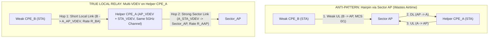

<!-- doc-head: Cooperative CPE RF feasibility, hardware capability matrix, and two-hop relay break-even analysis -->
5 GHz same-channel STA+AP relay on directional CPEs is gated by half-duplex airtime math and sidelobe link budget.
2.4 GHz management Wi-Fi is an early NO-GO for inter-rooftop WISP meshing due to internal PCB antenna and single-chain AR9342/QCA9558 limits.
Coherent distributed MIMO / joint PHY decoding is REFUTED on QCA988x due to lack of baseband I/Q and LO phase synchronization.
<!-- /doc-head -->

# OpenMax / FuturaMAX — Cooperative CPE Networking & Hardware Capability Feasibility Study

**Date**: 2026-10-22  
**Scope**: Sections 1 and 2 of [`docs/OPENMAX_MASTER_RESEARCH_PROMPT.md`](file:///G:/_OneDrive/OneDrive/Desktop/Py%20Apps/futuraMAX/docs/OPENMAX_MASTER_RESEARCH_PROMPT.md)  
**Epistemic Labels**: `CONFIRMED ON BENCH` | `CONFIRMED BY STATIC RE` | `DEMONSTRATED ON SIMILAR HARDWARE` | `HYPOTHESIS` | `REFUTED` | `UNKNOWN`

---

## 1. Master Hardware, Silicon & Radio Capability Matrix

Before evaluating cooperative relaying or edge intelligence across the operator's ~1,800-device WISP fleet, every hardware family must be indexed by **exact `board.sysid`, SoC, memory ceiling, primary 5 GHz transceiver, true secondary radio hardware, and firmware control boundary**.

### 1.1 Hardware & SoC Architecture Matrix

| Device Family / Model | `board.sysid` / PCI Subsys | Host SoC / ISA / Clock | RAM (Total / Usable Free) | Flash Layout & Protected Partitions | Primary 5 GHz Radio (`wifi0` / `phy0`) | True Secondary Radio (`wifi1` / BLE) | Epistemic Status & Evidence |
| :--- | :--- | :--- | :--- | :--- | :--- | :--- | :--- |
| **Ubiquiti LiteBeam 5AC Gen2 (`LBE-5AC-Gen2`)** | `0xe7f9` (`0777:e7f9`) | Qualcomm Atheros `AR9342` (`MIPS 74Kc` big-endian, 1 core @ `535 MHz` CPU / `400 MHz` DDR / `200 MHz` AHB) | `64 MB` DDR2 (`~18–26 MB` free in `/tmp` RAM under stock `WA` or OpenWrt) | `16 MB` SPI NOR (`mtd0` `u-boot` 256K, `mtd1` `u-boot-env` 64K, `mtd2/3` `firmware` 15.3M, `mtd4` `cfg` 256K, `mtd5` `EEPROM/ART` 64K) | `QCA9882` (`QCA988x hw2.0`, Target `0x4100016c`, PCIe `0000:00:00.0`), 2x2 MIMO 802.11ac Wave 1, **23 dBi** Cassegrain dish reflector (`~10°–12°` -3dB beamwidth) | `AR9342` integrated SoC AHB 2.4 GHz 802.11n (`ath_ahb` `wifi1`), internal PCB trace antenna (`~1–2 dBi`), management AP only (`192.168.172.1`, auto-off after 15m or configurable) | `CONFIRMED ON BENCH` ([`docs/HARDWARE_MATRIX.md`](file:///G:/_OneDrive/OneDrive/Desktop/Py%20Apps/futuraMAX/docs/HARDWARE_MATRIX.md)) |
| **Ubiquiti NanoStation 5AC Loco (`NS-5ACL` `WA` & `XC`)** | `0xe7fa` (`WA` main fleet) / `0xe3d8` (`XC` table entry 20) | `AR9342` (`MIPS 74Kc` BE @ `535 MHz`) | `64 MB` DDR2 (`~20–26 MB` free) | `16 MB` SPI NOR (same 6-partition layout; `mtd0`, `mtd1`, `mtd5` protected) | `QCA9882` (`QCA988x hw2.0`, Target `0x4100016c`), 2x2 MIMO 802.11ac Wave 1, **13 dBi** dual-polarity patch array (`~45°` azimuth / elevation beamwidth) | `AR9342` integrated AHB 2.4 GHz management Wi-Fi (`wifi1`), internal PCB antenna (`~1.5 dBi`) | `CONFIRMED ON BENCH` (`Loco195` on `WA.v8.7.25` & OpenWrt 24.10.4; [`docs/STAGE10_STOCK_AIROS8_INTEROP_AND_REVERT.md`](file:///G:/_OneDrive/OneDrive/Desktop/Py%20Apps/futuraMAX/docs/STAGE10_STOCK_AIROS8_INTEROP_AND_REVERT.md)) |
| **Ubiquiti LiteAP AC (`LAP-120`) & LiteAP GPS (`LAP-GPS`)** | `0xe8e5` (`LAP-120`) / `0xe7fd` (`LAP-GPS`) | `AR9342` (`MIPS 74Kc` BE @ `535 MHz`) | `64 MB` DDR2 (`~24.7 MB` `MemAvailable` under OpenWrt 24.10.4 with `futuramax` daemon) | `16 MB` SPI NOR (`mtd0`, `mtd1`, `mtd5` protected) | `QCA9882` (`0x4100016c`), 2x2 MIMO 802.11ac Wave 1, **16 dBi** (`LAP-120` 120° sector) / **17 dBi** (`LAP-GPS` 90° sector) | `AR9342` 2.4 GHz management Wi-Fi (`wifi1`); `LAP-GPS` adds UART GPS receiver (`ubnt-gps-reader`) | `CONFIRMED ON BENCH` (`LAP-120` OpenWrt 24.10.4 & production audit [`docs/STAGE10_STOCK_AIROS8_INTEROP_AND_REVERT.md`](file:///G:/_OneDrive/OneDrive/Desktop/Py%20Apps/futuraMAX/docs/STAGE10_STOCK_AIROS8_INTEROP_AND_REVERT.md)) |
| **Ubiquiti Rocket Prism 5AC Gen2 (`RP-5AC-Gen2`)** | `0xe7e9` & `0xe7e7` (`PrismStation`: `0xe7e6`, `0xe7e8`) | Qualcomm `QCA9558` (`MIPS 74Kc V5.0` BE @ **`720 MHz`** CPU / `600 MHz` DDR / `200 MHz` AHB) | **`128 MB`** DDR2 (`126,932 kB` total, `~85+ MB` free in RAM) | `16 MB` SPI NOR (`mx25l12805d`, `mtd0` `u-boot` 256K, `mtd1` `u-boot-env` 64K, `mtd4` `cfg` 256K, `mtd5` `EEPROM` 64K) | `QCA9880v2` (`0x4100016c`, PCIe `0000:00:00.0`, IRQ 75), `28 dBm` max TX, **AirPrism** active RF filter (`GPIO 13..16` 6-entry band-edge table in `umac.ko`; `caps=0xfce00814`) | `QCA9558` AHB 1x1 radio (`ath_ahb` `wifi1` @ `0xb8100000`, IRQ 2) multiplexed between **2.4 GHz management AP (`ath1`)** and **5 GHz receive-only AirView scanner** with hardware TX-blanking (`GPIO 21` / `IRQ 64` `ath-spectral-filter`) + GPS (`IRQ 22`) | `CONFIRMED ON BENCH` & `STATIC RE` ([`docs/STAGE11_XC_ROCKET_PRISM_AND_AIRPRISM_RE.md`](file:///G:/_OneDrive/OneDrive/Desktop/Py%20Apps/futuraMAX/docs/STAGE11_XC_ROCKET_PRISM_AND_AIRPRISM_RE.md)) |
| **Ubiquiti LTU-Lite / LTU-LR / LTU-Pro (`afltu`)** | `0xae08` (Bench `LTU-Lite` rev 9) / `0xea12` family | Ubiquiti `amesoc3` Dual-Core **ARM Cortex-A9** (`ARMv7-A` little-endian, Linux `3.14.65` SMP) | **`256 MB`** DDR3 (`~140–170 MB` free after `ame_core.ko` allocation) | **`128 MB` NAND** (`13` DTB partitions: `mtd0` `spl`, `mtd1/2` `uboot_env0/1`, `mtd3` `uboot` `@0x140000`, `mtd4` `EEPROM` `@0x240000`, `mtd5` `cfg` `@0x300000`, dual-bank `dtb0/1`, `kernel0/1`, `rootfs0/1`) | Analog Devices **`AD9361`** 2x2 MIMO Agile SDR (`70 MHz–6.0 GHz`, `40 MHz` SPI bus `0x02625a00`) + `amesoc3` custom baseband (`ame_core.ko`), supports up to **`4096-QAM` (`12X`, code `0x1f`)** and 8-subband OFDMA (`NO_LDPC=0`, `NO_OFDMA=0`). **Incompatible at PHY layer with 802.11a/n/ac** | **Bluetooth Low Energy (BLE)** management radio ONLY (**NO 2.4 GHz Wi-Fi transceiver** on `LTU-Lite`) | `CONFIRMED ON BENCH` & `STATIC RE` ([`docs/STAGE11_LTU_MODULATION_4096QAM_AND_ARCH_RE.md`](file:///G:/_OneDrive/OneDrive/Desktop/Py%20Apps/futuraMAX/docs/STAGE11_LTU_MODULATION_4096QAM_AND_ARCH_RE.md)) |
| **Ubiquiti LTU-Rocket (`aflturocket`)** | `0xea10` (`AME SoC 3 LTU-Rocket Board`) | **Dual-SoC**: Primary `amesoc3` (Dual Cortex-A9, Linux `3.14.65`) + Secondary **Intel Arria 10 SoC FPGA** (`altr,socfpga-arria10`, Dual Cortex-A9 + `128 MB` RAM, Linux `4.14.0 SMP` + `5.49 MB` `part05_fpga.bin`) | `256 MB` (`amesoc3`) + `128 MB` (`Arria 10 HPS`) | `128 MB` NAND (10-part `AMEIMG` container including `fpga`, `socfpga-uboot/dtb/kernel/rootfs`) | `AD9361` 2x2 SDR + `Arria 10` FPGA baseband/filter acceleration (`ame_core.ko` `3.32 MB`) | BLE management + dedicated GPS receiver + Arria 10 spectral processing | `CONFIRMED BY STATIC RE` ([`docs/STAGE11_LTU_MODULATION_4096QAM_AND_ARCH_RE.md`](file:///G:/_OneDrive/OneDrive/Desktop/Py%20Apps/futuraMAX/docs/STAGE11_LTU_MODULATION_4096QAM_AND_ARCH_RE.md)) |
| **MikroTik SXT Lite5 (`RBSXT5nDr2`)** | `RBSXT5nDr2` (`AR9344`) | `AR9344` (`MIPS 74Kc` BE @ `600 MHz`) | `64 MB` DDR2 (`~32 MB` free under OpenWrt 24.10.4) | `16 MB` SPI NOR | Integrated `AR9344` 5 GHz 802.11a/n 2x2 MIMO (`ath9k` driver, host-owned Minstrel-HT, `HT20/HT40`), **16 dBi** dual-chain patch (`~28°` beamwidth) | **None** (single-radio device) | `CONFIRMED ON BENCH` ([`docs/STAGE7_MULTIVENDOR_PTMP_REPORT.md`](file:///G:/_OneDrive/OneDrive/Desktop/Py%20Apps/futuraMAX/docs/STAGE7_MULTIVENDOR_PTMP_REPORT.md)) |
| **Ubiquiti LiteBeam M5 (`LBE-M5-23`)** | `0xe4a2` (`XM`/`XW` M5 family) | `AR9342` / `AR7241` (`MIPS` BE @ `400–535 MHz`) | `32–64 MB` RAM | `8–16 MB` SPI NOR | `AR934x` 5 GHz 802.11n **1x1 SISO** (`150 Mbps` HT40 max PHY), **23 dBi** reflector, `airOS 6.1.4` (`airMAX=off` standard 802.11n interop proven) | **None** (single-radio device) | `CONFIRMED ON BENCH` ([`docs/STAGE7_MULTIVENDOR_PTMP_REPORT.md`](file:///G:/_OneDrive/OneDrive/Desktop/Py%20Apps/futuraMAX/docs/STAGE7_MULTIVENDOR_PTMP_REPORT.md)) |

---

### 1.2 Critical Distinctions in Secondary Radio Hardware (`CONFIRMED`)

A recurring misconception in informal WISP discussions is treating "`wifi1` exists on airMAX AC radios" as a general-purpose secondary backhaul radio. Our hardware and ELF audits prove three completely different physical architectures:

1. **`WA` CPE Family (`LiteBeam 5AC Gen2` `0xe7f9`, `NanoStation 5AC Loco` `0xe7fa`, `LiteAP AC` `0xe8e5`)**:
   - `wifi1` is the `AR9342` SoC's internal **2.4 GHz 802.11n 1x1 AHB radio** connected to a **tiny unweighted PCB trace antenna (`~1–2 dBi`)** inside the plastic radome, with **no external RF connector and no high-power external PA/LNA**.
   - It cannot tune to 5 GHz. Its sole design role is short-range (`<15 m`) smartphone commissioning via the UISP mobile app on `192.168.172.1`.
2. **`XC` AP Family (`Rocket Prism 5AC Gen2` `0xe7e9`, `PrismStation 5AC` `0xe7e6/0xe7e8`)**:
   - `wifi1` (`ath_ahb` at `0xb8100000`, IRQ 2) is an integrated `QCA9558` AHB radio wired to:
     - An internal 2.4 GHz management path (`ath1` AP on `192.168.172.1`), **AND**
     - A **receive-only 5 GHz downconverter/scanner path** (`airview` VAP) synchronized with the primary 5 GHz `QCA9880v2` (`wifi0`, IRQ 75) via a hardware **TX-blanking interrupt on `GPIO 21` (`IRQ 64`, `ath-spectral-filter`)** inside `ath_dev.ko:ath_spectral_filter_init` (`.text + 0x27c00`).
   - On our physical bench `Rocket Prism 5AC Gen2` (`0xe7e9`), `/proc/interrupts` recorded **1,415 hardware interrupts on `IRQ 64`** during channel sweeps (`CONFIRMED ON BENCH`). Because `wifi1`'s 5 GHz path is receive-only (no 5 GHz TX PA and blanked whenever `wifi0` transmits), **`wifi1` on `XC` cannot transmit 5 GHz data frames**.
3. **`LTU` Family (`LTU-Lite` `0xae08` / `LTU-Rocket` `0xea10`)**:
   - Has **zero 802.11 Wi-Fi hardware**. The primary radio is an Analog Devices `AD9361` SDR driven by Ubiquiti's proprietary `ame_core.ko` TDD/OFDMA engine, and the local management interface is **Bluetooth Low Energy (BLE)**. An `LTU` radio can never associate to or relay 802.11ac/n frames.

---

### 1.3 Wireless Stack, Framing & Observability Matrix Across Firmware Targets

| Capability / Mechanism | Stock `airOS 8` (`WA.v8.7.25` / `XC.v8.7.25`) | Stock `airOS 8` + Hybrid Patch (`/tmp/uph.ko` + `ubnt_op_mode=0`) | OpenWrt 24.10.4 (`ath10k-ct` + Patched `mac80211.ko`) | Stock `LTU` (`afltu` / `aflturocket` `v2.4.x`) | Epistemic Status & Reference |
| :--- | :--- | :--- | :--- | :--- | :--- |
| **Radio Driver & Firmware** | QCA vendor offload `ol_ath` (`ath_pci 10.1.467`) + `umac.ko` + `ubnt_poll_host.ko` | Same `ol_ath` + `umac.ko`, with 4-site relocation-safe `/tmp/uph.ko` (`MD5: 077d151e...` on `WA.v8.7.25`) | `mac80211` + `ath10k-ct` (`10.1-ct-8x-__fW-022` / `10.2.4-1.0-00037`) | `ame_core.ko` + `ame_dev.ko` + `AD9361` SPI + (`Arria 10` FPGA on Rocket) | `CONFIRMED ON BENCH` |
| **MAC Access Control** | Proprietary `airMAX` TDMA polling (`addradio` mode `1`; CPE halts TX until polled; panics at `.text+0x7c08` after ~30s without polls) | Standard 802.11 DCF/EDCA (`ubnt_op_mode=0`, `allow_80211=1`, missing-poll panic & `bmiss` relocation-safely bypassed) | Standard 802.11ac/n EDCA + `mac80211` `AIRTIME_FAIRNESS` (`airtime_flags=3`) + `AQL` + `WMM AC_VO` DiffServ bypass | Proprietary TDD fixed/flexible framing (`frm_len=2.0 ms`, OFDMA 8 subbands) | `CONFIRMED ON BENCH` ([`docs/STAGE10_STOCK_AIROS8_INTEROP_AND_REVERT.md`](file:///G:/_OneDrive/OneDrive/Desktop/Py%20Apps/futuraMAX/docs/STAGE10_STOCK_AIROS8_INTEROP_AND_REVERT.md), [`docs/STAGE7_MULTIVENDOR_PTMP_REPORT.md`](file:///G:/_OneDrive/OneDrive/Desktop/Py%20Apps/futuraMAX/docs/STAGE7_MULTIVENDOR_PTMP_REPORT.md)) |
| **100% Zero-Touch Stock CPE $\leftrightarrow$ OpenWrt AP Interop** | Stock `Loco195` (`WA.v8.7.25`, `wds=1`) associates to OpenWrt `LAP-120` (`wds=1`) via **two-stage Beacon Vendor IE withdrawal** (broadcasts Ubiquiti discovery IE so stock `wpa_supplicant` passes scan validation, then withdraws IE after `0.5s` before `AssocReq` so stock `umac.ko` takes standard 802.11 path) | Patched CPE associates without needing IE withdrawal (`allow_80211=1`) | OpenWrt AP runs `wds=1` + `mac80211.ko` `ETH_P_TEB` (`0x6558`) 14-byte inner header strip (`19a8fde6...`) | N/A (incompatible SDR PHY) | **`CONFIRMED ON BENCH` (`run17` PASS, 2026-10-22; [`docs/BENCH_PLAN.md`](file:///G:/_OneDrive/OneDrive/Desktop/Py%20Apps/futuraMAX/docs/BENCH_PLAN.md#L1-L58))** |
| **L2 Framing & WDS Behavior** | Uses 4-address WDS + 14-byte inner `ETH_P_TEB` (`0x6558`) header; in `netmode=router` (all 11 audited production CPEs), only CPE's `ath0` MAC is emitted | Emits `0x6558` when `wds=0` or 4-addr + `0x6558` when `wds=1` | Standard 3-addr or 4-addr (`wds=1` creates `ap/vlan` child interface); patched `mac80211.ko` strips `0x6558` | Proprietary L2 translational bridge / router | `CONFIRMED ON BENCH` (`BENCH_PLAN.md` `run17`, `STAGE10` Section 3 & 5) |
| **Simultaneous `STA + AP` Multi-VDEV on 5 GHz** | **BLOCKED** by `/sbin/ubntconf` and `ubnt_poll_host.ko` (only 1 operational mode per radio in `system.cfg`) | **UNVERIFIED / HIGH RISK** (`ol_ath` supports `wlanconfig create` VAPs in principle, but `ubnt_poll_host` hooks assume single STA or single AP) | **SUPPORTED BY DRIVER (`ath10k-ct`)** (`iw phy0 info` allows `managed + AP` on same channel up to 8–16 vdevs, subject to single-channel constraint) | **BLOCKED** (`ame_core.ko` supports only 1 role per SDR) | `CONFIRMED BY STATIC RE` / `LAB TEST QUEUED` |
| **Persistence Mechanism** | `/sbin/ubntconf` generates `/etc/crontabs/ubnt` from `cron.1.job.1.cmd` in `/tmp/system.cfg` (**strict `2,048`-byte buffer / `2,030`-byte command ceiling**); `-cs` firmware also supports `/etc/persistent/rc.poststart` | Same `cron.1.job.1.cmd` (`1,994`-byte transactional recipe verified across reboot) | Native `/etc/init.d/futuramax` `procd` service + overlayfs | Native `cron.1.job.1.cmd` via `/bin/ubntconf -c` (verified on `LTU-Lite`; requires `/usr/etc/inittab` copy guard if re-run live) | `CONFIRMED ON BENCH` ([`docs/STAGE10_STOCK_AIROS8_INTEROP_AND_REVERT.md`](file:///G:/_OneDrive/OneDrive/Desktop/Py%20Apps/futuraMAX/docs/STAGE10_STOCK_AIROS8_INTEROP_AND_REVERT.md#L86-L92), [`docs/STAGE11_LTU_MODULATION_4096QAM_AND_ARCH_RE.md`](file:///G:/_OneDrive/OneDrive/Desktop/Py%20Apps/futuraMAX/docs/STAGE11_LTU_MODULATION_4096QAM_AND_ARCH_RE.md#L142-L144)) |

---

## 2. Central Question: Can a Healthy CPE (`CPE_A`) Help a Degraded CPE (`CPE_B`) Without Extra Hardware?

To avoid vague "mesh" claims, we decompose cooperative assistance into four physically distinct mechanisms and evaluate each against hardware, driver, antenna geometry, and airtime physics:

1. **Coherent Joint PHY / Distributed MIMO / Baseband Reception (`REFUTED / NO-GO`)**
2. **5 GHz Main-Radio Store-and-Forward Packet Relaying (`CONDITIONAL — Strictly Gated by Sidelobe Link Budget & Half-Duplex Airtime Equation`)**
3. **2.4 GHz Management Radio Inter-Rooftop Relaying (`EARLY NO-GO` for WISP links; `<20 m` same-rooftop emergency exception only)**
4. **Control-Plane Cooperative Sensing & Differential Diagnostics (`CONFIRMED GO — Zero Airtime Penalty, Immediate Fleet Value`)**

---

### 2.A — 5 GHz Main-Radio Cooperative Relay Analysis

#### 2.A.1 Why Coherent Joint PHY / Distributed MIMO is `REFUTED` on QCA988x
- **Hypothesis**: Could `CPE_A` and `Sector_AP` jointly decode weak uplink symbols from `CPE_B` (Maximum Ratio Combining across nodes or distributed MIMO beamforming)?
- **Hardware Reality (`CONFIRMED BY STATIC RE` — `NO-GO`)**:
  - On `QCA9880`/`QCA9882` (`TARGET TYPE 7 Vers 0x4100016c`), the entire OFDM baseband, FFT/IFFT, Viterbi/LDPC decoder, cyclic-prefix removal, and SIFS-timed Block-ACK generation run inside the closed-source Qualcomm target processor (`firmware-5.bin` / `10.1-ct-8x-__fW-022` / `ol_ath` `215 KB` binary).
  - The host MIPS CPU communicates with the radio exclusively via **HTT/WMI packet descriptors** over PCIe (`ath10k` or `ath_pci`). Raw time-domain I/Q samples, soft log-likelihood ratios (LLRs), and carrier phase locks are **never exposed to the PCIe bus** (spectral scan exposes only coarse 56-bin magnitude FFT snapshots).
  - Even on `LTU` (`AD9361` + `amesoc3`), where digital I/Q traverses a local bus into `ame_core.ko`/FPGA, there is no sub-nanosecond phase/frequency distribution bus between separate customer rooftops.
- **Verdict**: **REFUTED / HARD NO-GO**. Do not spend a single engineering hour on coherent distributed PHY decoding on airMAX AC hardware.

#### 2.A.2 Packet-Level L2/L3 Store-and-Forward Relay Topologies on 5 GHz

When `CPE_A` (good link to `Sector_AP`) attempts to relay packets for `CPE_B` (obstructed/weak link to `Sector_AP`) using only its primary 5 GHz `QCA988x` radio, there are two completely different packet paths that must never be confused:

1. **Why `STA_B -> Sector_AP -> STA_A -> Sector_AP` Hairpinning is Useless (`REFUTED`)**:
   - In standard 802.11 infrastructure mode without TDLS or local AP VDEV on `CPE_A`, two `STA` interfaces associated to the same `Sector_AP` cannot exchange frames directly over the air unless the frames traverse the AP (`ToDS=1, FromDS=1` hairpin) or use 802.11z TDLS.
   - Any tunnel (`GRE`, `WireGuard`, `BATMAN-adv`) between `STA_B` and `STA_A` that still transmits over the `B <-> Sector_AP` RF path still traverses the weak `B <-> AP` link **plus** duplicates the packet over `A <-> AP`. That strictly worsens sector capacity.
2. **True Over-the-Air Relay via Concurrent `STA + AP` VDEVs on `CPE_A` (`SUPPORTED IN OPENWRT ath10k-ct`)**:
   - Under OpenWrt 24.10.4 with `ath10k-ct` (`10.1-ct-8x-__fW-022`), `QCA988x` supports creating **two virtual devices (vdevs) on the same physical radio (`phy0`) and same 5 GHz channel**:
     - `phy0-sta0` (`managed` / `wds=1` 4-address client): Uplink associated to `Sector_AP` (either an OpenWrt `LAP-120` AP, or a stock `airOS 8` AP if `CPE_A` spoofs/participates appropriately—though on stock `airOS 8` AP with TDMA polling active, an OpenWrt `ath10k` STA cannot speak proprietary `ubnt_poll_host` TDMA).
     - `phy0-ap0` (`AP` mode, `wds=1`, different BSSID/SSID, **exact same channel & width** as `phy0-sta0`): Local micro-relay AP to which `CPE_B` associates!
   - **Crucial Interoperability Advantage from Today's `run17` Discovery ([`docs/BENCH_PLAN.md`](file:///G:/_OneDrive/OneDrive/Desktop/Py%20Apps/futuraMAX/docs/BENCH_PLAN.md#L9-L48))**:
     - Because we proved in `FMX-0015` `run17` that a **100% unmodified stock `airOS 8` CPE (`Loco195`, `WA.v8.7.25`)** associates and passes bidirectional traffic to an OpenWrt AP (`wds=1` + patched `mac80211.ko` `19a8fde6...` + two-stage Vendor IE withdrawal), **the weak `CPE_B` does NOT even need to be flashed to OpenWrt**!
     - Only the helper `CPE_A` needs OpenWrt (running `STA + AP` vdevs) if the `Sector_AP` is also running OpenWrt (`FuturaMAX` stack).
   - **Critical `ath10k-ct` Single-Channel Constraint**:
     - Because `QCA988x` has only one 5 GHz synthesizer/PLL, `phy0-ap0` on `CPE_A` **must** lock to the channel of `phy0-sta0`. If `phy0-sta0` loses association with `Sector_AP` and begins multi-channel background scanning, `phy0-ap0` experiences off-channel glitches (and as proven in Stage 9A [`docs/STAGE9_20MHZ_RATEMASK_COTSQ_AND_PROCD.md`](file:///G:/_OneDrive/OneDrive/Desktop/Py%20Apps/futuraMAX/docs/STAGE9_20MHZ_RATEMASK_COTSQ_AND_PROCD.md#L18), `ap-force` scanning on `ath10k-ct` triggers a persistent `102.4 ms` beacon sawtooth bug). Therefore, `CPE_A`'s `phy0-sta0` must be locked to a fixed BSSID/channel list (`scan_freq` locked to the sector channel).

#### 2.A.3 Physical Antenna Radiation Pattern & Sidelobe Penalty (`CRITICAL CONSTRAINT`)

Unlike indoor omnidirectional mesh nodes, WISP CPEs use directional antennas pointed directly at `Sector_AP`:

| CPE Model | Boresight Gain ($G_{\text{max}}$) | -3 dB Beamwidth (Azimuth / Elev) | Off-Axis Gain at $30^\circ$ | Off-Axis Gain at $60^\circ\text{--}90^\circ$ (Sidelobe) | Front-to-Back Ratio ($180^\circ$) | Relay Suitability |
| :--- | :---: | :---: | :---: | :---: | :---: | :--- |
| **NanoStation 5AC Loco (`0xe7fa`)** | `13 dBi` | **`~45°` / `45°`** | `~9–10 dBi` (`-3 to -4 dB` penalty) | `~0 to +3 dBi` (`-10 to -13 dB` penalty) | `~18–20 dB` (`-5 to -7 dBi` backlobe) | **MODERATE** (Wide `45°` patch lobe covers neighbors within `±35°` or `<150 m` lateral distance) |
| **LiteBeam 5AC Gen2 (`0xe7f9`)** | `23 dBi` | **`~10°–12°`** | `~0 to +5 dBi` (`-18 to -23 dB` penalty) | **`-5 to -10 dBi` (`-28 to -33 dB` penalty!)** | `~28–30 dB` (`-7 dBi` backlobe) | **POOR for wide angles** (Narrow Cassegrain dish strongly rejects off-axis signals unless $B$ is nearly collinear or $<30\text{--}50\text{ m}$ away) |

**Link Budget Consequence (`5.5 GHz`, Free-Space Path Loss $\text{FSPL}(d) = 47.3 + 20\log_{10}(d_{\text{m}})\text{ dB}$)**:
- Suppose `CPE_A` and `CPE_B` are on neighboring houses **$d_{AB} = 80\text{ m}$ apart** ($\text{FSPL} = 85.4\text{ dB}$), both pointed at `Sector_AP` (`1.5 km` away), so the angle $\text{CPE\_A} \leftrightarrow \text{CPE\_B}$ is $\approx 75^\circ$ off-boresight for both antennas:
  - **Case 1: Two `LiteBeam 5AC Gen2` dishes (`23 dBi` boresight, `-7 dBi` sidelobe at `75°`)**:
    - With $P_{\text{TX}} = 20\text{ dBm}$, $\text{RSSI}_{AB} = 20 - 7 - 7 - 85.4 = \mathbf{-79.4\text{ dBm}}$ (plus any roof/tree clutter $\to -85\text{ dBm}$, barely `MCS 0` or disconnected!). **Result: FAIL**.
  - **Case 2: Two `NanoStation 5AC Loco` patches (`13 dBi` boresight, `+1 dBi` sidelobe at `75°`) or collinear `LiteBeam` within `±15°` (`+12 dBi`)**:
    - With $P_{\text{TX}} = 20\text{ dBm}$ on two `Loco 5AC` at `80 m`: $\text{RSSI}_{AB} = 20 + 1 + 1 - 85.4 = \mathbf{-63.4\text{ dBm}}$ ($\text{SNR} \approx 29\text{ dB}$ on `20 MHz`, supporting **`VHT-MCS 7/8` (`144.4–173.3 Mbps` PHY / `~75 Mbps` TCP goodput)**!).
    - At $d_{AB} = 30\text{ m}$ ($\text{FSPL} = 76.8\text{ dB}$), even two `LiteBeam 5AC Gen2` dishes at `60°` off-axis (`-3 dBi` sidelobe) achieve $\text{RSSI}_{AB} = 20 - 3 - 3 - 76.8 = \mathbf{-62.8\text{ dBm}}$ (`VHT-MCS 7`).

---

#### 2.A.4 Exact Half-Duplex Two-Hop Airtime Break-Even Equation

Because `CPE_A` uses a **single 5 GHz transceiver (`phy0`) on the same channel** as `Sector_AP`, every bit relayed for `CPE_B` is transmitted **twice on the sector's 5 GHz channel**:
1. Hop 1: `CPE_B` $\leftrightarrow$ `CPE_A` at effective MAC goodput rate $R_{BA}$ ($\text{Mbps}$), consuming airtime $T_1 = \frac{1}{R_{BA}}\text{ s/Mbit}$.
2. Hop 2: `CPE_A` $\leftrightarrow$ `Sector_AP` at effective MAC goodput rate $R_{A,\text{AP}}$ ($\text{Mbps}$), consuming airtime $T_2 = \frac{1}{R_{A,\text{AP}}}\text{ s/Mbit}$.

Including a protocol/contention/turnaround overhead factor $\gamma \ge 1.0$ (typically $\gamma = 1.25$ for CSMA/CA inter-frame spacing, double Block-ACK, and L2/L3 forwarding overhead), the **total sector airtime per delivered Mbit via relay** is:

$$T_{\text{relay}} = \gamma \left( \frac{1}{R_{BA}} + \frac{1}{R_{A,\text{AP}}} \right)$$

Whereas direct transmission `CPE_B` $\leftrightarrow$ `Sector_AP` at degraded rate $R_{B,\text{AP}}$ (accounting for PER/retries) consumes:

$$T_{\text{direct}} = \frac{1}{R_{B,\text{AP}}}$$

> [!IMPORTANT]
> **Hard Mathematical Gate for Same-Channel 5 GHz Relay (`Break-Even Condition`)**:
> Same-channel relaying **saves net sector airtime and increases total sector capacity** if and only if:
> $$\frac{1}{R_{B,\text{AP}}} > \gamma \left( \frac{1}{R_{BA}} + \frac{1}{R_{A,\text{AP}}} \right) \quad \Longleftrightarrow \quad R_{\text{eff,relay}} = \frac{1}{\gamma \left(\frac{1}{R_{BA}} + \frac{1}{R_{A,\text{AP}}}\right)} > R_{B,\text{AP}}$$
> Additionally, the local link must satisfy $\text{RSSI}_{BA} \ge -68\text{ dBm}$ (`20 MHz` CINR $\ge 22\text{ dB}$) so Hop 1 does not itself suffer rate collapse under fade.

**Concrete Numerical Evaluation on a `20 MHz` (`VHT20`) Sector ($\gamma = 1.25$)**:

| Scenario | Direct `B -> AP` ($R_{B,\text{AP}}$, MCS / PER) |Direct Airtime Cost ($\text{ms / Mbit}$) | Local `B -> A` ($R_{BA}$, RSSI) | Helper `A -> AP` ($R_{A,\text{AP}}$) | Relay Airtime Cost $\gamma(\frac{1}{R_{BA}} + \frac{1}{R_{A,\text{AP}}})$ | Effective Relay Rate $R_{\text{eff}}$ | Net Sector Airtime Saved | Verdict |
| :--- | :--- | :---: | :--- | :--- | :---: | :---: | :---: | :--- |
| **Case 1: Severe NLOS / Foliage on `B`** | **`4.5 Mbps`** (`MCS 0`, 35% retry; like Stage 7 `3 dBm` wall case) | **`222.2 ms/Mbit`** | **`65.0 Mbps`** (`-61 dBm`, `MCS 7`) | **`80.0 Mbps`** (`-54 dBm`, `MCS 8`) | **`34.9 ms/Mbit`** | **`28.7 Mbps`** | **`-84.3%` airtime (`6.37x` gain!)** | **`STRONG GO`** |
| **Case 2: Moderate Edge CPE `B`** | **`18.0 Mbps`** (`MCS 2` 2x2) | `55.6 ms/Mbit` | **`60.0 Mbps`** (`-63 dBm`, `MCS 7`) | **`75.0 Mbps`** (`-56 dBm`, `MCS 8`) | **`37.5 ms/Mbit`** | **`26.7 Mbps`** | **`-32.5%` airtime (`1.48x` gain)** | **`CONDITIONAL GO`** |
| **Case 3: Mediocre `B` (`MCS 4`)** | **`38.0 Mbps`** (`MCS 4` 2x2) | `26.3 ms/Mbit` | `60.0 Mbps` (`-63 dBm`) | `75.0 Mbps` (`-56 dBm`) | **`37.5 ms/Mbit`** | `26.7 Mbps` | **`+42.5%` EXTRA airtime wasted** | **`REJECT / NO-GO`** |
| **Case 4: Poor Sidelobe `B <-> A`** | `6.0 Mbps` (`MCS 0/1`) | `166.7 ms/Mbit` | **`9.0 Mbps`** (`-76 dBm` dish sidelobe) | `80.0 Mbps` (`-54 dBm`) | **`154.5 ms/Mbit`** | `6.5 Mbps` | `-7.3%` (within noise; fails RSSI gate) | **`REJECT / NO-GO`** |

**Key Engineering Conclusion (`CONFIRMED BY MATH & STAGE 7/9 DATA`)**:
- Same-channel 5 GHz relaying is **strictly destructive** if $R_{B,\text{AP}} \ge 27\text{ Mbps}$ on a `20 MHz` channel (where maximum single-link TCP goodput is `~80–90 Mbps`), because double-transmitting on the same channel caps the two-hop harmonic mean at $\sim 27\text{--}32\text{ Mbps}$.
- However, when `CPE_B` is an **airtime hog** stuck at $R_{B,\text{AP}} \le 10\text{ Mbps}$ (e.g., behind new tree foliage or roof obstruction, consuming `>200 ms/Mbit` of sector airtime and dragging `Deficit: BE` to `-67,099 µs` as measured in Stage 7.4) **AND** sits within `30–100 m` of a line-of-sight neighbor `CPE_A` with $\text{RSSI}_{BA} \ge -65\text{ dBm}$ ($R_{BA} \ge 50\text{ Mbps}$), **relaying `B -> A -> AP` cuts `B`'s sector airtime consumption by `70–85%` while multiplying `B`'s throughput by `4x–6x`**!

---

### 2.B — 2.4 GHz Management Radio (`wifi1`) Analysis — Early `NO-GO` for WISP Mesh

Per Section 2.B of `OPENMAX_MASTER_RESEARCH_PROMPT.md`, we evaluate whether the secondary 2.4 GHz management radio (`wifi1`) on `WA`/`XC` CPEs can serve as an out-of-band inter-rooftop data relay (`CPE_B -> CPE_A` over 2.4 GHz, then `CPE_A -> Sector_AP` over 5 GHz) to avoid double-transmitting on the 5 GHz channel.

#### 2.B.1 Quantitative 2.4 GHz Link Budget & Hardware Audit

1. **Hardware Parameters (`WA` `LiteBeam 5AC Gen2` `0xe7f9` & `NanoStation 5AC Loco` `0xe7fa`)**:
   - **Transceiver**: `AR9342` integrated 2.4 GHz 802.11b/g/n (`ath_ahb` `wifi1`), **1x1 SISO** on most `WA` CPE revisions (`max HT20 PHY = 65–72.2 Mbps`).
   - **TX Power**: Constrained to **`~10–14 dBm`** (`10–25 mW`) with no external high-power PA.
   - **Antenna Gain & Enclosure Loss**: Internal PCB trace antenna (`~1.5 dBi` nominal) mounted **behind/inside the 5 GHz feed horn PCB and plastic housing**, suffering **`3–8 dB` shadowing loss** in horizontal rooftop-to-rooftop directions (`G_eff ≈ -2 to +1 dBi`).
   - **2.4 GHz Outdoor Noise Floor**: In residential WISP neighborhoods, every subscriber home has an indoor 2.4 GHz Wi-Fi router (`Channels 1, 6, 11` at `20–30 dBm` EIRP), raising the rooftop 2.4 GHz noise + interference floor ($N + I$) to **`-78 to -72 dBm`**.
2. **Link Budget Calculation at Representative Inter-Rooftop Distances ($f = 2437\text{ MHz}$)**:
   $$\text{RSSI}_{2.4}(d) = P_{\text{TX}} (12\text{ dBm}) + G_{\text{TX}} (0\text{ dBi}) + G_{\text{RX}} (0\text{ dBi}) - \left(40.2 + 20\log_{10}(d_{\text{m}})\right) - L_{\text{obstruction}}$$

| Scenario & Distance ($d_{AB}$) | Free-Space Path Loss (`2.4 GHz`) | Additional Clutter / Roof Edge Loss | Expected $\text{RSSI}_{2.4}$ | Expected $\text{SINR}$ (vs `-75 dBm` 2.4GHz floor) | Achievable 2.4 GHz Goodput | Verdict |
| :--- | :---: | :---: | :---: | :---: | :---: | :--- |
| **Same Mast / Same Rooftop (`5–15 m` LOS)** | `54.2–63.7 dB` | `0–3 dB` | **`-42 to -55 dBm`** | `20–33 dB` | `20–35 Mbps` TCP | **ONLY Viable Scope (Emergency Management / Same-Roof Bridge)** |
| **Adjacent House (`50 m`, light roof grazing)** | `74.2 dB` | `6–10 dB` | **`-68 to -72 dBm`** | **`3–7 dB`** | `<1–3 Mbps` (heavy Wi-Fi contention/retries) | **`FAIL / NO-GO`** |
| **Typical Neighbor CPE (`100–200 m`)** | `80.2–86.2 dB` | `8–15 dB` | **`-76 to -89 dBm`** | **`< 0 dB` (Below noise floor)** | **`0 Mbps` (No link)** | **`HARD NO-GO`** |

3. **Additional Firmware & Fleet Blockers**:
   - **`LTU` Fleet (`LTU-Lite`, `LTU-LR`, `LTU-Pro`)**: Possesses **NO 2.4 GHz Wi-Fi radio at all** (BLE only).
   - **Stock `airOS 8` Firmware**: `ubntconf` configures `wifi1` (`ath1`) strictly as an isolated management AP (`192.168.172.1/24`) with a shutdown timer (`mgmt_radio.off_timeout = 900s`) and firewall block preventing WAN/LAN forwarding. Reconfiguring `wifi1` as an 802.11n STA/mesh backhaul on stock `airOS 8` requires overriding `init.d/plugin` wireless scripts and permanently disables local technician UISP smartphone access.

> [!WARNING]
> **Early `NO-GO` Decision on 2.4 GHz Management Radio (Per Section 2.B Exit Rule)**:
> We formally issue an **EARLY NO-GO** on using the 2.4 GHz management radio (`wifi1`) for inter-building data relaying or WISP meshing. Its effective EIRP (`~12 dBm`), `0 dBi` internal PCB antenna, `-75 dBm` residential 2.4 GHz interference floor, and absence on `LTU` make it unusable beyond `15–20 m`.
> - **Sole Permitted Exception**: Out-of-band **emergency SSH/management rescue** when two radios are mounted on the **same pole/rooftop (`<15–20 m` LOS)** and one radio loses its 5 GHz uplink or Ethernet LAN path.

---

### 2.C — Engineering Comparison of the 6 Candidate Solutions for a Degraded CPE (`CPE_B`)

When a subscriber `CPE_B` suffers severe link degradation (foliage growth, partial Fresnel obstruction, high sector airtime tax), how do the 6 architectural options compare?

| Option | Additional Hardware BOM | Installation Labor | Sector 5 GHz Airtime Impact | Expected `CPE_B` Goodput & `p95` Latency | Works with Stock `airOS 8`? | Operational Complexity & Failure Modes | Overall Rank & Recommendation |
| :--- | :---: | :---: | :--- | :--- | :---: | :--- | :--- |
| **6. Cooperative CPE Sensor + Differential Diagnosis + AP `AC_VO` / `20 MHz` / `AQL` Tuning** | **`$0`** | **`0 hrs` (100% Remote)** | **Saves `15–40%` airtime** (via `20 MHz` +6dB PSD, `RTS/CTS 256B`, `AQL`, or identifying bad PoE cable/alignment) | `3.05x` goodput & `18.9x–21.0x` latency cut proven on obstructed bench CPEs ([`STAGE7`](file:///G:/_OneDrive/OneDrive/Desktop/Py%20Apps/futuraMAX/docs/STAGE7_MULTIVENDOR_PTMP_REPORT.md), [`STAGE9`](file:///G:/_OneDrive/OneDrive/Desktop/Py%20Apps/futuraMAX/docs/STAGE9_20MHZ_RATEMASK_COTSQ_AND_PROCD.md)) | **YES** (Read-only telemetry on stock `airOS`; AP-side tuning on OpenWrt) | **LOW** (Zero customer premises changes; fully reversible) | **#1 — DO NOW (Immediate Fleet Rollout)** |
| **2. Automated Sector Re-Association (`CPE_B` -> Better Overlapping AP/Sector)** | **`$0`** | **`0 hrs` (Remote SSID/Lock change) or `0.5 hr` re-aim** | **Offloads 100% of `B`'s airtime hogging** from congested/obstructed sector to higher-SNR sector | Restores full plan speed (`50–100+ Mbps`, `<10 ms` p95 RTT) if secondary sector has LOS within `±20°` (or after quick re-aim) | **YES** (`100% Stock airOS 8` via `system.cfg` + `cfgmtd -w` canary) | **LOW** (Requires pre-scan verification via `iwlist ath0 scanning` / `mca-status` + rollback timer) | **#2 — DO NOW (When Overlapping Sector Exists)** |
| **5. Targeted Physical RF Fix (Tree trim / 2m Mast Raise / Swap `Loco 13dBi` $\to$ `LiteBeam 23dBi`)** | `$0–$65` | `1.0 hr` truck roll | **Reduces `B`'s airtime/bit by `3x–8x`** permanently (`+10 dB` gain swapping `Loco` to `LBE-5AC-Gen2`) | `80–150+ Mbps`, `<5 ms` p95 RTT, 100% permanent | **YES** (`100% Stock`) | **LOWEST** long-term maintenance (no multi-hop dependency) | **#3 — STANDARD PRODUCTION FIX** (Guided by Sensor #6) |
| **4. Shared-Rooftop Ethernet / PoE Passthrough (`CPE_A` <-> `CPE_B` via Cat6 + L3/VLAN)** | `$5–$15` (Cat6 cable + surge/switch) | `0.5–1.0 hr` (only for multi-tenant / duplex buildings) | **Eliminates 100% of `CPE_B`'s RF overhead** (1 strong radio serves 2–4 apartments via VLAN/queueing) | `100+ Mbps` shared, `<5 ms` p95 RTT, zero double-hop RF penalty | **YES** (`100% Stock` VLAN / router mode) | **LOW** (Single point of failure at `CPE_A` power, solved by dual-diode PoE or ISP UPS) | **#4 — BEST FOR DUPLEX / MULTI-DWELLING UNITS** |
| **1. Dedicated Second Radio at `CPE_A` (Out-of-Band Micro-Relay `B -> A_Radio2 -> A_Radio1 -> AP`)** | `$49–$65` (`NanoStation 5AC Loco` on non-overlapping 5 GHz freq) | `1.0–1.5 hrs` at `CPE_A` | **Reduces Sector AP airtime by `70–85%`** (Sector AP only sees `CPE_A`'s `MCS 8` link; Hop 1 is on separate frequency) | `70–120 Mbps`, `~3–6 ms` p95 RTT (only `+1.5 ms` extra hop latency) | **YES** (`100% Stock airOS 8` PtP/PtMP on both hops!) | **MODERATE** (Depends on `CPE_A` mains power; requires 2nd frequency channel) | **#5 — BEST RF RELAY WHEN OBSTRUCTION IS UNSOLVABLE** |
| **2.A. Single-Radio 5 GHz Same-Channel Relay (`STA+AP` VDEVs on OpenWrt `CPE_A`)** | **`$0`** | `0 hrs` (if `CPE_A` already runs OpenWrt & geometry fits) | **Helps ONLY if $R_{\text{eff}} > R_{B,\text{AP}}$** ($R_{B,\text{AP}} \le 15\text{ Mbps}$ and $\text{RSSI}_{BA} \ge -65\text{ dBm}$); otherwise **wastes airtime** | Capped at **`~25–35 Mbps`** on `20 MHz` (`~2.5–4.5 ms` idle RTT, `10–25 ms` loaded RTT) | Requires **OpenWrt on `CPE_A` & `Sector_AP`** (`CPE_B` can stay stock `airOS 8` per `run17`!) | **HIGH** (Single-channel lock required; `CPE_A` power cut drops `CPE_B`; sidelobe sensitivity) | **#6 — NICHE TACTICAL TOOL (Bench-Gate First; Use Only When Break-Even Equation Passes)** |

---

### 2.D — Incremental 6-Profile Lab Bench Test Protocol (`FMX-COOP-001`)

Before any cooperative relay configuration is considered even for a lab soak, it must pass this strict **6-profile incremental qualification protocol** on isolated bench hardware (`LAP-120` OpenWrt AP + `CPE_A` OpenWrt `Loco 5AC` + `CPE_B` Stock `airOS 8` `Loco195` or `MikroTik SXT Lite5`), with wired Ethernet management and independent rollback guards on every node.

> [!CAUTION]
> **Safety & Authorization Boundary**: Per [`docs/BENCH_PLAN.md`](file:///G:/_OneDrive/OneDrive/Desktop/Py%20Apps/futuraMAX/docs/BENCH_PLAN.md#L49-L57), `LAP-120` is currently held in its post-`run17` closure state (`radio OFF`, RAM restored). **Do NOT execute live RF steps of `FMX-COOP-001` without explicit new operator authorization.** All pre-calculations and break-even gates are implemented offline in [`controller/cooperative_sensor.py`](file:///G:/_OneDrive/OneDrive/Desktop/Py%20Apps/futuraMAX/controller/cooperative_sensor.py).

#### Preconditions (Mandatory Before Profile 1)
1. **Out-of-Band Wired Ethernet Control**: All 3 radios (`Sector_AP`, `CPE_A`, `CPE_B`) reachable via wired Ethernet management VLAN/subnet independent of the wireless interfaces under test.
2. **Read-Only Inventory & Checksum Snapshot**: Record `board.sysid`, `/proc/mtd`, `EEPROM`/`ART` SHA-256, `/etc/config/wireless` SHA-256, and `iw phy0 info` (`valid interface combinations`) without modifying flash.
3. **240-Second Independent Radio-Off / Config-Restore Guard**: Armed in `/tmp` RAM on `Sector_AP` and `CPE_A` prior to bringing up any test VAP.

#### Profile-by-Profile Execution & Gate Table

| Profile | Topology & Configuration | Primary Measurements (`20 MHz`, `5180 MHz`, `0–11 dBm`) | Explicit `PASS` Gate | Explicit `FAIL` / `STOP` & `ROLLBACK` Condition |
| :--- | :--- | :--- | :--- | :--- |
| **Profile 1: Direct Baseline (`B -> AP` & `A -> AP` Without Relay)** | `Sector_AP` (`phy0-ap0`, `wds=1`) $\leftrightarrow$ `CPE_A` (LOS room, high SNR) + `CPE_B` (behind wall/attenuator, edge SNR `3 dBm` equivalent) | Standalone & simultaneous TCP UL/DL goodput ($R_{B,\text{AP}}$, $R_{A,\text{AP}}$), `p50/p95/p99` RTT, `airtime_us` per Mbit, `Deficit: BE`, CPU/RAM | Baseline reproducible within `±10%` across 3 trials; `CPE_B` confirmed in target degraded regime ($R_{B,\text{AP}} \le 12\text{ Mbps}$) | **STOP** if wired management drops or baseline cannot reproduce edge-SNR regime |
| **Profile 2: Standalone Local Link (`CPE_B <-> CPE_A` Sidelobe / Off-Axis Audit)** | `Sector_AP` radio OFF; `CPE_A` runs standalone `AP` (`wds=1`); `CPE_B` associates to `CPE_A` at **`0°`, `30°`, `60°`, and `90°` antenna angles** | $\text{RSSI}_{BA}$, CINR, MCS, PER, standalone TCP UL/DL goodput ($R_{BA}$) as a function of off-boresight angle | At operational angle, $\text{RSSI}_{BA} \ge -68\text{ dBm}$, $\text{PER} < 5\%$, and $R_{BA} \ge 45\text{ Mbps}$ on `20 MHz` | **HARD STOP / CLOSE RELAY BRANCH** for that antenna geometry if $\text{RSSI}_{BA} < -72\text{ dBm}$ or $R_{\text{eff,relay}} \le 1.15 \times R_{B,\text{AP}}$ |
| **Profile 3: Dual-VDEV Coexistence on `CPE_A` (`STA + AP` Idle & Management Stability)** | `CPE_A` brings up `phy0-sta0` (associated to `Sector_AP`, locked `freq_list=5180`) **AND** `phy0-ap0` (same channel `5180 MHz`, `wds=1`). `CPE_B` not yet passing bulk load | `iw dev` state on both vdevs, beacon interval jitter (`tcpdump` / `ath10k` debugfs), `CPE_A` `A -> AP` RTT and goodput degradation vs Profile 1 | Both vdevs stay `UP` and authorized for `300s` with `0` beacon-sawtooth anomalies; `CPE_A` standalone goodput drops by `< 8%` and idle `p95` RTT `< 4 ms` | **STOP & ROLLBACK** if `ath10k-ct` firmware crashes, enters `102.4 ms` scan sawtooth, or drops `phy0-sta0` uplink when `phy0-ap0` starts |
| **Profile 4: `STA + 802.11s` vs `STA + AP (WDS)` Framing Comparison** | Compare `phy0-sta0 + phy0-mesh0` (`802.11s`) against `phy0-sta0 + phy0-ap0` (`WDS 4-addr`) on `CPE_A` | CPU utilization (`sirq`), MTU `1500` pass-through, compatibility with Stock `airOS 8` `CPE_B` | Verify that `STA + AP (WDS)` works with Stock `airOS 8` `CPE_B` (whereas `802.11s` requires OpenWrt on `CPE_B`) | Park `802.11s` for stock fleet; retain `STA + AP (WDS)` as sole stock-compatible L2 relay mode |
| **Profile 5: Two-Hop Loaded Relay (`CPE_B -> CPE_A -> Sector_AP`) Under Contention** | `CPE_B` associates to `CPE_A` (`phy0-ap0`); L2 bridge or L3 route forwards `CPE_B` traffic through `CPE_A` (`phy0-sta0`) to `Sector_AP`. Run: (a) `CPE_B` alone, (b) `CPE_A + CPE_B` simultaneous UL/DL, (c) 3-station sector load | 1) `CPE_B` goodput & `p50/p95/p99` RTT; 2) Total sector goodput; 3) Total `Sector_AP` airtime consumed per Mbit; 4) `CPE_A` subscriber QoE impact | 1) `CPE_B` goodput increases by **$\ge 2.0\times$** vs Profile 1; 2) Total sector airtime per delivered Mbit decreases by **$\ge 25\%$**; 3) `CPE_A` simultaneous goodput remains within `85%` of fair share with `p95` RTT `< 25 ms`; 4) `MemAvailable >= 12 MB` | **REJECT SINGLE-RADIO RELAY** if total sector goodput drops below Profile 1, if `p99` RTT exceeds `80 ms`, or if `CPE_A` suffers starvation |
| **Profile 6: Fault Injection & Automated Failback (`Cut CPE_A` / `Reboot Sector_AP`)** | While `CPE_B` is relaying through `CPE_A`, power off / disable `CPE_A`'s `phy0-ap0`, then restore `CPE_A`; separately reboot `Sector_AP` | Time for `CPE_B` to fall back to direct `Sector_AP` association (`BSSID` failover or roaming list); absence of L2 bridge loops (`STP` / split-horizon ebtables) | `CPE_B` falls back to direct `Sector_AP` within `< 45s` when `CPE_A` fails; zero broadcast storms or routing loops; clean re-convergence when `Sector_AP` reboots | **STOP & BLOCK PILOT** if `CPE_B` becomes stranded offline when `CPE_A` powers down or if an L2 loop forms |

---

## 3. Summary Table: Cooperative CPE Capabilities (`Confirmed / Possible / Blocked`)

| Capability | Status | Controlling Layer | Evidence & Artifacts | Next Verification Step |
| :--- | :---: | :--- | :--- | :--- |
| **100% Stock `airOS 8` CPE $\leftrightarrow$ OpenWrt AP Direct Interop (`wds=1` + IE Withdrawal + `ETH_P_TEB` Strip)** | **`CONFIRMED ON BENCH`** | OpenWrt `hostapd` + patched `mac80211.ko` (`19a8fde6...`) + Stock `airOS 8` `wds=1` | `FMX-0015` `run17` PASS (`71.735s` stable, `0%` loss bidirectional `ping6`, [`docs/BENCH_PLAN.md`](file:///G:/_OneDrive/OneDrive/Desktop/Py%20Apps/futuraMAX/docs/BENCH_PLAN.md#L9-L48)) | Separate OTA discovery-IE byte/order and loaded PtMP soak qualification when authorized |
| **Relocation-Safe Hybrid Stock `airOS 8` CPE Patch (`/tmp/uph.ko` `F01+F02`)** | **`CONFIRMED ON BENCH`** | Stock `airOS 8` `ubnt_poll_host.ko` (`S1, S2, S3, R1` 4-site splice in RAM) | `147 Mbps` VHT80 / `89.5 Mbps` VHT20 CCMP, 35s AP outage survival ([`docs/STAGE10_STOCK_AIROS8_INTEROP_AND_REVERT.md`](file:///G:/_OneDrive/OneDrive/Desktop/Py%20Apps/futuraMAX/docs/STAGE10_STOCK_AIROS8_INTEROP_AND_REVERT.md)) | Bench-proven fallback if zero-touch IE withdrawal is not used |
| **Coherent Distributed MIMO / Joint PHY Reception across CPEs** | **`REFUTED / BLOCKED`** | QCA988x closed target firmware (`0x4100016c`) & absence of phase/IQ sync bus | [`knowledge/QCA988X_CONTROL_BOUNDARY.md`](file:///G:/_OneDrive/OneDrive/Desktop/Py%20Apps/futuraMAX/knowledge/QCA988X_CONTROL_BOUNDARY.md) | Closed permanently (do not pursue) |
| **2.4 GHz Management Radio (`wifi1`) Inter-Rooftop Mesh** | **`REFUTED / NO-GO`** | `AR9342`/`QCA9558` 1x1 `12 dBm` + internal `0 dBi` PCB antenna + `-75 dBm` 2.4GHz floor; absent on `LTU` | Section 2.B Link Budget Audit | Closed for WISP data links; restrict to `<15–20 m` same-mast emergency rescue |
| **5 GHz Same-Channel Two-Hop Relay (`STA + AP` on OpenWrt `CPE_A`)** | **`POSSIBLE / CONDITIONAL`** | OpenWrt `ath10k-ct` multi-vdev + Half-Duplex Break-Even Gate (`controller/cooperative_sensor.py`) | Break-even requires $R_{B,\text{AP}} \le 15\text{ Mbps}$ and $\text{RSSI}_{BA} \ge -65\text{ dBm}$ (`Loco 5AC` `45°` lobe or collinear $<50\text{ m}$) | Run `FMX-COOP-001` Profiles 1–6 on bench when authorized |
| **Cooperative CPE Telemetry Sensor & Spatial Fault Localizer** | **`CONFIRMED GO`** | Central controller (`controller/cooperative_sensor.py`) + read-only `mca-status`/`wstalist`/`ath10k` debugfs | Implemented & unit-tested in [`controller/cooperative_sensor.py`](file:///G:/_OneDrive/OneDrive/Desktop/Py%20Apps/futuraMAX/controller/cooperative_sensor.py) and [`docs/WISP_EDGE_SCRIPTS_AND_INTELLIGENCE.md`](file:///G:/_OneDrive/OneDrive/Desktop/Py%20Apps/futuraMAX/docs/WISP_EDGE_SCRIPTS_AND_INTELLIGENCE.md) | Run offline against historical/passive sector snapshots immediately |
