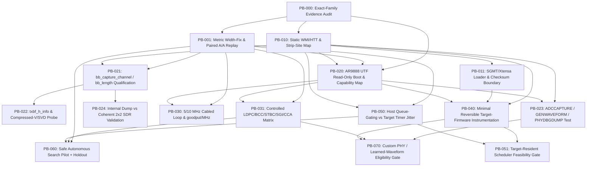

<!-- doc-head: PHYSICAL_BOUNDARY_EXPERIMENTAL_LADDER.md preserved document content -->
<!-- /doc-head -->

# QCA988x / AR9888 Physical-Boundary Experimental Ladder (`PB-000` .. `PB-070`)

## 1. Purpose and Governance

This document and its machine-readable counterpart [`research/physical_boundary/ladder.yaml`](../research/physical_boundary/ladder.yaml) (validated by [`research/physical_boundary/ladder_schema.py`](../research/physical_boundary/ladder_schema.py)) define the mandatory falsification and prerequisite DAG for the **openMAX QCA988x/AR9888 Physical-Boundary Research Program**.

### Core Discipline Rules
1. **No Speculative PHY Jumps**: No custom constellation, learned pilot, custom FEC, or neural on-chip waveform work (`PB-070`) may begin unless `PB-023` (`ADCCAPTURE` / `GENWAVEFORM` / `PHYDBGDUMP` sample-RAM access) and `PB-040` (safe reversible target-firmware execution) pass with external VSA/SDR verification.
2. **Phase 0 Hardware Lock**: Every gate with `execution_mode != "offline"` enforces `automatic_execution_allowed: false` during Phase 0. No bench or radio test may run without an operator-signed preflight receipt.
3. **Explicit Channel-Width & Paired Inference Gate (`PB-001`)**: Every quantitative experiment (`PB-020`..`PB-070`) requires explicit `channel_width_mhz` validation (`{5, 10, 20, 40, 80}`) and paired A/B/A/B block evaluation (`p99 -> p95 -> fairness -> goodput_per_mhz`).

---

## 2. DAG Overview (`PB-000` .. `PB-070`)

---

## 3. Gate Summary Table

| Gate ID | Title | Prereqs | Safety | Brick Risk | Mode | Auto Allowed |
| :--- | :--- | :--- | :---: | :---: | :---: | :---: |
| **`PB-000`** | Exact-family evidence audit and binary/register inventory | None | `L0` | `None` | `offline` | `true` |
| **`PB-001`** | Metric width-fix and paired-gatekeeper null-replay validation | `PB-000` | `L0` | `None` | `offline` | `true` |
| **`PB-010`** | Static firmware/module symbol and WMI/HTT dispatch map | `PB-000` | `L0` | `None` | `offline` | `true` |
| **`PB-011`** | SGMT/Xtensa loader, relocation and checksum/signature boundary | `PB-010` | `L0` | `None` | `offline` | `true` |
| **`PB-020`** | Exact AR9888 UTF read-only boot and capability enumeration | `PB-000`, `PB-001`, `PB-010` | `L2` | `Medium` | `cabled_bench` | `false` |
| **`PB-021`** | `bb_capture_channel` / `bb_captured_channel` / `bb_length` qualification | `PB-001`, `PB-010` | `L2` | `Medium` | `cabled_bench` | `false` |
| **`PB-022`** | `txbf_h_info` and compressed-V / SVD debug qualification | `PB-021` | `L2` | `Medium` | `cabled_bench` | `false` |
| **`PB-023`** | `ADCCAPTURE` / `GENWAVEFORM` / `PHYDBGDUMP` existence test | `PB-010`, `PB-020` | `L2` | `Medium` | `cabled_bench` | `false` |
| **`PB-024`** | Internal channel-dump vs external coherent 2x2 SDR validation | `PB-021` | `L2` | `Low` | `cabled_bench` | `false` |
| **`PB-030`** | 5/10 MHz exact-family cabled loop and `goodput/MHz` characterization | `PB-001`, `PB-020` | `L2` | `Low-Medium` | `cabled_bench` | `false` |
| **`PB-031`** | Controlled LDPC/BCC/STBC/SGI/CCA/AGC response-surface matrix | `PB-001`, `PB-020` | `L2` | `Low` | `shielded_ota` | `false` |
| **`PB-040`** | Minimal reversible target-firmware instrumentation proof | `PB-010`, `PB-011`, `PB-020` | `L3` | `High` | `sacrificial_pair` | `false` |
| **`PB-050`** | Host queue-gating vs target timer-resolution benchmark | `PB-001`, `PB-010` | `L1` | `Low` | `cabled_bench` | `false` |
| **`PB-051`** | Target-resident scheduler feasibility gate | `PB-040`, `PB-050` | `L3` | `High` | `sacrificial_pair` | `false` |
| **`PB-060`** | Safe autonomous MAC/PHY-parameter search pilot with holdout | `PB-001`, `PB-031`, `PB-050` | `L1` | `Low` | `cabled_bench` | `false` |
| **`PB-070`** | Custom PHY / learned-waveform eligibility gate | `PB-023`, `PB-031`, `PB-040` | `L3` | `High` | `cabled_bench` | `false` |

---

## 4. Branch-Elimination Logic

- **First Physical Campaign (`PB-020` + `PB-021`)**:
  - `PB-020` determines whether exact `AR9888` UTF can be booted read-only and enumerates which TLV commands actually exist in the compiled target.
  - `PB-021` determines whether the hardware `bb_capture_channel` bit in `AR9888` RX descriptors produces a packet-correlated channel dump in target/BB memory.
- **Target Execution Inflection Point (`PB-040`)**:
  - Proves whether a RAM-loaded target binary with a 1-line inert instrumentation change boots and recovers cleanly over `>= 10` cycles without touching SPI NOR flash.
- **Custom PHY Lockout (`PB-070`)**:
  - Remains `BLOCKED` unless `PB-023` and `PB-040` prove writable mapper/pilot/FEC tables or usable raw sample injection/capture verified by an external VSA/SDR.
