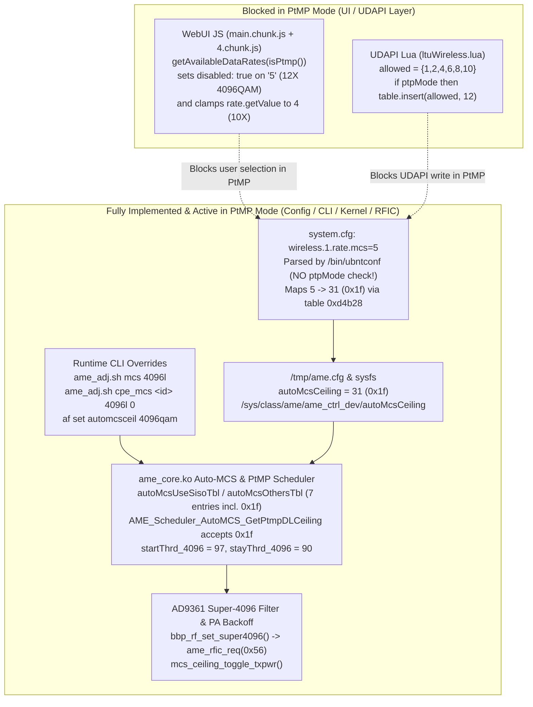

# Stage 11 — Ubiquiti LTU (`AF-LTU` / `LTU-Rocket` v2.4.2) Firmware Reverse Engineering: Dual-SoC Architecture, the "Abandoned 4096-QAM (`12x`)" Investigation, Hidden Knobs & airMAX AC Portability Matrix

**Status:** Complete (Static Firmware RE — No Live Device Interaction)  
**Analyzed Firmware Artifacts (`v2.4.2.00005.261009.1310`):**
- [`aflturocket-2.4.2.261009.bin`](file:///G:/_OneDrive/OneDrive/Desktop/Py%20Apps/futuraMAX/artifacts/firmware_re_xc_ltu/aflturocket-2.4.2.261009.bin) (`30,523,604` bytes — LTU-Rocket PtMP BaseStation AP)
- [`afltu-2.4.2.261009.bin`](file:///G:/_OneDrive/OneDrive/Desktop/Py%20Apps/futuraMAX/artifacts/firmware_re_xc_ltu/afltu-2.4.2.261009.bin) (`15,241,116` bytes — LTU-Lite, LTU-LR, LTU-Pro, LTU-XR CPEs)
- Unpacked trees:
  - [`artifacts/firmware_re_xc_ltu/ltu_extracted/aflturocket_2.4.2/`](file:///G:/_OneDrive/OneDrive/Desktop/Py%20Apps/futuraMAX/artifacts/firmware_re_xc_ltu/ltu_extracted/aflturocket_2.4.2)
  - [`artifacts/firmware_re_xc_ltu/ltu_extracted/afltu_2.4.2/`](file:///G:/_OneDrive/OneDrive/Desktop/Py%20Apps/futuraMAX/artifacts/firmware_re_xc_ltu/ltu_extracted/afltu_2.4.2)

---

## 1. Executive Summary & Claim Ledger

Unlike Ubiquiti's 802.11ac-based **airMAX AC (`WA`/`XC`)** family (which pairs a Qualcomm Atheros `QCA988x` 802.11ac Wi-Fi radio with an `AR9342`/`QCA955x` MIPS host and uses a proprietary TDMA overlay on top of an 802.11ac PHY), **Ubiquiti LTU (`AF-LTU`) is a clean-slate Software-Defined Radio (SDR) + custom ASIC/FPGA architecture (`amesoc3`)**. It does not use `mac80211`, `ath10k`, or IEEE 802.11 framing on the air interface.

| ID | Claim | Status | Primary Evidence |
| :--- | :--- | :--- | :--- |
| **LTU-01** | Both `afltu` and `aflturocket` use an custom outer container (`AMEIMG` v2) wrapping `uImage` / UBI / SquashFS partitions for Ubiquiti's custom **`amesoc3`** SoC (Dual-core 32-bit ARM Cortex-A9 running `Linux 3.14.65 SMP PREEMPT RT` with 256 MB RAM and 128 MB NAND). | **CONFIRMED** | Outer header `0x00..0x58` (`AMEIMG`), [`part02_Device_tree.bin`](file:///G:/_OneDrive/OneDrive/Desktop/Py%20Apps/futuraMAX/artifacts/firmware_re_xc_ltu/ltu_extracted/aflturocket_2.4.2/part02_Device_tree.bin) (`model = "AME SoC 3 LTU Board"`, `compatible = "ubnt,amesoc"`), [`part03_Linux_Kernel.bin`](file:///G:/_OneDrive/OneDrive/Desktop/Py%20Apps/futuraMAX/artifacts/firmware_re_xc_ltu/ltu_extracted/aflturocket_2.4.2/part03_Linux_Kernel.bin). |
| **LTU-02** | The RF front-end on LTU radios is an **Analog Devices AD9361** agile 2x2 SDR transceiver (`compatible = "ame_ad9361"`) on `SPI0` (`0xf02a6080`) with LVDS IQ streaming (`lvds-type = 2`) into the `amesoc3` custom baseband (`ame_core.ko`, `ame_radio_mod.ko`). | **CONFIRMED** | [`part02_Device_tree.bin`](file:///G:/_OneDrive/OneDrive/Desktop/Py%20Apps/futuraMAX/artifacts/firmware_re_xc_ltu/ltu_extracted/aflturocket_2.4.2/part02_Device_tree.bin), [`ame_radio_mod.ko`](file:///G:/_OneDrive/OneDrive/Desktop/Py%20Apps/futuraMAX/artifacts/firmware_re_xc_ltu/ltu_extracted/aflturocket_2.4.2/rootfs_extracted/lib/modules/3.14.65/ame_radio_mod.ko). |
| **LTU-03** | `aflturocket` (AP) embeds a **second complete SoC FPGA system** (Parts 5–9: `5.49 MB` FPGA bitstream `.rbf`, U-Boot, DTB, `Linux 4.14.0 SMP` kernel, and SquashFS rootfs v52) for an on-board **Intel/Altera Arria 10 SoC FPGA** (`altr,socfpga-arria10`), managed over internal bridge `br2` at IPv6 link-local `fe80::a00:1ff:fe02:304%br2` via SSH key `/usr/etc/.ssh/id_rsa`. | **CONFIRMED** | `aflturocket` [`part05_HPS_FPGA_rbf_file.bin`](file:///G:/_OneDrive/OneDrive/Desktop/Py%20Apps/futuraMAX/artifacts/firmware_re_xc_ltu/ltu_extracted/aflturocket_2.4.2/part05_HPS_FPGA_rbf_file.bin)–[`part09_HPS_RootFS_image.bin`](file:///G:/_OneDrive/OneDrive/Desktop/Py%20Apps/futuraMAX/artifacts/firmware_re_xc_ltu/ltu_extracted/aflturocket_2.4.2/part09_HPS_RootFS_image.bin), [`ubnt_hps_update.sh`](file:///G:/_OneDrive/OneDrive/Desktop/Py%20Apps/futuraMAX/artifacts/firmware_re_xc_ltu/ltu_extracted/aflturocket_2.4.2/rootfs_extracted/bin/ubnt_hps_update.sh). |
| **LTU-04** | **4096-QAM (`12X`) is NOT a dead UI stub.** It is fully implemented across the `amesoc3` baseband (`0x1f` = `4096qam LDPC 5/6`, `0x1e` = `4096qam RS 5/6`), AD9361 RF filter reconfiguration (`bbp_rf_set_super4096` / `ame_rfic_req(0x56)`), Auto-MCS rate tables (`autoMcsUseSisoTbl`, `autoMcsOthersTbl`), EVM/BLER thresholds (`startThrd_4096 = 97`, `stayThrd_4096 = 90`), PtMP scheduler (`AME_Scheduler_AutoMCS_GetPtmpDLCeiling`), `ubntconf`, `af`, `ameradio`, and `ame_adj.sh`. | **CONFIRMED** | [`ame_core.ko`](file:///G:/_OneDrive/OneDrive/Desktop/Py%20Apps/futuraMAX/artifacts/firmware_re_xc_ltu/ltu_extracted/aflturocket_2.4.2/rootfs_extracted/lib/modules/3.14.65/ame_core.ko), [`ame_dev.ko`](file:///G:/_OneDrive/OneDrive/Desktop/Py%20Apps/futuraMAX/artifacts/firmware_re_xc_ltu/ltu_extracted/aflturocket_2.4.2/rootfs_extracted/lib/modules/3.14.65/ame_dev.ko), [`ubntbox`](file:///G:/_OneDrive/OneDrive/Desktop/Py%20Apps/futuraMAX/artifacts/firmware_re_xc_ltu/ltu_extracted/aflturocket_2.4.2/rootfs_extracted/bin/ubntbox), [`ame_adj.sh`](file:///G:/_OneDrive/OneDrive/Desktop/Py%20Apps/futuraMAX/artifacts/firmware_re_xc_ltu/ltu_extracted/aflturocket_2.4.2/rootfs_extracted/bin/ame_adj.sh). |
| **LTU-05** | **4096-QAM (`12X`) is gated ONLY in the WebUI JavaScript (`disabled: this.wirelessBasicModel.isPtmp()`) and UDAPI Lua (`ltuWireless.lua` `if ptpMode then table.insert(allowed, 12)`).** Because `amesoc3` shares its codebase with the PtP `AF-5XHD` (where `ptpMode == true`), `12X (4096QAM)` appears in the LTU PtMP WebUI dropdown but is permanently greyed out (`disabled: true`). | **CONFIRMED** | [`main.chunk.36b738fe.js.gz`](file:///G:/_OneDrive/OneDrive/Desktop/Py%20Apps/futuraMAX/artifacts/firmware_re_xc_ltu/ltu_extracted/aflturocket_2.4.2/rootfs_extracted/usr/www/main.chunk.36b738fe.js.gz), [`4.chunk.5886a687.js.gz`](file:///G:/_OneDrive/OneDrive/Desktop/Py%20Apps/futuraMAX/artifacts/firmware_re_xc_ltu/ltu_extracted/aflturocket_2.4.2/rootfs_extracted/usr/www/4.chunk.5886a687.js.gz), [`ltuWireless.lua`](file:///G:/_OneDrive/OneDrive/Desktop/Py%20Apps/futuraMAX/artifacts/firmware_re_xc_ltu/ltu_extracted/aflturocket_2.4.2/rootfs_extracted/lib/lua/udapi/ltuWireless.lua). |
| **LTU-06** | **How to unlock 4096-QAM (`12x`) on LTU PtMP without WebUI/Lua:** `ubntconf` does **not** check `ptpmode` when parsing `wireless.1.rate.mcs=5` (`CMP R12, #5; BLE`); it maps `5 -> 31 (0x1f)` via table `0xd4b28` and writes `autoMcsCeiling = 31` to `/tmp/ame.cfg` and `/sys/class/ame/ame_ctrl_dev/autoMcsCeiling`. It can also be forced live at runtime via `ame_adj.sh mcs 4096l`, `af set automcsceil 4096qam`, or per-CPE via `ame_adj.sh cpe_mcs <cpe_id> 4096l 0`. | **CONFIRMED** | [`ubntbox`](file:///G:/_OneDrive/OneDrive/Desktop/Py%20Apps/futuraMAX/artifacts/firmware_re_xc_ltu/ltu_extracted/aflturocket_2.4.2/rootfs_extracted/bin/ubntbox) (`va=0x40240..0x402cc`, `va=0x41da0..0x41e40`), [`ame_adj.sh`](file:///G:/_OneDrive/OneDrive/Desktop/Py%20Apps/futuraMAX/artifacts/firmware_re_xc_ltu/ltu_extracted/aflturocket_2.4.2/rootfs_extracted/bin/ame_adj.sh), [`ame_core.ko`](file:///G:/_OneDrive/OneDrive/Desktop/Py%20Apps/futuraMAX/artifacts/firmware_re_xc_ltu/ltu_extracted/aflturocket_2.4.2/rootfs_extracted/lib/modules/3.14.65/ame_core.ko). |
| **LTU-07** | Whether an LTU PtMP link actually sustains `4096-QAM LDPC 5/6` (`0x1f`) over the air when unlocked via `autoMcsCeiling=31` / `cpe_mcs` depends on meeting the hardware EVM/BLER threshold (`startThrd_4096 = 97`, `stayThrd_4096 = 90`, ~38–42 dB CINR) and PA linearity backoff (`mcs_ceiling_toggle_txpwr`). | **INFERRED** (Static RE confirms software/driver path is intact; over-the-air SNR/EVM behavior requires physical LTU RF bench test, which is outside airMAX AC scope). | [`ame_core.ko`](file:///G:/_OneDrive/OneDrive/Desktop/Py%20Apps/futuraMAX/artifacts/firmware_re_xc_ltu/ltu_extracted/aflturocket_2.4.2/rootfs_extracted/lib/modules/3.14.65/ame_core.ko) (`autoMCS_startTraining`, `autoMCS_updateDL`, `bbp_rf_set_super4096`, `mcs_ceiling_toggle_txpwr`). |
| **LTU-08** | LTU firmware contains numerous **undocumented / hidden capabilities** absent from standard WebUI views, including **2/4/8-subband OFDMA** (`radio.1.ofdma_mode = 0..3`), **Mixed-MCS per-QoS-queue portioning** (`ame_adj.sh mix_mcs`), **Contention Zone length tuning** (`radio.1.czlen = 1..29`), **Performance Boost single-CPE mode** (`wireless.1.max_sq_cpe`), **Auto Power Backoff by MCS** (`radio.1.autopwr_backoff.status`), **Engineering Mode** (`eng.mode.status=enabled` / `/tmp/.engmode` / `ameeng.cgi`), and embedded **real-time TDMA scheduler web visualizers** (`/lib/ame-debug/www/sched.html` and `ctrl.html`). | **CONFIRMED** | [`ubntbox`](file:///G:/_OneDrive/OneDrive/Desktop/Py%20Apps/futuraMAX/artifacts/firmware_re_xc_ltu/ltu_extracted/aflturocket_2.4.2/rootfs_extracted/bin/ubntbox), [`ame_adj.sh`](file:///G:/_OneDrive/OneDrive/Desktop/Py%20Apps/futuraMAX/artifacts/firmware_re_xc_ltu/ltu_extracted/aflturocket_2.4.2/rootfs_extracted/bin/ame_adj.sh), [`ame-debug-sched`](file:///G:/_OneDrive/OneDrive/Desktop/Py%20Apps/futuraMAX/artifacts/firmware_re_xc_ltu/ltu_extracted/aflturocket_2.4.2/rootfs_extracted/bin/ame-debug-sched), [`sched.html`](file:///G:/_OneDrive/OneDrive/Desktop/Py%20Apps/futuraMAX/artifacts/firmware_re_xc_ltu/ltu_extracted/aflturocket_2.4.2/rootfs_extracted/lib/ame-debug/www/sched.html). |

---

## 2. Outer Container (`AMEIMG`) & Dual-SoC Hardware Architecture

### 2.1 `AMEIMG` v2 Binary Container Layout (`CONFIRMED`)
Both `afltu-2.4.2.261009.bin` and `aflturocket-2.4.2.261009.bin` start with an 88-byte (`0x58`) outer header:
- `0x00..0x06`: Magic `"AMEIMG"`
- `0x12..0x14`: Container format version `0x0002` (big-endian `uint16`)
- `0x14..0x54`: 64-byte NUL-padded version string:
  - `afltu`: `"afltu.amesoc3.v2.4.2.00005.261009.1310"`
  - `aflturocket`: `"aflturocket.amesoc3.v2.4.2.00005.261009.1310"`
- `0x54..0x58`: `num_parts` (big-endian `uint32`: `5` in `afltu`, `10` in `aflturocket`)

Each partition entry consists of:
- `0x00..0x04`: `part_type` (`0x00000003` BE32)
- `0x04..0x08`: `part_size` (BE32, includes the 64-byte part name field)
- `0x08..0x18`: 16-byte MD5 digest of the payload
- `0x18..0x58`: 64-byte NUL-padded ASCII partition name
- `0x58..(0x18 + part_size)`: Partition payload (`part_size - 0x40` bytes)

| Part # | Partition Name | `afltu` (CPE) Size | `aflturocket` (AP) Size | Inner Format & Role |
| :---: | :--- | ---: | ---: | :--- |
| `0` | `SPL image` | `25,672 B` | `25,672 B` | First-stage NAND SPL (`U-Boot SPL 2016.03`) for `amesoc3` |
| `1` | `U-Boot file` | `400,264 B` | `400,264 B` | Main `U-Boot 2016.03` bootloader for `amesoc3` |
| `2` | `Device tree` | `17,328 B` | `17,328 B` | Flattened Device Tree (`FDT`, `model = "AME SoC 3 LTU Board"`) |
| `3` | `Linux Kernel` | `2,202,912 B` | `2,202,912 B` | ARM `uImage` (`Linux-3.14.65`, load/entry `0x00008000`, `SMP PREEMPT RT`) |
| `4` | `RootFS image` | `12,582,912 B` | `12,582,912 B` | UBI image (`PEB=128 KiB`, `LEB=124 KiB`) containing `vol_id=0` SquashFS (`1,321` / `1,325` files) |
| `5` | `HPS FPGA rbf file` | *(absent)* | `5,490,084 B` | `uImage`-wrapped Intel/Altera **Arria 10 FPGA bitstream (`.rbf`)** (`fpga_soc`) |
| `6` | `HPS U-Boot file` | *(absent)* | `1,048,576 B` | `4 x 256 KiB` redundant `U-Boot 2014.10` image for Arria 10 HPS (`socfpga_arria10`) |
| `7` | `HPS device tree` | *(absent)* | `18,095 B` | Flattened Device Tree (`model = "LTU Rocket SoC"`, `compatible = "altr,socfpga-arria10"`) |
| `8` | `HPS Linux Kernel` | *(absent)* | `3,658,656 B` | ARM `zImage` (`Linux 4.14.0 #1 SMP`, Buildroot GCC 6.4.0, Cortex-A9 VFPv3 hard-float) |
| `9` | `HPS RootFS image` | *(absent)* | `5,124,096 B` | SquashFS 4.0 LE rootfs (`426` files, version `52`) for the Arria 10 HPS |
| **Tail** | Outer Signature Footer | `11,580 B` | `11,148 B` | Ubiquiti RSA/manifest signature block |

### 2.2 Primary SoC (`amesoc3`) & Peripheral Architecture (`CONFIRMED`)
From [`part02_Device_tree.bin`](file:///G:/_OneDrive/OneDrive/Desktop/Py%20Apps/futuraMAX/artifacts/firmware_re_xc_ltu/ltu_extracted/aflturocket_2.4.2/part02_Device_tree.bin) and `/lib/modules/3.14.65/*.ko`:
- **CPU & Memory:** Dual-core 32-bit ARM Cortex-A9 (`arm,cortex-a9`, SCU `@ 0xf8f00000`, GIC `@ 0xf8f01000`, PL310 L2 cache `@ 0xf8f02000`) with **256 MB RAM** (`0x00000000..0x10000000`) and a **PREEMPT_RT** kernel (`Linux version 3.14.65 #1 SMP PREEMPT RT`).
- **NAND Flash (`ubnt,ame-nand @ 0xf0900000`, 128 MB):**
  - `0x00000000` (`128 KiB`): `spl`
  - `0x00020000` (`128 KiB`): `uboot_env0`
  - `0x00040000` (`128 KiB`): `uboot_env1`
  - `0x00060000` (`1 MiB`): `uboot`
  - `0x00160000` (`128 KiB`): `EEPROM` (board ID, MACs, calibration data)
  - `0x00180000` (`1 MiB`): `cfg` (persistent config `/etc/persistent` + `system.cfg`)
  - `0x00280000` (`128 KiB` + `4 MiB` + `58 MiB`): `dtb0`, `kernel0`, `rootfs0` (Active/Backup slot 0)
  - `0x040a0000` (`128 KiB` + `4 MiB` + `58 MiB`): `dtb1`, `kernel1`, `rootfs1` (Active/Backup slot 1)
  - `0x07ec0000` (`1.25 MiB`): `reserved`
- **RF Transceiver (`SPI0 @ 0xf02a6080`):**
  - **Analog Devices AD9361** (`compatible = "ame_ad9361"`, `spi-max-frequency = 20 MHz`, `lvds-type = 2`, `clk-out-mode = 2`), driven by [`ame_radio_mod.ko`](file:///G:/_OneDrive/OneDrive/Desktop/Py%20Apps/futuraMAX/artifacts/firmware_re_xc_ltu/ltu_extracted/aflturocket_2.4.2/rootfs_extracted/lib/modules/3.14.65/ame_radio_mod.ko).
  - Because the AD9361 is a full-duplex 2x2 SDR transceiver (`70 MHz – 6.0 GHz`) with **two independent Fractional-N RF PLL synthesizers** (one for RX LO and one for TX LO) and programmable analog/digital channel filters up to 56 MHz (and stitched/wider modes via the companion FPGA on LTU-Rocket), LTU can natively tune TX and RX to completely separate frequencies (**Split-Frequency**) and synthesize non-802.11 channel widths (`10/20/30/40/50/60/80/100 MHz`).
- **Baseband / Custom MAC (`ame_core.ko` + `ame_dev.ko`):**
  - Maps custom memory-mapped baseband (`air_fpga` / `ame_bbp`), hardware packet forwarding engine (`AME.hfe @ 0xf02b2000`), and hardware CAM (`AME.hcam @ 0xf02b1000`).
- **Networking (`cds_mac_mod.ko`):**
  - Dual Cadence GEM Gigabit Ethernet MACs (`gmac0 @ 0xf0280000` and `gmac1 @ 0xf0290000`, `rgmii-id`, external MDIO PHYs at addresses `1` and `3`).
- **Sensors & GPS:**
  - `SPI1 @ 0xf02a60a0`: STMicroelectronics `LIS2DH12` 3-axis accelerometer (`st,lis2dh12`) for dish tilt/alignment monitoring (`ubnt_acceld`).
  - `UART1 @ 0xf02a0020`: Internal GPS module (`ubnt_gps_SyncClk` in `ame_core.ko`).
  - Bluetooth LE management radio (`bt_pan.sh`).

### 2.3 LTU-Rocket Companion Intel Arria 10 SoC FPGA (`HPS`) (`CONFIRMED`)
Why is `aflturocket-2.4.2.261009.bin` twice the size of `afltu-2.4.2.261009.bin` (`30.5 MB` vs `15.2 MB`)?
- **LTU-Rocket (AP)** includes an on-board **Intel/Altera Arria 10 SoC FPGA** (`altr,socfpga-arria10`) alongside the `amesoc3` chip.
- From [`ubnt_hps_update.sh`](file:///G:/_OneDrive/OneDrive/Desktop/Py%20Apps/futuraMAX/artifacts/firmware_re_xc_ltu/ltu_extracted/aflturocket_2.4.2/rootfs_extracted/bin/ubnt_hps_update.sh), [`ubnt_hps_alive.sh`](file:///G:/_OneDrive/OneDrive/Desktop/Py%20Apps/futuraMAX/artifacts/firmware_re_xc_ltu/ltu_extracted/aflturocket_2.4.2/rootfs_extracted/bin/ubnt_hps_alive.sh), and [`hps_rootfs_extracted/etc/inittab`](file:///G:/_OneDrive/OneDrive/Desktop/Py%20Apps/futuraMAX/artifacts/firmware_re_xc_ltu/ltu_extracted/aflturocket_2.4.2/hps_rootfs_extracted/etc/inittab):
  - The Arria 10 HPS boots `Linux 4.14.0 SMP` from its own QSPI NOR flash (`/dev/mtd0` = u-boot, `/dev/mtd1` = devicetree, `/dev/mtd2` = kernel, `/dev/mtd3` = `.rbf` FPGA bitstream, `/dev/mtd4` = SquashFS rootfs, `/dev/mtd5` = config) and runs `S30set_mac_addr`, `S35vlan` (creates `eth0.4093`), and `S50dropbear`.
  - The primary `amesoc3` SoC communicates with the Arria 10 HPS over internal Ethernet bridge `br2` using IPv6 link-local address `fe80::a00:1ff:fe02:304%br2` via SSH key `/usr/etc/.ssh/id_rsa`.
  - During boot (`rc.sysinit`), `amesoc3` checks if the Arria 10 HPS rootfs version matches `/usr/etc/expected_hps_rootfs_version` (`52`) and automatically flashes any updated FPGA bitstream (`HPS FPGA rbf file`), kernel, DTB, or rootfs to the Arria 10's MTD partitions via `ubnt_hps_update.sh`.
  - `amesoc3` also reads/writes Arria 10 FPGA/HPS physical registers remotely using [`/bin/ubnt_devmem.sh`](file:///G:/_OneDrive/OneDrive/Desktop/Py%20Apps/futuraMAX/artifacts/firmware_re_xc_ltu/ltu_extracted/aflturocket_2.4.2/rootfs_extracted/bin/ubnt_devmem.sh) (`ssh ... devmem $@`).
  - **Architectural role of the Arria 10 FPGA on LTU-Rocket (`INFERRED` from `part05_HPS_FPGA_rbf_file.bin` + `ubnt_devmem.sh` + LTU-Rocket hardware design):** Provides high-order AP-side digital filtering, channelizer/selectivity processing, and 100 MHz / multi-CPE uplink DSP acceleration on the Rocket AP, whereas cost-optimized CPEs (`LTU-Lite`, `LTU-LR`, `LTU-Pro`, `LTU-XR`, board IDs `0xae05`, `0xae0e`, `0xae06`, `0xae12`) rely solely on the `amesoc3` ASIC + `AD9361`.

---

## 3. Deep-Dive: The "Abandoned 4096-QAM (`12x`)" Modulation Investigation

Operators have long noticed that Ubiquiti LTU marketing and early UI screenshots touted **`4096-QAM (12X)`**, and that `12X (4096QAM)` is visible in the LTU WebUI "Max TX Modulation" dropdown—yet is **permanently greyed out / disabled** on LTU-Rocket and LTU CPEs.

Our static reverse-engineering across all 5 software/hardware layers reveals the exact truth: **4096-QAM (`12x`) is completely implemented in the `amesoc3` baseband, AD9361 RF driver, Auto-MCS state machine, PtMP scheduler, and `ubntconf` configuration compiler, and is artificially disabled ONLY in the WebUI JavaScript and UDAPI Lua validation layer when `isPtmp()` is true.**



### 3.1 Layer 1 — Hardware Baseband & Rate Table Encoding (`CONFIRMED`)
In [`/bin/ubntbox`](file:///G:/_OneDrive/OneDrive/Desktop/Py%20Apps/futuraMAX/artifacts/firmware_re_xc_ltu/ltu_extracted/aflturocket_2.4.2/rootfs_extracted/bin/ubntbox) (`af` / `ameradio` applet) and [`ame_core.ko`](file:///G:/_OneDrive/OneDrive/Desktop/Py%20Apps/futuraMAX/artifacts/firmware_re_xc_ltu/ltu_extracted/aflturocket_2.4.2/rootfs_extracted/lib/modules/3.14.65/ame_core.ko), every modulation rate has a 5-bit hardware modulation index (`0x00..0x1f`):

| `system.cfg` `wireless.1.rate.mcs` | WebUI Label | `ubntconf` Table `0xd4b28` -> `autoMcsCeiling` | `ame_core.ko` LDPC Modulation Code | `ame_core.ko` Reed-Solomon (RS) Code | MIMO (`2x2`) Spectral Efficiency | SISO (`1x1`) Spectral Efficiency |
| :---: | :--- | :---: | :---: | :---: | :---: | :---: |
| `0` | `1X (QPSK)` | `7` (`0x07`) | `0x07` = `qpsk LDPC 1/2` (`4l`) | `0x04` = `qpsk RS 1/2` (`4r`) | `2x` (`1x` SISO) | `1x` |
| `1` | `2X (QPSK)` | `11` (`0x0b`) | `0x0b` = `qpsk LDPC 3/4` (`4l`) | `0x09` = `qpsk RS 3/4` | `2x` | `1x` |
| `2` | `4X (16QAM)` | `15` (`0x0f`) | `0x0f` = `16qam LDPC 1/2` (`16l`) | `0x0c` = `16qam RS 1/2` (`16r`) | `4x` | `2x` |
| `3` | `6X (64QAM)` | `19` (`0x13`) | `0x13` = `64qam LDPC 3/4` (`64l`) | `0x19` = `64qam RS 5/6` (`64r`) | `6x` | `3x` |
| `4` | `8X (256QAM)` | `23` (`0x17`) | `0x17` = `256qam LDPC 3/4` (`256l`) | `0x1b` = `256qam RS 5/6` (`256r`) | `8x` | `4x` |
| `4` (Auto up to 10X) | `10X (1024QAM)` | `23` (`0x17`)* | `0x17` / `1024qam LDPC 5/6` (`1024l`) | `0x1d` = `1024qam RS 5/6` (`1024r`) | `10x` | `5x` |
| **`5`** | **`12X (4096QAM)`** | **`31` (`0x1f`)** | **`0x1f` = `4096qam LDPC 5/6` (`4096l`)** | **`0x1e` = `4096qam RS 5/6` (`4096r`)** | **`12x`** | **`6x`** |

*\*Note on table `0xd4b28` in `ubntconf`:* In `ame_core.ko`'s `.rodata` rate tables (`autoMcsUseSisoTbl` at `0xd384` and `autoMcsOthersTbl` at `0xd394`), the 7 rate steps are encoded as `(mcs_code, is_mimo)` pairs:
- `autoMcsUseSisoTbl` (`14` bytes = 7 steps): `(7,0), (11,0), (15,0), (15,1), (19,1), (23,1), (31,1)`
- `autoMcsOthersTbl` (`14` bytes = 7 steps): `(7,0), (7,1), (11,1), (15,1), (19,1), (23,1), (31,1)`
And `autoMCS_get_rate_table` (`0x156098` in `ame_core.ko`) unconditionally sets the rate-table length to **`7` (`MOV R3, #7`)** on all 2x2 MIMO LTU radios—meaning **step 6 (`(31, 1)` = `0x1f`, 4096-QAM LDPC 5/6 MIMO 2x2) is always loaded in the kernel's active rate table!**

### 3.2 Layer 2 — Kernel Auto-MCS, PtMP Scheduler & AD9361 `super4096` RF Mode (`CONFIRMED`)
Inspection of [`ame_core.ko`](file:///G:/_OneDrive/OneDrive/Desktop/Py%20Apps/futuraMAX/artifacts/firmware_re_xc_ltu/ltu_extracted/aflturocket_2.4.2/rootfs_extracted/lib/modules/3.14.65/ame_core.ko) confirms that 4096-QAM is actively wired into every part of the kernel driver:
1. **EVM / Link Quality Thresholds (`.rodata` & `.data` in `ame_core.ko`):**
   - `startThrd_4096 = 97` (`0x61`) — Link quality / EVM score required to enter 4096-QAM (`autoMCS_startTraining`).
   - `stayThrd_4096 = 90` (`0x5a`) — Link quality / EVM score required to stay in 4096-QAM before stepping down.
   - Compare with lower modulations: `mcsUpThrd_1024 = 93`, `mcsUpThrd_256 = 96`, `mcsUpThrd_lowqam = 95`, `ackmcsUpThrd = 98`.
   - `autoMCS_set4096` / `autoMCS_get4096` (exposed via `/sys/class/ame/ame_ctrl_dev/autoMcs4096`) reads/writes `.data+0x12e8` (initialized to `10`), controlling the 4096-QAM training/promotion parameter in the `autoMcsTP` block (`0x12b4`).
2. **AD9361 `super4096` Filter Reconfiguration (`bbp_rf_set_super4096` @ `0x1766bc`):**
   - Called directly from `autoMCS_startTraining` (`+0x24e8`, `+0x2500`), `autoMCS_updateDL` (`+0xb58`, `+0xba0`), and `ame_bbp_set_Param_mcs` (`+0x1bc`, `+0x210`, `+0x220`).
   - Reads the BBP RF registers via `bbp_rf_get_register`, logs `cfgFilter = %04x`, and invokes `ame_rfic_req(0x56, ...)` to switch the AD9361 transceiver into a low-EVM filter profile (`super4096`) specifically calibrated for 4096-QAM constellation density.
3. **PtMP Downlink Scheduler Ceiling (`AME_Scheduler_AutoMCS_GetPtmpDLCeiling` @ `0x0735ac`):**
   - When scheduling downlink slots for `cpe_id`, the PtMP scheduler checks `schedCpeInfo[cpe_id].dl_ceiling` (`offset 0x0d` of the 188-byte per-CPE struct).
   - Its validation logic (`SUB R2, R0, #25; CMP R2, #6`) explicitly accepts `31` (`0x1f` = 4096-QAM LDPC 5/6) as a valid per-CPE ceiling, and if no per-CPE ceiling is set, returns the global `system_config.autoMcsCeiling` (`offset 0x174`)!
4. **TX Power Backoff by MCS (`mcs_ceiling_toggle_txpwr` @ `0x0391b0`):**
   - Called by `ame_bbp_set_autoMcsCeiling` (`0x196af0`) and `ame_bbp_set_desired_txpower` (`0x195068`). When `radio.1.autopwr_backoff.status=enabled`, raising the ceiling to 4096-QAM (`0x1f`) queries `get_mcs_max_pwr` to apply the required linear PA power backoff so TX EVM does not self-degrade the 4096-QAM constellation.

### 3.3 Layer 3 — Where 4096-QAM Is Actually Gated (WebUI JS & UDAPI Lua) (`CONFIRMED`)
1. **WebUI Frontend ([`main.chunk.36b738fe.js.gz`](file:///G:/_OneDrive/OneDrive/Desktop/Py%20Apps/futuraMAX/artifacts/firmware_re_xc_ltu/ltu_extracted/aflturocket_2.4.2/rootfs_extracted/usr/www/main.chunk.36b738fe.js.gz) & [`4.chunk.5886a687.js.gz`](file:///G:/_OneDrive/OneDrive/Desktop/Py%20Apps/futuraMAX/artifacts/firmware_re_xc_ltu/ltu_extracted/aflturocket_2.4.2/rootfs_extracted/usr/www/4.chunk.5886a687.js.gz)):**
   - In `main.chunk.36b738fe.js.gz` (`@1335225`), `f.getAvailableDataRates(t)` returns:
     ```javascript
     [
       { label: "1X (QPSK)",     value: "0", valueWithNss: "0@0", disabled: false },
       { label: "2X (QPSK)",     value: "1", valueWithNss: "1@1", disabled: false },
       { label: "4X (16QAM)",    value: "2", valueWithNss: "2@1", disabled: false },
       { label: "6X (64QAM)",    value: "3", valueWithNss: "3@1", disabled: false },
       { label: "8X (256QAM)",   value: "4", valueWithNss: "4@1", disabled: false },
       { label: "10X (1024QAM)", value: "4", valueWithNss: "4@1", disabled: false },
       { label: "12X (4096QAM)", value: "5", valueWithNss: "5@1", disabled: t }
     ]
     ```
   - In `4.chunk.5886a687.js.gz` (`@488899`, `@493300`, `@826218`), every call passes `t = this.wirelessBasicModel.isPtmp()`.
   - Because LTU-Rocket and LTU CPEs always run in PtMP mode (`isPtmp() === true`), `12X (4096QAM)` is rendered in the dropdown with `disabled: true`.
   - Furthermore, in `4.chunk.5886a687.js.gz` (`@109973` and `@111239`), `getDefaultRate()` returns `e.isPtp() ? 5 : 4`, and `rate.getValue` clamps any value `> 4` down to `4` in PtMP mode (`const a = l.isPtp() ? 5 : 4; return a < r && (r = a)`).
2. **UDAPI Lua Backend ([`lib/lua/udapi/ltuWireless.lua`](file:///G:/_OneDrive/OneDrive/Desktop/Py%20Apps/futuraMAX/artifacts/firmware_re_xc_ltu/ltu_extracted/aflturocket_2.4.2/rootfs_extracted/lib/lua/udapi/ltuWireless.lua)):**
   - Disassembly of the Lua 5.1 bytecode in `ltuWireless.lua` shows:
     - `Func 0` (`get`, `pc 74..97`): reads `wireless.1.rate.mcs`, maps it through `{[0]=1, [1]=2, [2]=4, [3]=6, [4]=10, [5]=12}`, and if `not ptpMode` and `maxTxRate > 10`, clamps `maxTxRate = 10`.
     - `Func 1` (`validate`, `pc 339..357`): constructs `allowed = {1, 2, 4, 6, 8, 10}` and only calls `table.insert(allowed, 12)` if `ptpMode` is truthy.

### 3.4 Layer 4 — How 4096-QAM (`12x`) Can Be Unlocked on LTU (`CONFIRMED`)
Because **`/bin/ubntconf`** (`ubntbox` @ `va=0x40240..0x402cc`) validates `wireless.1.rate.mcs` with `CMP R12, #5; BLE 0x402cc` **without checking `ptpmode`**, 4096-QAM (`0x1f`) is **not** blocked at the `system.cfg` compiler or kernel level!
It can be enabled on LTU via three independent mechanisms (documented here as static RE findings):
1. **Persistent `system.cfg` Configuration (`ubntconf` path):**
   - Setting `wireless.1.rate.mcs=5` in `/tmp/system.cfg` and running `ubntconf -c /tmp/system.cfg` (or saving via `cfgmtd -w -p /etc` as long as the WebUI wireless page is not re-saved) causes `ubntconf` (`va=0x41da0..0x41e40`) to translate `5 -> 31` (`0x1f`) via table `0xd4b28` and write `autoMcsCeiling = 31` to `/tmp/ame.cfg` and `/sys/class/ame/ame_ctrl_dev/autoMcsCeiling`.
2. **Live Kernel/CLI Override (`ame_adj.sh` / `af` / `sysfs`):**
   - Global ceiling:
     - `echo 31 > /sys/class/ame/ame_ctrl_dev/autoMcsCeiling`
     - `af set automcsceil 4096qam`
   - Fixed-rate 4096-QAM LDPC 5/6 (`0x1f`) or RS 5/6 (`0x1e`):
     - `ame_adj.sh mcs 4096l` (or `ame_adj.sh mcs 4096r`)
   - Per-CPE MCS control on the AP (`ame_adj.sh cpe_mcs`):
     - `ame_adj.sh cpe_mcs <cpe_id> 4096l 0` (`op=0`: set per-CPE Auto-MCS ceiling to `4096-QAM LDPC`; `op=2`: lock CPE to fixed `4096-QAM LDPC`; `op=3`: unlock back to global Auto-MCS).

---

## 4. Complete Inventory of LTU Capabilities & Under-the-Hood Mechanics

### 4.1 Split-Frequency (`TX != RX`) Operation (`CONFIRMED`)
- **Configuration Keys:**
  - `wireless.1.split_freq=enabled|disabled` (default `disabled`)
  - `wireless.1.tx_freq=<kHz_or_MHz>` and `wireless.1.rx_freq=<kHz_or_MHz>` (when `split_freq=enabled`)
  - `wireless.1.freq=<MHz>` (when `split_freq=disabled`, sets both TX and RX to the same frequency)
- **Under-the-Hood Mechanics (`ubntconf` @ `va=0x3ed90..0x3ef20`, `ame_core.ko`, `ame_radio_mod.ko`):**
  - When `wireless.1.split_freq=disabled`, `ubntconf` copies `wireless.1.freq` into both internal frequency slots (`tx_freq` and `rx_freq`).
  - When `wireless.1.split_freq=enabled`, `ubntconf` writes distinct `tx_frequency` and `rx_frequency` values to `/tmp/ame.cfg` and `/sys/class/ame/ame_ctrl_dev/tx_frequency` + `rx_frequency`.
  - In `ame_radio_mod.ko`, the Analog Devices **AD9361** has two independent Fractional-N RF PLLs (RX Synthesizer and TX Synthesizer). Even though LTU uses TDD framing in time (`ame_bbp_set_Param_duplex`), the AD9361 keeps the TX LO parked on `tx_freq` and the RX LO parked on `rx_freq`, eliminating PLL retuning latency between DL and UL subframes while allowing the AP to transmit on a clean downlink frequency and receive on a completely different uplink frequency.

### 4.2 Auto-Frequency / Interference Avoidance / Backup Frequencies / Find My AP / Auto-Channel-Bandwidth (`CONFIRMED`)
LTU implements a multi-layered frequency agility subsystem across `ubntconf`, `ame_core.ko` (`freq_mon_*`, `ame_freq_select_*`), and `ubnt_specd`:
1. **AP Auto-Frequency & Interference Avoidance (`radio.1.auto_freq.*` / `wireless.1.freq_list`):**
   - `radio.1.auto_freq.status=enabled|disabled` -> `/sys/class/ame/ame_ctrl_dev/auto_freq`
   - `radio.1.auto_freq.Mode=0|1` -> `/sys/class/ame/ame_ctrl_dev/auto_freq_mode`
   - `radio.1.auto_freq.fallback_WaitTime=<sec>` -> `/sys/class/ame/ame_ctrl_dev/auto_freq_fallback_wait_time`
   - `wireless.1.freq_list_status=enabled|disabled` and `wireless.1.freq_list=<comma-separated MHz>` -> `/sys/class/ame/ame_ctrl_dev/freq_list`
   - **Mechanics:** `ame_core.ko` runs a continuous frequency monitor (`freq_mon_enable`, `freq_mon_start`, `freq_mon_dump`, `freq_mon_clear_history`) that tracks per-channel interference, DFS radar events (`dfs_hit_count`), and CPE BLER/CINR degradation (`ame_freq_select_show`, `ame_freq_select_best_freq`). When interference exceeds thresholds on the primary frequency, the AP coordinates a synchronized channel switch with all associated CPEs (`ubnt_poll_ap_switch_freq`) to the best candidate in `freq_list`, and waits `fallback_WaitTime` before attempting to return to the preferred frequency.
   - **Background CAC / Pre-Cleared Backup Frequency (`wireless.ifreq`):** `wireless.ifreq_status` and `wireless.ifreq` (`ifreq_cac_state`, `ifreq_cac_timer` in `/sys/class/ame/ame_ctrl_dev/`) allow the AP to pre-clear a secondary DFS frequency so channel switches do not incur a 60-second radar CAC outage.
2. **CPE "Find My AP" & Scan Bandwidth (`wireless.1.scan_list` & `wireless.1.autochanbwd`):**
   - `wireless.1.scan_list.status=enabled|disabled` and `wireless.1.scan_list.channels=<list>` -> programmed via ioctl `IOC_MODEM_SET_FREQ_LIST` (`0x40846910`).
   - `wireless.1.autochanbwd=enabled|disabled` and `wireless.1.scanbw=<list>` (`10,20,30,40,50,60,80,100`) -> `/sys/class/ame/ame_ctrl_dev/auto_bw` and `scan_bw`.
   - **Mechanics:** When an LTU CPE loses association (or boots with `Find My AP` enabled), `ame_core.ko` sweeps the configured `scan_list` (or full regulatory band) across all enabled bandwidths in `scan_bw` until it locks onto the AP's sync/beacon header.

### 4.3 Custom Channel Widths (`10/20/30/40/50/60/80/100 MHz`), Configurable TDD Framing & DL/UL Duty Cycle (`CONFIRMED`)
- **Channel Widths (`wireless.1.chanbw` -> `/tmp/ame.cfg` `bandwidth` & `/sys/class/ame/ame_ctrl_dev/bandwidth`):**
  - Supported values in `ubntconf` (`va=0x401c8..0x4023c`): **`10`, `20`, `30`, `40`, `50`, `60`, `80`, `100` MHz**.
  - `ame_bbp_set_Param_bw` (`0x1923b4` in `ame_core.ko`) reconfigures the baseband FFT size/sampling clock and AD9361 analog/FIR filters (`fft_full_table` in `.data+0x130c`). Note that on CPEs without the Arria 10 FPGA, bandwidths up to 100 MHz use RX channel stitching/extension (`rx_bw_100M_capable` in `/sys/class/ame/ame_ctrl_dev/`).
- **TDD Frame Lengths (`wireless.1.frame_len` -> `/sys/class/ame/ame_ctrl_dev/frame_len`):**
  - Validated in `ubntconf` (`va=0x40594`): **`1000`, `2000`, `2500`, `4000`, `5000` µs** (`1 ms`, `2 ms`, `2.5 ms`, `4 ms`, `5 ms`).
- **DL/UL Duty Cycle (`wireless.1.duty_cycle` -> `/sys/class/ame/ame_ctrl_dev/duty_cycle`):**
  - Validated in `ubntconf`: **`25`, `33` (`33.3%`), `50`, `67` (`66.7%`), `75`** (% Downlink).
- **Contention Zone Length (`radio.1.czlen` -> `/sys/class/ame/ame_ctrl_dev/czlen`):**
  - Validated in `ubntconf` (`va=0x402e4..0x40304`): integer **`1..29`** (`CMP R3, #28; BLS`). Controls the number of contention-zone symbols reserved in the TDD frame for CPE ranging, association, and bandwidth requests (`ame_core_get_czlen`, `ame_core_czlen_vs_normal`).

### 4.4 Per-CPE ATPC (Automatic Transmit Power Control) & UL/DL Digital Gain (`CONFIRMED`)
- **Configuration Keys:**
  - `radio.1.ulpwr_ctrl=enabled|disabled` (`auto_txpower` in `/tmp/ame.cfg` and `/sys/class/ame/ame_ctrl_dev/auto_txpower`)
  - `radio.1.ulpwr_Boost=enabled|disabled` (`auto_txpower_boost` in `/sys/class/ame/ame_ctrl_dev/auto_txpower_boost`)
  - `radio.1.rxtargetpwr=<-90..-30 dBm>` (`rx_target_power` in `/sys/class/ame/ame_ctrl_dev/rx_target_power`)
  - `radio.1.txpower=<dBm>` (`txpower` in `/sys/class/ame/ame_ctrl_dev/txpower`)
  - `radio.1.cable.loss=<dB>` and `radio.1.ant_gain=<dBi>`
- **Under-the-Hood Mechanics (`ame_core.ko`):**
  - The AP measures each CPE's uplink received power (`ul_rxpower`) and CINR during its scheduled TDD uplink burst and compares it against `rx_target_power`.
  - Via closed-loop control messages in the downlink TDD MAP, the AP adjusts each CPE's transmit power and per-CPE uplink digital gain (`ame_adj.sh cpe_ul_dgain <cpe_id> [0..15]`, `ptmp_autopwr_max_txpwr_adjust_dl_dgain`) so near and far CPEs arrive at the AP within the AD9361's optimal ADC dynamic range without saturating the front-end or causing adjacent-subband leakage.
  - When `ulpwr_Boost=enabled`, the AP temporarily boosts target power for CPEs experiencing high BLER or high-order modulation transitions (`ptmp_ap_rx_expected_10x_mcs`).

### 4.5 Hardware Packet Engine (`HFE` / `HCAM`) & 4-Queue Hardware QoS (`CONFIRMED`)
- **Driver & Hardware Blocks:** [`cds_mac_mod.ko`](file:///G:/_OneDrive/OneDrive/Desktop/Py%20Apps/futuraMAX/artifacts/firmware_re_xc_ltu/ltu_extracted/aflturocket_2.4.2/rootfs_extracted/lib/modules/3.14.65/cds_mac_mod.ko) + `AME.hfe` (`0xf02b2000`) + `AME.hcam` (`0xf02b1000`).
- **Configuration Keys (`ubntconf` @ `va=0x2e218..0x2e31c`):**
  - `qos.mode`, `qos.pcp0..pcp7`, `qos.dscp0..dscp63` -> written to `/proc/sys/net/ame/qos_mode`, `/proc/sys/net/ame/pcp_map`, `/proc/sys/net/ame/dscp_map`.
  - Hardware L2/VLAN/PPPoE/IPv4/IPv6 classification via `HCAM` (`CDS_HCAM_Init`, `/proc/net/ame_hcam/*`) and hardware flow offloading via `HFE` (`CDS_HFE_Init`, `/proc/net/ame_hfe/*`), routing frames directly into 4 per-CPE hardware priority queues (`Q0..Q3`, voice/video/data/bulk) without Linux software bridge bottlenecks.

### 4.6 Persistence & Crontab Hooks on LTU (`CONFIRMED`)
- Just like airMAX AC (`WA`/`XC`), LTU's [`/bin/ubntbox`](file:///G:/_OneDrive/OneDrive/Desktop/Py%20Apps/futuraMAX/artifacts/firmware_re_xc_ltu/ltu_extracted/aflturocket_2.4.2/rootfs_extracted/bin/ubntbox) includes the `cron` plugin (`cron.%d.status`, `cron.%d.user`, `cron.%d.job.%d.status`, `cron.%d.job.%d.schedule`, `cron.%d.job.%d.cmd`), compiling jobs into `/etc/crontabs/<user>`.
- Persistent files live in the `cfg` NAND partition (`/dev/mtd5`, mounted/unpacked into `/etc/persistent`) and are committed with `cfgmtd -w -p /etc`.

---

## 5. Hidden / Undocumented Capabilities & Internal Knobs Discovered in Firmware Binaries

Static analysis of [`/bin/ubntbox`](file:///G:/_OneDrive/OneDrive/Desktop/Py%20Apps/futuraMAX/artifacts/firmware_re_xc_ltu/ltu_extracted/aflturocket_2.4.2/rootfs_extracted/bin/ubntbox), [`/bin/ame_adj.sh`](file:///G:/_OneDrive/OneDrive/Desktop/Py%20Apps/futuraMAX/artifacts/firmware_re_xc_ltu/ltu_extracted/aflturocket_2.4.2/rootfs_extracted/bin/ame_adj.sh), [`/bin/ame-debug-sched`](file:///G:/_OneDrive/OneDrive/Desktop/Py%20Apps/futuraMAX/artifacts/firmware_re_xc_ltu/ltu_extracted/aflturocket_2.4.2/rootfs_extracted/bin/ame-debug-sched), and [`ame_core.ko`](file:///G:/_OneDrive/OneDrive/Desktop/Py%20Apps/futuraMAX/artifacts/firmware_re_xc_ltu/ltu_extracted/aflturocket_2.4.2/rootfs_extracted/lib/modules/3.14.65/ame_core.ko) uncovered several major capabilities that are **completely hidden from the standard LTU WebUI**:

| Hidden Feature | `system.cfg` / CLI / Sysfs Interface | Exact Behavior Verified in Binary |
| :--- | :--- | :--- |
| **1. Multi-Subband OFDMA (`2`, `4`, or `8` Subbands)** | `radio.1.ofdma_mode=0..3` (`0`=disable, `1`=2 subbands, `2`=4 subbands, `3`=8 subbands)<br/>`/sys/class/ame/ame_ctrl_dev/ofdma_en`<br/>`/sys/class/ame/ame_ctrl_dev/ofdma_subband_type`<br/>`/sys/class/ame/ame_ctrl_dev/ofdma_subbands`<br/>`/sys/class/ame/ame_ctrl_dev/ofdma_subband0_hdrIdx` | In `ubntconf` (`va=0x40424..0x40458` & `va=0x42304..0x42390`), `radio.1.ofdma_mode` programs `ofdma_en` (`0` or `1`) and `ofdma_subband_type` (`0`, `1`, `2` for 2/4/8 subbands) into `ame_core.ko` (`bbp_base_set_ofdma_subband_type`, `bbp_mrx_band_ofdma_subbands`). Furthermore, `ofdma_subbands` accepts an 8-character bitmask string (e.g. `"11111111"`) allowing individual subbands to be notched out around narrowband interference! |
| **2. Hidden Engineering Mode (`eng.mode.status` & `ameeng.cgi`)** | `eng.mode.status=enabled` in `system.cfg` -> creates `/tmp/.engmode`<br/>Web endpoint: [`/usr/www/ameeng.cgi`](file:///G:/_OneDrive/OneDrive/Desktop/Py%20Apps/futuraMAX/artifacts/firmware_re_xc_ltu/ltu_extracted/aflturocket_2.4.2/rootfs_extracted/usr/www/ameeng.cgi) | `ubntconf` checks `eng.mode.status=enabled` and touches `/tmp/.engmode`. When `/tmp/.engmode` exists, `/usr/www/ameeng.cgi` unlocks a shell-backed CGI gateway that executes arbitrary commands via `eval ${cmd_decoded}` and returns JSON (`{"success": true, "output": ...}`). |
| **3. Embedded Real-Time TDMA Scheduler & Control Web Visualizers** | `/bin/ame-debug-sched -p <port> -w /lib/ame-debug/www`<br/>[`/lib/ame-debug/www/sched.html`](file:///G:/_OneDrive/OneDrive/Desktop/Py%20Apps/futuraMAX/artifacts/firmware_re_xc_ltu/ltu_extracted/aflturocket_2.4.2/rootfs_extracted/lib/ame-debug/www/sched.html)<br/>[`/lib/ame-debug/www/ctrl.html`](file:///G:/_OneDrive/OneDrive/Desktop/Py%20Apps/futuraMAX/artifacts/firmware_re_xc_ltu/ltu_extracted/aflturocket_2.4.2/rootfs_extracted/lib/ame-debug/www/ctrl.html) | Built-in WebSocket daemon (`ame-debug-sched`, built with `libwebsockets`) serving two internal HTML5/Chart.js/vis.js apps:<br/>- `sched.html`: Live visual timeline of every TDD frame, DL/UL subframe slot allocation (`get_dl_sch_res`, `get_ul_sch_res`), per-CPE modulation, TX/RX power, BLER, and interactive sliders to change `bandwidth`, `frame_len`, `duty_cycle`, `mcs`, `txpower`, `rx_target_power`, and `loopback`.<br/>- `ctrl.html`: Live per-CPE token-bucket (`Token`), queue depth (`Q0..Q3`), request/grant (`Req`), and throughput inspector (`get_sched_info`, `get_token_info`). |
| **4. Mixed-MCS Per-Queue Portioning (`mix_mcs`)** | [`ame_adj.sh`](file:///G:/_OneDrive/OneDrive/Desktop/Py%20Apps/futuraMAX/artifacts/firmware_re_xc_ltu/ltu_extracted/aflturocket_2.4.2/rootfs_extracted/bin/ame_adj.sh): `ame_adj.sh mix_mcs <q0%> <q1%> <q2%> <q3%>`<br/>`/sys/class/ame/ame_ctrl_dev/mix_mcs` | Configures how much of a TDD frame's airtime can be allocated across different QoS queues when CPEs are operating at mixed MCS rates (`q0 + q1 + q2 + q3 = 100`). |
| **5. Per-CPE MCS Lock / Ceiling (`cpe_mcs`) & Per-CPE Uplink DGain (`cpe_ul_dgain`)** | `ame_adj.sh cpe_mcs <cpe_id> <rate> <op>`<br/>`ame_adj.sh cpe_ul_dgain <cpe_id> [0..15]`<br/>`/sys/class/ame/ame_ctrl_dev/cpe_fixrate`<br/>`/sys/class/ame/ame_ctrl_dev/cpe_ul_dgain` | Allows locking or capping a specific CPE (`cpe_id`) to any modulation (`4r`, `4l`, `16r`, `16l`, `64r`, `64l`, `256r`, `256l`, `1024r`, `1024l`, `4096r`, `4096l`) with `op=0` (Auto-MCS ceiling), `op=1` (fixed rate without Harq/auto), `op=2` (fixed rate), `op=3` (restore global Auto-MCS), or overriding a noisy CPE's uplink digital gain (`0..15`, or `255` to restore auto). |
| **6. Performance Boost / Single-CPE Max-SQ Mode (`max_sq_cpe`)** | `wireless.1.max_sq_cpe=enabled|disabled`<br/>`/sys/class/ame/ame_ctrl_dev/max_sq_cpe` | Tunes scheduler queue aggregation (`max_sq_cpe = 0/1`) to maximize single-CPE peak throughput vs multi-CPE PtMP fairness. |
| **7. Auto Power Backoff by MCS (`autopwr_backoff`) & PtMP SISO/MIMO Step Table (`autoMcs_ptmpCpeUseMimo`)** | `radio.1.autopwr_backoff.status=enabled|disabled`<br/>`/sys/class/ame/ame_ctrl_dev/autopwr_backoff`<br/>`/sys/class/ame/ame_ctrl_dev/autoMcs_ptmpCpeUseMimo` | Controls whether TX power automatically backs off when stepping up to high-order QAM (`1024-QAM` / `4096-QAM`) and whether weak CPEs step down through SISO (`1x1`) rates (`autoMcsUseSisoTbl`) or stay MIMO (`2x2`) down to QPSK (`autoMcsOthersTbl`). |

---

## 6. Portability Matrix: Which LTU Capabilities Can Be Ported to airMAX AC (`WA`/`XC` / FuturaMAX)?

Our primary hardware target in FuturaMAX is **airMAX AC (`WA`/`XC`: LiteAP GPS, LiteBeam 5AC Gen2, NanoStation 5AC / Loco 5AC)** based on `AR9342`/`QCA955x` + `QCA988x`. Comparing LTU's implementation against the `QCA988x` hardware/firmware control boundary yields a clear 3-tier portability classification:

### Tier 1 — Directly Portable in Software to airMAX AC (Stock airOS Daemon or OpenWrt)
These LTU mechanisms are pure host-side algorithms or control-loop policies that do **not** depend on the `amesoc3` ASIC or `AD9361` SDR:
1. **Per-CPE Downlink Rate-Ceiling & Penalty Hysteresis (`AME_Scheduler_AutoMCS_GetPtmpDLCeiling` + `penaltyTime` / `penaltyThreshold`):**
   - *LTU mechanism:* Tracks per-CPE BLER (`cpeTxBler`, `cpeRxBler`), applies a timed step-up penalty (`penaltyTime = 4`, `mcsUpThreshold_timer = 90`, `mcsDnThreshold_timer = 1`) when a CPE fails high-QAM bursts, and enforces a per-CPE MCS ceiling (`cpe_fixrate`).
   - *Portability to airMAX AC:* **Directly portable** on OpenWrt via `ath10k` per-peer WMI rate-mask updates (`WMI_PEER_ASSOC` / `nl80211` `set_bitrates` per station) and on stock airOS via per-CPE ceiling / pacing policies.
2. **Mixed-MCS Queue Portioning (`mix_mcs`) & Token-Bucket Airtime Fairness (`ctrl.html` / `get_token_info`):**
   - *LTU mechanism:* Prevents a low-MCS CPE or bulk queue (`Q3`) from starving high-priority queues (`Q0..Q2`) or high-MCS CPEs by bounding the airtime share per queue/CPE.
   - *Portability to airMAX AC:* **Directly portable** via Linux `mac80211` `TXQ` / `AQL` airtime weights (`airtime_weight`) + `CAKE` / `FQ-CoDel` diffserv4 tin pacing on OpenWrt or at the POP/router for stock airOS.
3. **Live Scheduler & Per-CPE Airtime/Queue Telemetry Visualizer (`ame-debug-sched` / `sched.html` / `ctrl.html`):**
   - *LTU mechanism:* Streams real-time per-CPE slot allocation, queue depth, token bucket state, CINR, and MCS over WebSockets to a lightweight HTML5 dashboard.
   - *Portability to airMAX AC:* **Directly portable** to FuturaMAX's telemetry stack using `ath10k` `htt_stats` / `txq` debugfs + `wstalist` polling.
4. **Persistence & Cron Execution Pattern (`cron.%d.*` in `system.cfg` + `cfgmtd -w -p /etc`):**
   - *LTU mechanism:* Identical `ubntconf` cron specification to `WA`/`XC` airOS (`cron.1.status=enabled`, `cron.1.user=admin`, `cron.1.job.1.schedule=* * * * *`, `cron.1.job.1.cmd=...`).
   - *Portability to airMAX AC:* **100% identical** across `WA`, `XC`, and `LTU` via `ubntbox`/`ubntconf`.

### Tier 2 — Partially Portable / Emulatable on airMAX AC (Using `wifi1` AirView Radio or `ath10k` Hooks)
These LTU features rely on driver hooks that can be approximated on airMAX AC (`WA`/`XC`), especially on units with the dedicated **`wifi1` (`AR9887`) spectral scan radio**:
1. **Interference-Triggered Auto-Frequency & Ranked Backup Channel List (`auto_freq` + `freq_list` + `Find My AP` `scan_list`):**
   - *LTU mechanism:* Continuously scores background interference (`freq_mon_*`) and switches the sector to the cleanest frequency in `freq_list` (`auto_freq_fallback_wait_time`), while CPEs scan `scan_list`.
   - *Portability to airMAX AC:* **Emulatable** by combining continuous spectral FFT scanning on `wifi1` (or background `ath10k` spectral FFT on `wifi0`) with an automated controller that updates the AP's primary frequency from a pre-validated `freq_list` and configures a matching `scan_list` on all CPEs. (However, standard 802.11h `CSA` or `ubnt_poll` channel switch is slower than LTU's hitless TDD frame-synchronized switch unless `ifreq` DFS pre-clearing is offloaded).
2. **Closed-Loop Per-CPE Uplink ATPC (`ulpwr_ctrl` + `rxtargetpwr` + `ulpwr_Boost`):**
   - *LTU mechanism:* AP adjusts each CPE's TX power every TDD frame to hit `rx_target_power` at the AP receiver, boosting power temporarily when BLER spikes.
   - *Portability to airMAX AC:* Stock airOS already has basic ATPC, and a smarter **slow-loop (1–5 second) per-CPE TX power controller** is **portable in software** over SSH/UBNT-poll by reading AP per-station RSSI/EVM and adjusting each CPE's `radio.1.txpower` dynamically to eliminate near-far front-end overload and reduce inter-sector interference.
3. **Auto TX Power Backoff by MCS Ceiling (`mcs_ceiling_toggle_txpwr` / `autopwr_backoff`):**
   - *LTU mechanism:* Automatically reduces TX power when MCS ceiling is raised to highest QAM (`1024`/`4096`) to preserve PA EVM, or raises TX power when MCS ceiling is capped at `64-QAM`/`16-QAM`.
   - *Portability to airMAX AC:* **Directly emulatable** on `QCA988x` (`MCS8`/`MCS9` 256-QAM often suffers self-inflicted PA EVM compression at max TX power on `WA`/`XC`; backing off TX power by 2–3 dB when targeting `MCS9` or capping at `MCS7` when running max TX power is a high-value Experiment Stage 2/3 candidate).

### Tier 3 — Silicon-Bound to LTU Hardware (`amesoc3` + `AD9361` + `Arria 10` FPGA) — NOT Portable to `QCA988x`
These capabilities are physically executed by the Analog Devices `AD9361` dual-synthesizer SDR, `amesoc3` baseband ASIC, or `Arria 10` FPGA, and **cannot** be ported to `QCA988x` (`WA`/`XC`) silicon:
1. **`1024-QAM (10x)` and `4096-QAM (12x)` Modulations (`0x17`, `0x1d`, `0x1e`, `0x1f`):**
   - `QCA988x` is an IEEE 802.11ac Wave 1 PHY whose hardware constellation mapper/demapper tops out at **256-QAM 5/6 (`MCS9`)**. No firmware or driver patch can add 1024-QAM or 4096-QAM to `QCA988x`.
2. **Split-Frequency (`TX != RX` on Independent Channels):**
   - Requires independent TX and RX RF PLL synthesizers (present in LTU's `AD9361` SDR). `QCA988x` has a single shared RF synthesizer per radio chain and cannot switch LO frequencies between TX and RX within a millisecond TDD frame.
3. **Non-Standard Channel Widths (`30`, `50`, `60`, `100 MHz`):**
   - `QCA988x` hardware baseband clocking and analog filters support `5`, `10`, `20`, `40`, and `80 MHz` (via clock scaling / VHT80), not arbitrary `30/50/60/100 MHz` SDR filter profiles.
4. **Multi-Subband OFDMA (`radio.1.ofdma_mode = 1..3` for 2/4/8 Subbands & Subband Notching `ofdma_subbands`):**
   - Requires an OFDMA FFT/subcarrier allocator in the PHY (`amesoc3` baseband). `QCA988x` is a single-carrier-group 802.11ac OFDM PHY (not 802.11ax OFDMA) and cannot puncture subbands or schedule multiple CPEs on different frequency subcarriers simultaneously.
