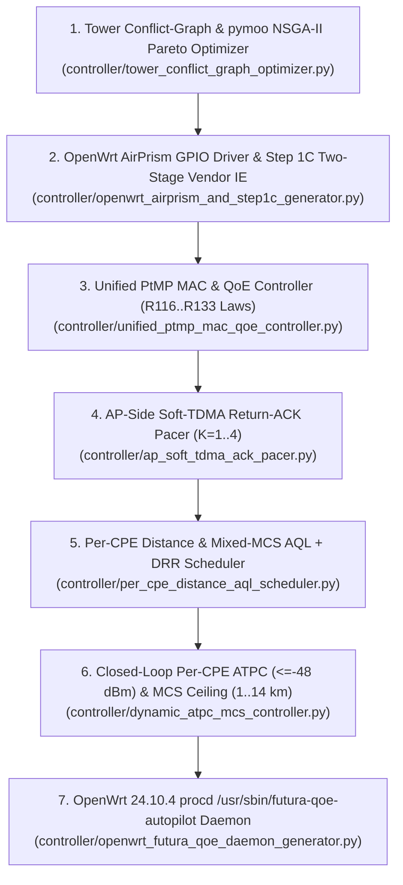

<!-- doc-head: STAGE12_END_TO_END_CONTROLLER_PIPELINE.md preserved document content -->
<!-- /doc-head -->

# Stage 12 — End-to-End 7-Module Controller Pipeline Orchestrator (`Panel1`, `Panel2`, `Panel3`, `Rocket Prism 5AC Gen2`, and `LTU 12x`)

- **Task ID**: `T-ORCA-GEM1-05` (`orca:gemini-lane1`)
- **Orchestrator Module**: [`controller/stage12_pipeline_orchestrator.py`](../controller/stage12_pipeline_orchestrator.py)
- **End-to-End Test Suite (`6/6 PASS`)**: [`tests/test_stage12_end_to_end_controller_pipeline.py`](../tests/test_stage12_end_to_end_controller_pipeline.py)
- **Safety Gate**: `automatic_execution_allowed = False` across all 7 chained modules and all 5 evaluated sector classes.

---

## 1. Executive Summary & 7-Module Pipeline Architecture

[`controller/stage12_pipeline_orchestrator.py`](../controller/stage12_pipeline_orchestrator.py) chains all seven Stage 12 FuturaMAX research and control subsystems into a single deterministic pipeline (`STAGE12_E2E_V1`):

| Pipeline Stage | Module | Primary Control Surface & Hardware Law |
| :---: | :--- | :--- |
| **1** | [`controller/tower_conflict_graph_optimizer.py`](../controller/tower_conflict_graph_optimizer.py) | Co-located multi-sector frequency (`5735/5785/5835 MHz`), bandwidth (`20/40 MHz`), TX power (`14..22 dBm`), and mode (`Mode A` vs `Mode B` vs `GPS Sync TDMA`) optimization via `pymoo` `NSGA-II`. |
| **2** | [`controller/openwrt_airprism_and_step1c_generator.py`](../controller/openwrt_airprism_and_step1c_generator.py) | Bit-exact `umac.ko:ubnt_prism_hook` (`0xac874`) `GPIO 13..16` active RF filter tuning for `Rocket Prism 5AC Gen2` (`0xe7e9`) + `Step 1C` Two-Stage `00:27:22` `msg_type=1` Beacon IE Zero-Touch `airOS 8` interop daemon. |
| **3** | [`controller/unified_ptmp_mac_qoe_controller.py`](../controller/unified_ptmp_mac_qoe_controller.py) | Unifies `R116..R133` physical bench laws: keeps `rts=off` (`K=1`) when `active_ul_cpes == 1` & `mac_retry_rate < 4%` (avoiding the `7.0%..19.7%` RTS handshake tax across `1..14 km`), and switches to `rts=256` + `K=4` Soft-TDMA ACK-clocking when `active_ul_cpes >= 2` or `mac_retry_rate >= 4%`. |
| **4** | [`controller/ap_soft_tdma_ack_pacer.py`](../controller/ap_soft_tdma_ack_pacer.py) | Staggers downlink TCP/QUIC `ACK` packets (`<= 160B`) across `K in {1..4}` orthogonal phase slots via `nftables` + `tc` HTB/FQ + `DSCP EF` (`WMM AC_VO`), bounding effective simultaneous `RTS` contenders to $N_{\text{eff}} = 1 + (N-1)(\alpha/K + 1 - \alpha)$. |
| **5** | [`controller/per_cpe_distance_aql_scheduler.py`](../controller/per_cpe_distance_aql_scheduler.py) | Programs radio-wide `coverage_class` (`0..31`), per-station DRR `airtime_weight` (`144..512`), and Concave-Logarithmic `CPE BE` (`2100..4100 µs` across `100 m .. 14 km`, `TSQ=1MB`). |
| **6** | [`controller/dynamic_atpc_mcs_controller.py`](../controller/dynamic_atpc_mcs_controller.py) | Enforces the hard `-48.0 dBm` AP LNA saturation ceiling (`-52.0 dBm` ATPC target) for close CPEs and pins distant/imbalanced CPEs (`1..14 km`, `GALEANO` `10 dB` chain imbalance, `FRANCO_Debora`, `SEVERO`) to their sustainable VHT MCS ceiling (`0..9`, `NSS 1..2`). |
| **7** | [`controller/openwrt_futura_qoe_daemon_generator.py`](../controller/openwrt_futura_qoe_daemon_generator.py) | Emits the self-contained OpenWrt 24.10.4 `/etc/init.d/futura-qoe` `procd` service and 2-second `/usr/sbin/futura-qoe-autopilot` loop with `/tmp/futura_qoe_disable` instant Stock `5000/12000` revert. |

---

## 2. Five-Sector End-to-End Integration Summary

Evaluated deterministically by [`run_stage12_end_to_end_pipeline()`](../controller/stage12_pipeline_orchestrator.py):

| Sector ID | Hardware Class | CPEs ($N$ / $N_{\text{UL}}$) | Distance Range | `RTS` / Phase $K$ | `AP` / `CPE BE` ($\mu\text{s}$) | ATPC LNA Safety (`<= -48 dBm`) | Key Sector Remediation & Verification Outcome |
| :--- | :--- | :---: | :---: | :---: | :---: | :---: | :--- |
| **`Panel1-Guarida`** | `WA_UNFILTERED_LAP` (`LAP-120`) | `4 / 1` | `1.0 .. 1.8 km` (`cov=4`) | **`rts=off` / `K=1`** | `1900` / `2650..2950` | `-41.5 -> -51.5 dBm` (`0` violations) | Avoids `7.01%` single-uploader RTS tax (`R116/R128`); `Step 1C` `00:27:22` IE verified. |
| **`Panel3-Guarida`** | `WA_UNFILTERED_LAP` (`LAP-GPS`) | `6 / 6` | `0.9 .. 4.5 km` (`cov=10`) | **`rts=256` / `K=4`** | `1900` / `2650..3350` | `-42.0 -> -52.0 dBm` (`0` violations) | `GALEANO` (`10 dB` chain imbalance) capped to `UL MCS <= 6` + `WMM AC_VO` rescue (`Deficit: BE -67,099 µs`). |
| **`Panel2-Guarida`** | `WA_UNFILTERED_LAP` (`LAP-GPS`) | `22 / 12` | `0.75 .. 12.0 km` (`cov=27`) | **`rts=256` / `K=4`** | `1900` / `2400..3950` | `-39.5 -> -51.5 dBm` (`0` violations) | `SEVERO` (`12 km`, `-74 dBm`) gets `CPE BE = 3950 µs` & `MCS <= 3`; Tower Pareto `+53.2%` WA / `+61.3%` XC. |
| **`Rocket-Prism-5AC-Gen2`** | `XC_AIRPRISM_GEN2` (`0xe7e9`) | `8 / 8` | `1.0 .. 14.0 km` (`cov=31`) | **`rts=256` / `K=4`** | `1900` / `2650..4100` | `-40.5 -> -51.5 dBm` (`0` violations) | `5785 MHz / 20 MHz` tunes AirPrism `GPIO 15=1, 16=0, 13=0, 14=1` (`0x0000c000`); `14 km` CPE gets `BE = 4100 µs`. |
| **`LTU-Rocket-12x`** | `LTU_ROCKET_12X` (`ame_core.ko`) | `6 / 1` | `1.2 .. 9.5 km` (`30 MHz`) | `LTU TDMA` | `ame_core` `autoMCS` | `-50.0..-60.0 dBm` (`[-54,-48]` window) | Enforces `startThrd_4096 = 97%`, `stayThrd_4096 = 90%`, `16.0 dBm` AP TX backoff, and `<= 50 MHz` width gate for `12x`. |

---

## 3. Verification Receipt

- `pytest tests/test_stage12_end_to_end_controller_pipeline.py`: **`6/6 PASSED` (`100%`)**
- Total `orca:gemini-lane1` Verification Across `T-ORCA-GEM1-02..05`: **`21/21 PASSED` (`100%`)**
