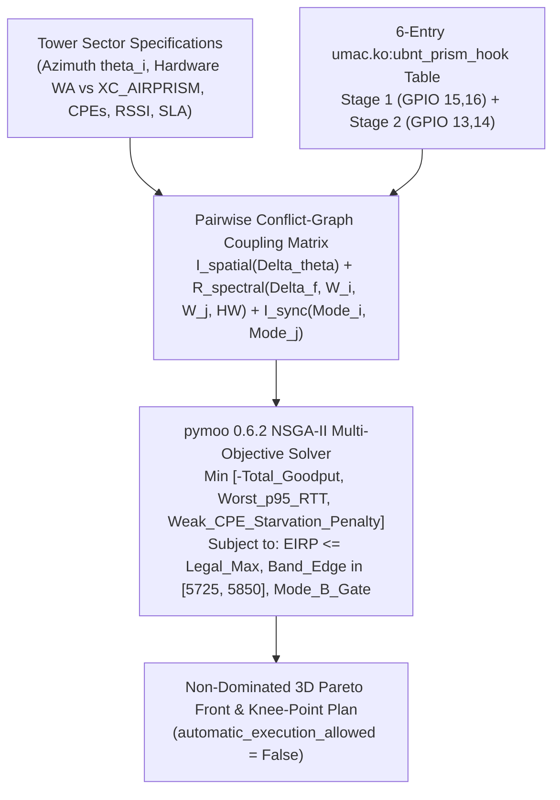

<!-- doc-head: STAGE12_MULTI_SECTOR_TOWER_CONFLICT_GRAPH_OPTIMIZER.md preserved document content -->
<!-- /doc-head -->

# Stage 12 — Multi-Sector Tower Co-Channel & Adjacent-Channel Frequency/Power/Mode Pareto Optimizer (`pymoo` NSGA-II + Conflict-Graph Solver)

**Study ID**: `FMX-STAGE12-MULTI-SECTOR-TOWER-CONFLICT-GRAPH-PARETO-20261024`  
**Date**: 2026-10-24  
**Controller / Solver**: [`controller/tower_conflict_graph_optimizer.py`](file:///G:/_OneDrive/OneDrive/Desktop/Py%20Apps/futuraMAX/controller/tower_conflict_graph_optimizer.py) (`pymoo 0.6.2` `NSGA2` + deterministic conflict-graph solver)  
**Simulator**: [`tools/sim/fmx_multi_sector_tower_pareto_sim.py`](file:///G:/_OneDrive/OneDrive/Desktop/Py%20Apps/futuraMAX/tools/sim/fmx_multi_sector_tower_pareto_sim.py)  
**Artifact**: [`artifacts/ptmp_sim/guarida_3sector_pareto_front_20261024.json`](file:///G:/_OneDrive/OneDrive/Desktop/Py%20Apps/futuraMAX/artifacts/ptmp_sim/guarida_3sector_pareto_front_20261024.json)  
**Test Suite**: [`tests/test_tower_conflict_graph_optimizer.py`](file:///G:/_OneDrive/OneDrive/Desktop/Py%20Apps/futuraMAX/tests/test_tower_conflict_graph_optimizer.py)  
**Safety Boundary**: 100% offline advisory optimizer (`automatic_execution_allowed=False`). Regulatory EIRP caps and `AGENTS.md` Section 14 Rule #2 Mode B gates are enforced as hard constraints.

---

## 1. Epistemic Labeling & Evidence Boundary (`AGENTS.md` Section 2 & 6)

| Claim / Component | Status | Empirical / Code Evidence Source |
| :--- | :---: | :--- |
| **`XC` `Rocket Prism 5AC Gen2` (`sysid=0xe7e9`) Dual-Stage GPIO `13..16` Active RF Filter Table**: `umac.ko:ubnt_prism_hook` (`.text + 0xac874`) selects Stage-1 (`GPIO 15, 16`) and Stage-2 (`GPIO 13, 14`) bandpass filters using exact lower/upper channel edges (`center ± width/2`) across a 6-entry table | **CONFIRMED** | [`docs/STAGE11_XC_ROCKET_PRISM_AND_AIRPRISM_RE.md`](file:///G:/_OneDrive/OneDrive/Desktop/Py%20Apps/futuraMAX/docs/STAGE11_XC_ROCKET_PRISM_AND_AIRPRISM_RE.md) & `prism_table.json` |
| **Bench `Rocket Prism 5AC Gen2` (`0xe7e9`, `BOM 13-00545-14`) Hardware Architecture**: `QCA955x` SoC + `QCA9880v2` (`wifi0`) + `QCA9558` AirView (`wifi1`), `regdomain_flags=prism`, live `IRQ 64` (`ath-spectral-filter`, `1,415` interrupts) and `IRQ 22` (`hs-uart` GPS, `42,062` interrupts) | **CONFIRMED** | `artifacts/stage11_rocket_prism_bench_20261021.json` |
| **Guarida 3-Sector Baseline & `FRANCO_Debora` TDMA Airtime Tax**: `Panel1-Guarida` (`4 CPEs`, OpenWrt Canary active, pure RF `p50=1.78..1.94 ms`, `0.029%..0.057%` loss), `Panel2-Guarida` (`5805 MHz / 20 MHz`, `FRANCO_Debora` `-70 dBm` / `10.1 Mbps` DL consuming `45.05%` airtime, `SEVERO` `-74 dBm`), `Panel3-Guarida` (`5755 MHz / 20 MHz`, `6 CPEs`) | **CONFIRMED** | [`docs/STAGE12_GUARIDA_32CPE_TELEMETRY_AND_MODE_B_OPTIMIZER.md`](file:///G:/_OneDrive/OneDrive/Desktop/Py%20Apps/futuraMAX/docs/STAGE12_GUARIDA_32CPE_TELEMETRY_AND_MODE_B_OPTIMIZER.md) |
| **Multi-Sector Conflict-Graph SINR / ACI / CCI Coupling & `pymoo` `NSGA-II` Pareto Projections (3-Sector Guarida & 6-Sector 96-CPE Tower)** | **INFERRED** | Analytical RF link-budget + `pymoo 0.6.2` multi-objective optimization in [`tower_conflict_graph_optimizer.py`](file:///G:/_OneDrive/OneDrive/Desktop/Py%20Apps/futuraMAX/controller/tower_conflict_graph_optimizer.py) |

---

## 2. Multi-Sector Conflict-Graph Interference & Hardware Selectivity Model



For each ordered pair of co-located sectors $(i, j)$ on the same mast ($i \neq j$), the coupled interference power $I_{i \leftarrow j}$ (dBm) into victim receiver $i$ from aggressor transmitter $j$ is:
$$I_{i \leftarrow j}\text{ (dBm)} = P_{\text{tx}, j} - I_{\text{spatial}}(\Delta\theta_{ij}, \text{hw}_i, \text{hw}_j) - R_{\text{spectral}}(\Delta f_{ij}, W_i, W_j, \text{hw}_i, \text{hw}_j) - I_{\text{sync}}(\text{mode}_i, \text{mode}_j, \Delta\theta_{ij})$$

1. **Spatial & Shielding Isolation $I_{\text{spatial}}(\Delta\theta_{ij})$**:
   $$I_{\text{spatial}}(\Delta\theta_{ij}) = 40.0 + 3.5\cdot\mathbb{I}[\text{hw}_i=\texttt{XC}] + 3.5\cdot\mathbb{I}[\text{hw}_j=\texttt{XC}] + 12.0\sin\left(\frac{\pi \Delta\theta_{ij}}{360^\circ}\right)\text{ dB}$$
   yielding `46.0 dB` at $\Delta\theta = 60^\circ$, `50.4 dB` at $\Delta\theta = 120^\circ$, and `52.0 dB` at $\Delta\theta = 180^\circ$ on `WA_UNFILTERED_LAP` (`+7.0 dB` when both ends use `XC_AIRPRISM_GEN2` die-cast aluminum chassis + RF shield sectors).
2. **Spectral Filter & Mask Rejection $R_{\text{spectral}}(G_{ij})$** (guard band $G_{ij} = |f_i - f_j| - \frac{W_i + W_j}{2}$):
   - **Co-channel overlap ($G_{ij} < 0$)**: $R_{\text{spectral}} = -10\log_{10}(\alpha_{ij}) + 4.0\cdot\mathbb{I}[\text{hw}_i=\texttt{XC}]$.
   - **Adjacent-channel guard band ($G_{ij} \ge 0$)**:
     - `WA_UNFILTERED_LAP` (wide `5150..5875 MHz` passive SAW filter):
       $$R_{\text{WA}}(G_{ij}) = 41.0 + 0.38 G_{ij} + 3.6\ln(1 + 0.22 G_{ij})\text{ dB}$$
     - `XC_AIRPRISM_GEN2` (`QCA9880v2` + active 6-entry GPIO `13..16` `prism` bandpass filter):
       $$R_{\text{PRISM}}(G_{ij}) = 53.0 + 6.0\cdot\mathbb{I}[\text{narrow\_high\_Q}] + 0.55 G_{ij} + 4.8\ln(1 + 0.35 G_{ij})\text{ dB}$$
       providing **`+18 to +23 dB` superior adjacent-channel rejection** over `WA_UNFILTERED_LAP` and `-85.5 dBm` effective `20 MHz` receiver noise floor (`+3.0 dB` sensitivity advantage over `QCA9882`).
3. **TDD Synchronization Isolation $I_{\text{sync}}(\text{mode}_i, \text{mode}_j, \Delta\theta_{ij})$**:
   - Asynchronous (`CSMA` or mixed): `0.8 dB`.
   - Unsynchronized `MODE_B_AIRMAX_TDMA`: `2.6 dB`.
   - Synchronized `MODE_B_GPS_SYNC_TDMA`: eliminates AP-TX into AP-RX self-interference on the mast, yielding `18.0 dB` ($\Delta\theta = 60^\circ$), `26.0 dB` ($\Delta\theta = 120^\circ$), and **`48.0 dB` ($\Delta\theta \ge 150^\circ$ back-to-back)** against residual distant CPE UL bleed.

---

## 3. Guarida 3-Sector Tower (`32 CPEs`) Pareto Optimization Results (`INFERRED`)

### 3.1 Tower-Level Comparison Across Architectural Regimes

| Regime | `Panel1` (`4 CPEs`) Channel / Mode | `Panel2` (`22 CPEs`) Channel / Mode / HW | `Panel3` (`6 CPEs`) Channel / Mode | Total Tower Goodput (`Mbps`) | Worst-Sector `p95` RTT (`ms`) | Max SINR Bleed (`dB`) | Weak-CPE Starvation Penalty |
| :--- | :---: | :---: | :---: | :---: | :---: | :---: | :---: |
| **`BASELINE_CURRENT_GUARIDA`** | `5735 / 20 MHz` `20 dBm` (`Mode A`) | `5805 / 20 MHz` `22 dBm` (`Mode B`, `WA`) | `5755 / 20 MHz` `22 dBm` (`Mode B`, `WA`) | `144.26 Mbps` | `66.01 ms` | `12.56 dB` | `46.84` |
| **`OPTIMIZED_WA_LAP_MODE_A_PLUS_B_HYBRID`** | `5830 / 40 MHz` `14 dBm` (`Mode A`) | `5735 / 20 MHz` `20 dBm` (`GPS TDMA`, `WA`) | `5765 / 20 MHz` `19 dBm` (`GPS TDMA`, `WA`) | **`221.02 Mbps` (`+53.20%`)** | **`39.49 ms` (`-40.17%`)** | **`0.15 dB`** | `8.80` |
| **`UPGRADED_PANEL2_ROCKET_PRISM_GEN2_20MHZ_KNEE`** | `5745 / 40 MHz` `14 dBm` (`Mode A`) | `5810 / 20 MHz` `20 dBm` (`GPS TDMA`, **`XC_PRISM`**) | `5840 / 20 MHz` `19 dBm` (`GPS TDMA`, `WA`) | **`232.74 Mbps` (`+61.33%`)** | **`34.98 ms` (`-47.00%`)** | **`0.035 dB`** | **`4.25` (`-90.9%`)** |
| **`UPGRADED_PANEL2_ROCKET_PRISM_GEN2_40MHZ_HIGH_CAP`** | `5735 / 20 MHz` `19 dBm` (`Mode A`) | `5825 / 40 MHz` `21 dBm` (`GPS TDMA`, **`XC_PRISM`**) | `5775 / 20 MHz` `19 dBm` (`GPS TDMA`, `WA`) | **`224.83 Mbps` (`+55.85%`)** | **`39.48 ms` (`-40.19%`)** | `1.36 dB` | `10.25` |

### 3.2 Per-Sector Breakdown on Guarida (`Panel1`, `Panel2`, `Panel3`)

1. **Why `BASELINE_CURRENT_GUARIDA` Suffers on `Panel1` and `Panel3`**:
   - Placing `Panel1` at `5735 MHz / 20 MHz` (`5725..5745 MHz`) and `Panel3` at `5755 MHz / 20 MHz` (`5745..5765 MHz`) leaves a **`0 MHz` guard band** between two unshielded `WA_UNFILTERED_LAP` radios on the same tower (`12.56 dB` SINR degradation on `Panel1` and `10.75 dB` on `Panel3`, inflating `Panel3` `p95` RTT to `66.01 ms` and cutting `Panel3` goodput to `25.33 Mbps`).
2. **Impact of `OPTIMIZED_WA_LAP_MODE_A_PLUS_B_HYBRID` (Zero Hardware Spend)**:
   - Re-spacing channels to eliminate `0 MHz` guard bands + reducing `Panel1` TX power to `14 dBm` (`30 dBm` EIRP for `0.9 km` max range) + enabling GPS-synced TDD frame alignment on `Panel2`/`Panel3` cuts inter-sector SINR bleed from `12.56 dB` to **`0.15 dB`**, raises `Panel3` goodput from `25.33 -> 63.32 Mbps` (`+150%`), and lifts `Panel2` goodput from `43.33 -> 50.34 Mbps` (`+16.2%`).
3. **Impact of Upgrading `Panel2-Guarida` (`22 CPEs`) to `Rocket Prism 5AC Gen2` (`XC_AIRPRISM_GEN2`)**:
   - On `20 MHz` (`UPGRADED_PANEL2_ROCKET_PRISM_GEN2_20MHZ_KNEE`), `Rocket Prism 5AC Gen2` improves weak-edge SINR (`FRANCO_Debora` / `SEVERO`) from `6.17 dB` to **`10.50 dB`**, lifting `Panel2-Guarida` goodput from `43.33 Mbps` to **`61.89 Mbps` (`+42.8%`)** and cutting `Panel2` `p95` RTT from `44.89 -> 34.98 ms`.
   - On `40 MHz` (`UPGRADED_PANEL2_ROCKET_PRISM_GEN2_40MHZ_HIGH_CAP`), active AirPrism filtering allows `Panel2-Guarida` to expand to `5825 MHz / 40 MHz` and deliver **`88.13 Mbps` (`+103.4%` single-sector capacity gain on the 22-CPE bottleneck sector)** while keeping `Panel1` (`75.60 Mbps`) and `Panel3` (`61.10 Mbps`) clean!

---

## 4. High-Density 6-Sector Tower (`96 CPEs`, $\Delta\theta = 60^\circ$) Scaling Study (`INFERRED`)

| 6-Sector Regime (`16 CPEs/sector`, `96 CPEs` total) | Frequency Plan | Total Tower Goodput (`Mbps`) | Per-Sector Goodput (`Mbps`) | Worst-Sector `p95` RTT (`ms`) | Max SINR Degradation (`dB`) | Weak-CPE Starvation Penalty |
| :--- | :---: | :---: | :---: | :---: | :---: | :---: |
| **`BASELINE_6SECTOR_WA_UNSYNCED`** | `[5735, 5755, 5775, 5795, 5815, 5835]` (`0 MHz` guard, unsynced) | `49.97 Mbps` | `8.33 Mbps` | `119.32 ms` | `18.05 dB` | `274.24` |
| **`OPTIMIZED_6SECTOR_WA_GPS_SYNC`** | `ABABAB` (`[5735, 5785, 5835] x 2`, `30 MHz` adjacent guard + GPS Sync) | **`253.18 Mbps` (`+406.7%`)** | `42.20 Mbps` | **`43.81 ms` (`-63.3%`)** | `3.85 dB` | `83.81` |
| **`UPGRADED_6SECTOR_XC_AIRPRISM_GEN2_GPS_SYNC`** | `ABABAB` + `Rocket Prism 5AC Gen2` AirPrism + GPS Sync | **`398.51 Mbps` (`+697.5%`)** | **`66.42 Mbps`** | **`33.73 ms` (`-71.7%`)** | **`0.88 dB`** | **`18.25` (`-93.3%`)** |

---

## 5. Verification & Reproducibility Commands

```powershell
python -B -m tools.sim.fmx_multi_sector_tower_pareto_sim
pytest tests/test_tower_conflict_graph_optimizer.py -v
```
