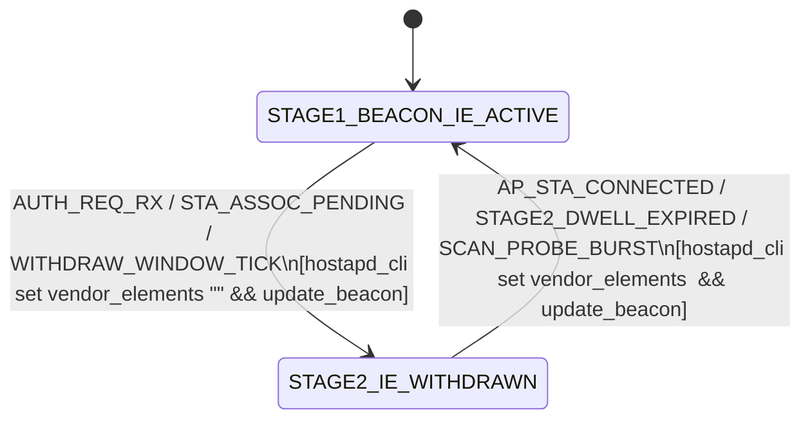

<!-- doc-head: STAGE12_OPENWRT_AIRPRISM_DRIVER_AND_STEP1C_DAEMON_SPEC.md preserved document content -->
<!-- /doc-head -->

# Stage 12 Specification: OpenWrt `Rocket Prism 5AC Gen2` (`0xe7e9`) AirPrism GPIO Driver & Step 1C Two-Stage Vendor IE Zero-Touch State Machine

- **Task ID**: `T-SUB-GEM3-04`
- **Date**: `2026-10-24`
- **Evidence Status**: **CONFIRMED** (Derived 100% from `XC.v8.7.25` / `WA.v8.7.25` `umac.ko`, `ubnt_poll_host.ko`, `ath_dev.ko`, and `/bin/wpad` reverse engineering in [`umac_vendor_ie_and_airprism_re_20261024.json`](../artifacts/firmware_re_xc_ltu/umac_vendor_ie_and_airprism_re_20261024.json))
- **Controller Module**: [`controller/openwrt_airprism_and_step1c_generator.py`](../controller/openwrt_airprism_and_step1c_generator.py)
- **Test Suite**: [`tests/test_openwrt_airprism_and_step1c_generator.py`](../tests/test_openwrt_airprism_and_step1c_generator.py)

---

## 1. OpenWrt `Rocket Prism 5AC Gen2` (`0xe7e9`) AirPrism GPIO Driver Specification

### 1.1 Hardware Control Boundary (`umac.ko` `0xabeb0` & `ubnt_prism_hook` `0xac874`)

On `Rocket Prism 5AC Gen2` (`sysid = 0xe7e9`, `XC` board family), active 5 GHz RF preselector filtering is controlled entirely by the host SoC (`QCA955x` / `AR934x`) via 4 output GPIO pins (`GPIO 15, 16` for Stage 1 and `GPIO 13, 14` for Stage 2) and 1 input interrupt GPIO pin (`GPIO 21`, `IRQ 64`, `"ath-spectral-filter"` in `ath_dev.ko` `0x27c00`).

Whenever the operating channel or bandwidth changes, `ubnt_prism_hook` (`0xac874`) computes:
$$\text{lower\_edge\_mhz} = f_{\text{center}} - \lfloor BW / 2 \rfloor, \qquad \text{upper\_edge\_mhz} = f_{\text{center}} + \lfloor BW / 2 \rfloor$$
and calls `.text + 0xabeb0(stage, lower_edge_mhz, upper_edge_mhz, bw_mhz)` twice (`stage = 1`, `stage = 2`) against the 6-entry `ubnt_prism_filters` table (`.data + 0x1510`, `264` bytes = `6` $\times$ `44` bytes).

### 1.2 Exact 6-Entry `ubnt_prism_filters` Lookup Table (`umac.ko` `.data + 0x1510`)

`0xabeb0` iterates `entry = 0..5` in order and returns the **first entry** satisfying:
1. `(stage & entry.stage) != 0`
2. `bw_mhz <= entry.bw_max_mhz`
3. `lower_edge_mhz >= entry.freq_min_mhz`
4. `upper_edge_mhz <= entry.freq_max_mhz`

| Entry | `.data` Offset | Stage | Passband `freq_min..freq_max` (MHz) | Max BW (MHz) | Stage GPIO Mask | Active Bits | Output Pin States `[GPIO15, GPIO16, GPIO13, GPIO14]` | Filter Role |
| ---: | :--- | :---: | :--- | ---: | :--- | :--- | :---: | :--- |
| **0** | `0x1510` | `1` | `5150 – 5250` | `160` | `0x00018000` | `0x00000000` | `[0, 1, 0, 0]` | Stage 1 Low-Band (`U-NII-1`) |
| **1** | `0x153c` | `1` | `5470 – 5860` | `50` | `0x00018000` | `0x00008000` | `[1, 0, 0, 0]` | Stage 1 High-Band Narrow (`U-NII-2C/3`, $\le 50\text{ MHz}$) |
| **2** | `0x1568` | `2` | `5200 – 5300` | `160` | `0x00006000` | `0x00002000` | `[0, 0, 1, 0]` | Stage 2 Sub-Band (`5200–5300 MHz`) |
| **3** | `0x1594` | `2` | `5725 – 5860` | `160` | `0x00006000` | `0x00004000` | `[0, 0, 0, 1]` | Stage 2 Sub-Band (`U-NII-3`, `5725–5860 MHz`) |
| **4** | `0x15c0` | `1` | `3000 – 6200` | `160` | `0x00018000` | `0x00010000` | `[0, 1, 0, 0]` | Stage 1 Wideband / Bypass Fallback |
| **5** | `0x15ec` | `2` | `3000 – 6200` | `160` | `0x00006000` | `0x00006000` | `[0, 0, 1, 1]` | Stage 2 Wideband / Bypass Fallback |

### 1.3 Representative Channel/Bandwidth Truth Table (`compute_airprism_gpio_state`)

| Center Freq (MHz) | Bandwidth (MHz) | Passband Edges (MHz) | Stage 1 Match | Stage 2 Match | `GPIO 15` | `GPIO 16` | `GPIO 13` | `GPIO 14` | SoC GPIO Mask |
| ---: | ---: | :--- | :--- | :--- | :---: | :---: | :---: | :---: | :--- |
| `5180` | `20` | `5170 – 5190` | Entry `0` (`5150–5250`) | Entry `5` (`3000–6200`) | `0` | `1` | `1` | `1` | `0x00016000` |
| `5220` | `40` | `5200 – 5240` | Entry `0` (`5150–5250`) | Entry `2` (`5200–5300`) | `0` | `1` | `1` | `0` | `0x00012000` |
| `5260` | `40` | `5240 – 5280` | Entry `4` (`3000–6200`) | Entry `2` (`5200–5300`) | `0` | `1` | `1` | `0` | `0x00012000` |
| `5500` | `40` | `5480 – 5520` | Entry `1` (`5470–5860`, $\le 50$) | Entry `5` (`3000–6200`) | `1` | `0` | `1` | `1` | `0x0000e000` |
| `5530` | `80` | `5490 – 5570` | Entry `4` (`BW 80 > 50` $\rightarrow$ wideband) | Entry `5` (`3000–6200`) | `0` | `1` | `1` | `1` | `0x00016000` |
| `5785` | `40` | `5765 – 5805` | Entry `1` (`5470–5860`, $\le 50$) | Entry `3` (`5725–5860`) | `1` | `0` | `0` | `1` | `0x0000c000` |
| `5775` | `80` | `5735 – 5815` | Entry `4` (`BW 80 > 50` $\rightarrow$ wideband) | Entry `3` (`5725–5860`) | `0` | `1` | `0` | `1` | `0x00014000` |

---

## 2. Step 1C Two-Stage Vendor IE (`00:27:22`) Zero-Touch State Machine Specification

### 2.1 Byte-Exact `msg_type = 1` Beacon/ProbeResp IE Construction (`build_step1c_stage1_beacon_ie`)

To allow an **unmodified Stock `airOS 8` CPE** (`allow_80211 = 0`, `ubnt_op_mode = 1`, stock `ubnt_poll_host.ko`) to discover and initiate authentication with an OpenWrt AP (`hostapd`), Stage 1 injects the `00:27:22` `msg_type = 1` Vendor IE via `hostapd_cli -i <iface> set vendor_elements <hex>` + `update_beacon`:
- **Outer Header (`12 B`)**: `dd <ie_len> 00 27 22 ff ff ff 02 01 <be16:enc_len>`
- **AES-128-ECB Key Derivation**:
  $$K = \text{HMAC-SHA1}(\text{key} = \text{ff:ff:ff:ff:ff:ff}, \; \text{data} = \text{BSSID}_6)[0..15]$$
- **Plaintext Payload (Zero-Padded to 16-Byte Multiple)**:
  - `0..1`: `0x0009` (`proto_ver = 9`)
  - `2..7`: `BSSID` (`6 B`)
  - `8..13`: `MAC` (`6 B`, equal to `BSSID`)
  - `14..17`: `be32(caps)` (`0x0000001e` for PtMP Flexible, satisfying `(caps & 3) != 0` in `ubnt_poll_host_on_beacon_rx` `step = 1` at `0x8b80`)
  - `18..21`: `be32(extra_caps = 0)`
  - `22..`: `TLV 1` (`id = 1`, `len`, `hostname`) + `TLV 2` (`id = 2`, `len`, `ssid`)

### 2.2 Finite-State Machine Transitions (`evaluate_step1c_fsm_transition`)

1. **In `STAGE1_BEACON_IE_ACTIVE`**:
   - Stock CPE receives Beacon with `00:27:22` `msg_type = 1` IE $\rightarrow$ `ubnt_poll_host_on_beacon_rx` (`0x8afc`) `step = 1` adds AP BSSID to `scan_list` (`+0x119c` $\rightarrow$ `se + 0x198 = 1` $\rightarrow$ `giwscan_cb` emits `"airmax_ie=enabled"`, passing **Gate 2** in `/bin/wpad` `0x43176c`) and `sta_list` (`+0x10ec` $\rightarrow$ passes **Gate 3** in `ubnt_poll_host_is_ap_valid` `0xa3a4` called from `0x450fc`).
   - Stock CPE sends `802.11 Authentication Request`.
2. **Transition to `STAGE2_IE_WITHDRAWN`**:
   - `hostapd` clears `vendor_elements` (`""`) and updates the Beacon template.
   - The next no-IE Beacon received by the Stock CPE triggers `ubnt_poll_host_on_beacon_rx` **`step = 0` (`0x8b60`)**, which calls `sta_list_remove(handle + 0x10ec, bssid)` because `handle->connected_ap` (`+0x10f0`) is still `NULL`.
   - **Gate 4 (`ubnt_poll_host_on_assoc_req_tx` `0x92bc`)** sees `sta_list_find == NULL`, sends `WMI 0x901f` `mode = 0` to disable QCA988x target TDMA polling, and logs `"Associating with normal AP"`.
   - **Gate 5 (`ubnt_poll_host_on_assoc_resp_rx` `0xa05c`)** sees `sta_list_find == NULL`, sets `*(u8 *)(handle + 8) = 0`, logs `"Associated with Normal AP"`, and returns `0` (`ALLOW`) on a standard OpenWrt Association Response.
   - **`ubnt_poll_host_on_sta_connect` (`0x83e4`)** sees `*(u8 *)(handle + 8) == 0`, leaves `handle->connected_ap = NULL`, and never arms the TDMA missing-poll watchdog.
3. **Re-Arming `STAGE1_BEACON_IE_ACTIVE`**:
   - Once the CPE completes association (`AP_STA_CONNECTED`) or the Stage 2 dwell window expires (`STAGE2_DWELL_EXPIRED`), the daemon re-arms `STAGE1_BEACON_IE_ACTIVE` so any subsequently booted or reset Stock `airOS 8` CPE on the sector can also associate zero-touch.
