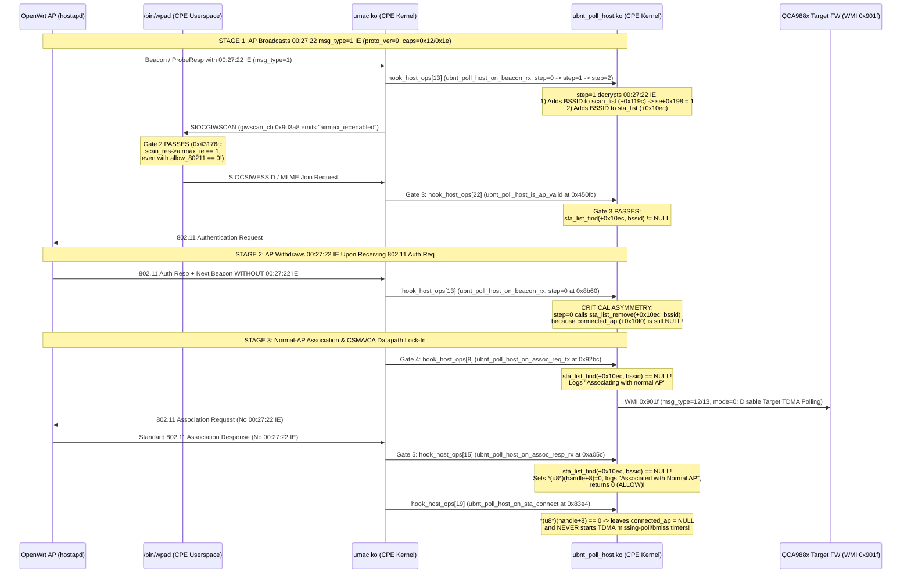

<!-- doc-head: STAGE12_UMAC_BEACON_IE_AND_AIRPRISM_CALLGRAPH_RE.md continuation 2 of 2; source lines preserved -->
<!-- /doc-head -->

[Document router](STAGE12_UMAC_BEACON_IE_AND_AIRPRISM_CALLGRAPH_RE.md) | Part 2/2
 [Stage 12 Deep Reverse Engineering: `umac.ko` Ubiquiti Vendor IE (`0x00156d` vs `0x002722`) State Machine & `ubnt_prism_hook` / `ath_dev.ko` Call-Graph (`WA.v8.7.25` & `XC.v8.7.25`)](STAGE12_UMAC_BEACON_IE_AND_AIRPRISM_CALLGRAPH_RE_CONTINUATION_139684a2de_001.md#stage-12-deep-reverse-engineering-umacko-ubiquiti-vendor-ie-0x00156d-vs-0x002722-state-machine--ubnt_prism_hook--ath_devko-call-graph-wav8725--xcv8725) |  [1. Executive Summary & Binary Identity (`WA.v8.7.25` vs `XC.v8.7.25`)](STAGE12_UMAC_BEACON_IE_AND_AIRPRISM_CALLGRAPH_RE_CONTINUATION_139684a2de_001.md#1-executive-summary--binary-identity-wav8725-vs-xcv8725) |  [2. Ubiquiti Vendor IE Architecture: OUI `00:15:6d` vs `00:27:22`](STAGE12_UMAC_BEACON_IE_AND_AIRPRISM_CALLGRAPH_RE_CONTINUATION_139684a2de_001.md#2-ubiquiti-vendor-ie-architecture-oui-00156d-vs-002722) |  [2.1 Definitive OUI Split Across the `airOS 8` Firmware (`CONFIRMED`)](STAGE12_UMAC_BEACON_IE_AND_AIRPRISM_CALLGRAPH_RE_CONTINUATION_139684a2de_001.md#21-definitive-oui-split-across-the-airos-8-firmware-confirmed) |  [2.2 `ubnt_poll_host.ko` `00:27:22` Encrypted Vendor IE Wire Format (`msg_type = 1, 2, 3`)](STAGE12_UMAC_BEACON_IE_AND_AIRPRISM_CALLGRAPH_RE_CONTINUATION_139684a2de_001.md#22-ubnt_poll_hostko-002722-encrypted-vendor-ie-wire-format-msg_type--1-2-3) |  [3. Complete 27-Slot `hook_host_ops` Dispatch Table (`ubnt_poll_host.ko` $\leftrightarrow$ `umac.ko`)](STAGE12_UMAC_BEACON_IE_AND_AIRPRISM_CALLGRAPH_RE_CONTINUATION_139684a2de_001.md#3-complete-27-slot-hook_host_ops-dispatch-table-ubnt_poll_hostko-leftrightarrow-umacko) |  [4. `umac.ko` Module Parameters, `ubnt_op_mode`, `ni_ubnt_poll`, and Step 1C Two-Stage IE Withdrawal](STAGE12_UMAC_BEACON_IE_AND_AIRPRISM_CALLGRAPH_RE_CONTINUATION_139684a2de_001.md#4-umacko-module-parameters-ubnt_op_mode-ni_ubnt_poll-and-step-1c-two-stage-ie-withdrawal) |  [4.1 `umac.ko` `__param` Module Parameters & `ubnt_op_mode` Firmware Selection (`CONFIRMED`)](STAGE12_UMAC_BEACON_IE_AND_AIRPRISM_CALLGRAPH_RE_CONTINUATION_139684a2de_001.md#41-umacko-__param-module-parameters--ubnt_op_mode-firmware-selection-confirmed) |  [4.2 `struct ieee80211_node` (`ni`) Ubiquiti Extensions (`CONFIRMED`)](STAGE12_UMAC_BEACON_IE_AND_AIRPRISM_CALLGRAPH_RE_CONTINUATION_139684a2de_001.md#42-struct-ieee80211_node-ni-ubiquiti-extensions-confirmed) |  [4.3 The 5-Gate Stock `airOS 8` STA Association State Machine & Why Step 1C Works (`CONFIRMED`)](STAGE12_UMAC_BEACON_IE_AND_AIRPRISM_CALLGRAPH_RE_CONTINUATION_139684a2de_001.md#43-the-5-gate-stock-airos-8-sta-association-state-machine--why-step-1c-works-confirmed)

<!-- stage822a-payload-begin -->

---

## 5. `XC` (`Rocket Prism 5AC Gen2`) `ubnt_prism_hook` & `ath_dev.ko` `ath-spectral-filter` Call-Graph

### 5.1 Complete Channel/Bandwidth Transition Call-Graph (`CONFIRMED`)

```mermaid
flowchart TD
    subgraph UMAC["umac.ko (QCA988x Offload Control Plane)"]
        A1["ieee80211_set_channel / wlan_set_channel"] --> B1["wmi_unified_pdev_set_channel (0xab2d0)"]
        A2["ol_ath_setTxPowerLimit (0xab5cc)"] -->|"jal at 0xab674 (+0xa8)"| B1
        A3["wmi_unified_vdev_start_send (0xaccd4)<br/>wmi_unified_vdev_restart_send (0xacdd4)<br/>wmi_unified_vdev_start_chan_send (0xaced4)<br/>wmi_unified_vdev_chan_switch_send (0xacfe0)"] -->|"jal at +0x74 / +0x70"| B2["wmi_unified_vdev_start_or_restart_common (0xaca48)"]
        A4["Target WMI Channel Switch Event"] --> B3["wmi_unified_chan_switch_handler (0xa5fe0)"]

        B1 -->|"jal at 0xab538 (+0x268)"| C["ubnt_prism_hook (0xac874)"]
        B2 -->|"jal at 0xacca0 (+0x258)"| C
        B3 -->|"jal at 0xa600c (+0x2c)"| C

        C --> D["ubnthal_get_radio_cap(radio_id, 'prism') (0xac8a0)"]
        D -->|"cap != 0"| E["Compute Passband Edges:<br/>lower = center_mhz - bw_mhz/2 (0xac8fc)<br/>upper = center_mhz + bw_mhz/2 (0xac900)"]
        E --> F1["Stage 1 Lookup: 0xabeb0(type, stage=1, lower, upper)<br/>against ubnt_prism_filters (.data + 0x1510)"]
        E --> F2["Stage 2 Lookup: 0xabeb0(type, stage=2, lower, upper)<br/>against ubnt_prism_filters (.data + 0x1510)"]
        F1 --> G1["gpio_line_config + gpio_line_set:<br/>GPIO 15 = Stage 1 bit 0 (0xac99c..0xac9b0)<br/>GPIO 16 = Stage 1 bit 1 (0xac9b4..0xac9c8)"]
        F2 --> G2["gpio_line_config + gpio_line_set:<br/>GPIO 13 = Stage 2 bit 0 (0xac9cc..0xac9e0)<br/>GPIO 14 = Stage 2 bit 1 (0xac9e4..0xaca08)"]
    end

    subgraph ATHDEV["ath_dev.ko (Direct-Attach AR9380/AR9580 Spectral Scan Driver)"]
        S1["ath_spectral_attach (.text + 0x8aa0)"] -->|"jal at 0x8bbc"| S2["ath_spectral_filter_init (0x27c00)"]
        S2 --> S3["gpio_int_init(GPIO 21) (0x27c18)<br/>request_threaded_irq(IRQ 64, isr=0x27be0, 'ath-spectral-filter') (0x27c40)"]
        S4["ath_spectral_control (0xe424)"] -->|"jal at 0xe4c4 / 0xe578"| S5["ath_spectral_filter_start (0x27cac: gpio_int_enable(21))<br/>ath_spectral_filter_stop (0x27cb4: gpio_int_disable(21))"]
        S3 -.->|"IRQ 64 fires"| S6["ISR .text + 0x27be0:<br/>*(u32 *)(sc->sc_spectral + 0x384) = 1"]
    end
```

### 5.2 `ubnt_prism_filters` Table in `umac.ko` (`.data + 0x1510`, `264` Bytes = `6` $\times$ `44` Bytes)

Each `44`-byte (`11` $\times$ `u32`) entry in `ubnt_prism_filters` encodes the stage (`1` or `2`), passband frequency range (`freq_min_mhz`, `freq_max_mhz`), GPIO stage bitmask (`0x00018000` for Stage 1 GPIO 15/16; `0x00006000` for Stage 2 GPIO 13/14), active GPIO bitmask, individual pin states `[GPIO15, GPIO16, GPIO13, GPIO14]`, and bandwidth limits (`bw_min_mhz`, `bw_max_mhz`):

| Entry | `.data` Offset | Stage | Passband (MHz) | Stage GPIO Mask | Active GPIO Bits | Pin States `[15, 16, 13, 14]` | Bandwidth Range (MHz) | Role |
| ---: | :--- | :---: | :--- | :--- | :--- | :---: | :--- | :--- |
| **0** | `0x1510` | `1` | `5150 – 5250` | `0x00018000` | `0x00000000` | `[0, 1, 0, 0]` | `0 – 160` | Stage 1 Low-Band (`U-NII-1`, `5150–5250 MHz`) |
| **1** | `0x153c` | `1` | `5470 – 5860` | `0x00018000` | `0x00008000` | `[1, 0, 0, 0]` | `0 – 50` | Stage 1 High-Band Narrow (`U-NII-2C / 3`, $\le 50\text{ MHz}$) |
| **2** | `0x1568` | `2` | `5200 – 5300` | `0x00006000` | `0x00002000` | `[0, 0, 1, 0]` | `0 – 160` | Stage 2 Sub-Band (`5200–5300 MHz`) |
| **3** | `0x1594` | `2` | `5725 – 5860` | `0x00006000` | `0x00004000` | `[0, 0, 0, 1]` | `0 – 160` | Stage 2 Sub-Band (`U-NII-3`, `5725–5860 MHz`) |
| **4** | `0x15c0` | `1` | `3000 – 6200` | `0x00018000` | `0x00010000` | `[0, 1, 0, 0]` | `0 – 160` | Stage 1 Wideband / Bypass (`3000–6200 MHz`) |
| **5** | `0x15ec` | `2` | `3000 – 6200` | `0x00006000` | `0x00006000` | `[0, 0, 1, 1]` | `0 – 160` | Stage 2 Wideband / Bypass (`3000–6200 MHz`) |

### 5.3 Architectural Separation Between `umac.ko` `ubnt_prism_hook` and `ath_dev.ko` `ath_spectral_filter_*` (`CONFIRMED`)

1. **`umac.ko` `ubnt_prism_hook` (`0xac874`)**:
   - Drives **4 output GPIO pins** (`GPIO 15, 16` for Stage 1 and `GPIO 13, 14` for Stage 2) via `ubnthal`'s `gpio_line_config(pin, 1)` + `gpio_line_set(pin, bit)` whenever the primary QCA988x offload radio changes channel or bandwidth (`wmi_unified_pdev_set_channel` at `0xab538`, `wmi_unified_vdev_start_or_restart_common` at `0xacca0`, or `wmi_unified_chan_switch_handler` at `0xa600c`).
2. **`ath_dev.ko` `ath_spectral_filter_*` (`0x27be0..0x27cbc`)**:
   - Operates inside `ath_dev.ko` (the direct-attach AR9380/AR9580 HAL driver used for the dedicated airView/spectral radio on dual-radio Prism units).
   - Configures **`GPIO 21` as an input interrupt line** (`gpio_int_init(21)` at `0x27c18`) and registers threaded/hard IRQ **`64` (`0x40 = ATH79_GPIO_IRQ_BASE(43) + 21`)** named `"ath-spectral-filter"` (`request_threaded_irq` at `0x27c40`) with ISR `.text + 0x27be0`.
   - When `GPIO 21` (IRQ `64`) triggers during a spectral scan (`ath_spectral_filter_start` `0x27cac` -> `gpio_int_enable(21)`), the ISR at `0x27be0` sets `*(u32 *)(sc->sc_spectral + 0x384) = 1` (`0x27bf4`) to notify the spectral FFT processor (`ath_process_spectraldata`) that the hardware spectral filter transition has settled.
<!-- stage822a-payload-end -->
