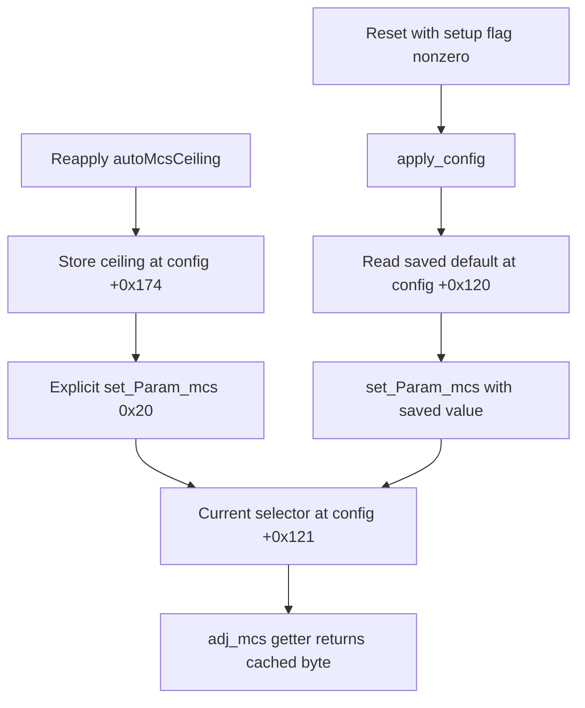

<!-- doc-head: WaveA exact WA module identity and LTU auto-reversion paths -->
WA UMAC660435ed identity resolved;15 parameters,309 WEXT records and34 UPH nodes bound.
Two LTU2.4.2 code paths return adjusted MCS to auto; D2actual2.4.0 cause remains unknown.
Static parser bounds do not authorize runtime writes, training bypass or hardware claims.
All work is local/offline; Antigravity retains live bench ownership.
<!-- /doc-head -->

# Stage12 — WA UMAC and LTU adjusted-MCS state machine

WaveA resolves the exact WA UMAC identity missing from the original248-entry catalog and expands the current catalog to571 disabled entries. LTU analysis proves two paths to automatic MCS in the retained2.4.2 code; it does **not** establish which path caused the sparse D2 observations on2.4.0. This qualified negative attribution result is preserved, rather than inventing a daemon or a missing AP-session condition.

## WA image and extracted modules

Input `firmware/WA.8.7.25.bin`:10278253 B, SHA256 `e87ffba1f0ed9e245b42541a86044f7688f3a7ba1ca783a30263ad7d9ad3dbc3`; header `WA.ar934x.v8.7.25.48568.260730.1010`. Its rootfs PART starts at file offset1233556 with payload9043968 B. Filesystem `bytes_used=8803133` matches the held `WA.8.7.25.squashfs` prefix exactly, SHA256 `2e9e1237f8c8ea8bc11c2c11a627f540d4af8ee64d43ce947d2f5282fdd8eea0`; differing trailing bytes were not rewritten. No signature/CRC/flash validator or boot acceptance is claimed.

Exact module sizes and full hashes are in [WA facts](../artifacts/autoresearch/waves_abcd_20261024/wave_a_wa/facts_final.json). Extracted modules reside under `artifacts/firmware_re_xc_ltu/wa_8725_rootfs/lib/modules/2.6.32.68/`: `umac.ko`, `ath_dev.ko`, `ath_rate_atheros.ko`, `ath_hal.ko` and `ubnt_poll_host.ko`. UMAC matches the historical expected SHA256 `660435ed9c50f1390945535a975565d7234543e01933644bf99dd9deca1b2cd6`,2356432 B. UPH matches `bfc3f499a086766917fcbbf1a52d0fac496ad237ae1671c4e640cccdd122c2b5`,189880 B.

`ubnt_spectral.ko` is absent in the archive listing. `ath_spectral.ko` is a distinct observed name and is not silently substituted. Likewise, `firmware/WA.8.7.4-cs.bin` does not exist locally: comparison uses its retained SquashFS only. These are explicit availability limits, not invented modules or a claim that the feature is absent in hardware.

Host extraction/analysis recipes and failed attempts are retained in the [WA README](../artifacts/autoresearch/waves_abcd_20261024/wave_a_wa/README.md). Source images and previously extracted different-version modules remain intact. The files are local analysis material, not an installable firmware or authorization to redistribute vendor implementation.

The requested `artifacts/firmware_re_xc_ltu/wa_8725_rootfs/` now contains all696 regular files (23705197 B);691 were added and the five previously extracted modules retained byte identity. All files were rehashed against the complete source inventory.244 symlinks and `/dev/console` are preserved as metadata only, without creating host links/devices. Six case-distinct basename pairs required per-directory NTFS case sensitivity within the owned extraction directories; no global/WSL setting changed. The initial case-collision failure remains preserved. The [final complete-rootfs receipt](../artifacts/autoresearch/waves_abcd_20261024/wave_a_wa/complete_rootfs_r2/receipt.json), SHA256 `eea613858c776847e1a4ad707c55c5904c16a864c0a2d435de7eb4426027596c`, supersedes the failed first completeness attempt and does not qualify execution or boot.

## Exact WA tables and comparison with8.7.4-cs

| Table / property | WA8.7.25 | Held WA8.7.4-cs | Static interpretation |
| --- | --- | --- | --- |
| UMAC `__param` |15 |14 | Added `ubnt_radar_mode`; regulator/radar-related and excluded. Other parsers/modes match. |
| WEXT total records |309 |307 |24-byte descriptors, including dispatchers. |
| Named WEXT records |290 |288 | Added `get_nolstate#0x1a1` and `get_noltimeout#0x1a0`; no new setter/effect proven. |
| UPH registered nodes |34 |34 | New8.7.25 UPH byte-identical to the previous exact WA audit; prior read limits remain source-bound. Name equality alone does not transfer them to8.7.4. |
| `ath_rate_atheros.ko` |Byte-identical across the two inputs |Same bytes |Identity observation, not equal RF behavior of the complete releases. |

Each descriptor retains name, selector, `.rodata`/file offset, set/get argument type/count/capacity and source hash. Aliases such as chwidth70 and122 are not collapsed by a name-keyed map. Scalar signed32 descriptors and kernel `param_set_int`/`param_set_uint` prove storage/parser domains only. Array capacities are not semantic numeric bounds. All `approved_range` values remain null and every entry stays disabled, without an executor or live policy change.

The current [catalog](../orchestration/autoresearch/firmware_knob_candidates.json) contains the full records and [schema/tests](../tests/test_firmware_knob_candidates.py) enforce source binding, aliases, int32/uint32 bounds and activation rejection. The [expansion manifest](../artifacts/autoresearch/waves_abcd_20261024/wave_a_catalog_expansion.json) records248→571 and42 sources; generation starts from a frozen initial catalog, preserving the original audit as history.

## LTU observation and version boundary

D2 used `afltu.v2.4.0`. Its snapshot after native lowercase4096l reports adjusted selector0x1f at2026-10-23T21:09:17.279567Z; the later OFDMA-mask snapshot reports0x20 at21:09:20.416090Z. The timestamps belong to an airMAC sample in each snapshot, not the exact store/read. The intermediate controller branch writes only the mask0xff; it does not explicitly reapply ceiling or MCS. The original `NOT_ACCEPTED_NATIVE_TREATMENT / FIXED_RATE_READBACK` failure and exact baseline restoration are retained.

The analyzed modules are **2.4.2**, separately bound for AP and CPE. `ubnt_ame.ko` and `af_ame_app` were not located in those scoped trees; they are not invented as aliases for `ame_core.ko` or as a necessary hold process. Userspace `ubntbox`/udapi binaries are hash-bound, but stripped string locators were not promoted to caller proof. The exact D2 writer cannot be identified from those names or from2.4.2 behavior alone.

## Confirmed2.4.2 state paths

| Function | AP2.4.2 `.text` offset | CPE2.4.2 `.text` offset |
| --- | --- | --- |
| Get adjusted MCS |0x1907f4 |0x18b6bc |
| Set adjusted MCS |0x194648 |0x18f510 |
| Set automatic ceiling |0x196af0 |0x1919b8 |
| Apply saved config |0x15ee4 |0x14558 |
| Reset with setup |0x19888 |0x17ef0 |

CPE ceiling setter executes `mov r0,#0x20` at0x1919cc and a relocation-bound call to the MCS setter at0x1919d0; AP equivalent call is0x196b08. It can therefore return to auto even when reapplying the same numeric ceiling.

CPE reset retains its setup argument and, when nonzero, calls apply-config at0x1815c. Apply-config loads default byte+0x120 at0x146e4 and calls the setter at0x146e8; current selector is stored at+0x121 at0x18f740. `cpeFsmStop` conditionally calls reset-with-setup(1) at0x4db04. **If saved default is0x20 and the branch executes**, this is a second mechanism for the transition. D2's default byte and taken exact-version branch were not captured.

The getter loads cached byte+0x121 at0x18b6cc. A hardware mismatch comparison may log a diagnostic but does not make its returned value writer attribution or a measured constellation. Initialization inspected here uses0x19, so a universal rule “all init forces auto0x20” is refuted. NO_LDPC/NO_RS guards are intact. The bounded OFDMA-mask/MRX path has no direct call to the MCS setter; indirect asynchronous behavior is not excluded.

## What remains unresolved

| Rival for D2 | Confirmed supporting boundary | Concrete missing discriminant |
| --- | --- | --- |
| Link/scan/PHY reset reapplies auto default |2.4.2 reset→apply→saved default→current |Exact2.4.0 bytes, D2 default byte and time-bound taken writer/callsite. |
| Ceiling is reapplied asynchronously |2.4.2 explicit ceiling→auto path; a control-handler branch/native auto path exists |Exact2.4.0 caller/control event at the transition. |
| Other daemon, peer/session or training writer |Not established by bounded source analysis |Actual consumer body and a time-bound write event; names/strings are insufficient. |
| Cached state/version/measurement interpretation |Getter cache and sparse chronology |Exact-version effective state synchronized with the selector transition. |

The mechanisms are **CONFIRMED_STATIC**; the claim that one particular condition caused D2 remains **UNKNOWN**. No sustained4096-QAM waveform, persistent fixed mode or usable OFDMA was proven. The missing evidence is not permission to instrument, reset or SSH into Antigravity's bank. The required LTU evidence and independent validation are [findings](../artifacts/autoresearch/waves_abcd_20261024/wave_a_ltu_findings.json), [detailed report](../artifacts/autoresearch/waves_abcd_20261024/wave_a_ltu_report.md) and [independent review](../artifacts/autoresearch/waves_abcd_20261024/review_wave_a_ltu.md).

## Methods and limits

Only host Python, ELF/relocation parsing, Capstone and the existing7-Zip read/extraction utilities were used. No binary or script from the target firmware ran. Analysis leaves CRC/signatures, hardware safety, firmware enforcement and rollback unqualified. Failed root-path/extraction-analysis/alias attempts are preserved, with the changed diagnostic hypothesis for each repair.

The local hypothesis-generation skill governed the observation/mechanism/rival boundary. Its declared Scientific Agent Skills reference is documented in the [statistical methods report](STAGE12_AUTORESEARCH_STATISTICAL_AND_CAUSAL_AUDIT.md); bibliography was not rechecked over a network in this offline program.
