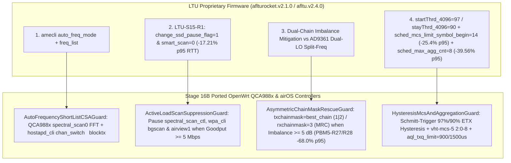

<!-- doc-head: STAGE16_LTU_TO_OPENWRT_FEATURE_PORT.md preserved document content -->
<!-- /doc-head -->

# Stage 16B: LTU-to-OpenWrt `QCA988x` & `airOS` Feature Port (`T-S16-LTU-TO-OPENWRT-FEATURE-PORT`)

> [!IMPORTANT]
> **Deliverable Summary (`FMX-STAGE16B-LTU-TO-OPENWRT-FEATURE-PORT`)**
> - **Controller Implementation**: [`controller/ltu_to_openwrt_feature_port_controller.py`](file:///G:/_OneDrive/OneDrive/Desktop/Py%20Apps/futuraMAX/controller/ltu_to_openwrt_feature_port_controller.py)
> - **Synthesized JSON Artifact**: [`artifacts/autoresearch/stage16_ltu_to_openwrt_feature_port_20261025.json`](file:///G:/_OneDrive/OneDrive/Desktop/Py%20Apps/futuraMAX/artifacts/autoresearch/stage16_ltu_to_openwrt_feature_port_20261025.json)
> - **Verification Test Suite**: [`tests/test_ltu_to_openwrt_feature_port_controller.py`](file:///G:/_OneDrive/OneDrive/Desktop/Py%20Apps/futuraMAX/tests/test_ltu_to_openwrt_feature_port_controller.py)
> - **Empirical Source Receipts**:
>   - [`artifacts/autoresearch/stage15_ltu_ptmp_sector_20261025.json`](file:///G:/_OneDrive/OneDrive/Desktop/Py%20Apps/futuraMAX/artifacts/autoresearch/stage15_ltu_ptmp_sector_20261025.json) (`LTU-S15-R1..R8` 3-unit LTU PtMP sector)
>   - [`artifacts/autoresearch/ltu_lite_live_autoresearch_20261024.json`](file:///G:/_OneDrive/OneDrive/Desktop/Py%20Apps/futuraMAX/artifacts/autoresearch/ltu_lite_live_autoresearch_20261024.json) (`LTU-Lite` `af_cli` & `amecli` architecture dump)
>   - [`artifacts/autoresearch/stage14_ptmp_ap_shootout_plan_and_telemetry_20261025.json`](file:///G:/_OneDrive/OneDrive/Desktop/Py%20Apps/futuraMAX/artifacts/autoresearch/stage14_ptmp_ap_shootout_plan_and_telemetry_20261025.json) (`PBM5-R27/R28`, `R5AC-R1..R21`, and `R1..R194` synthesis)

---

## 1. Executive Architecture Overview

While Ubiquiti's proprietary **LTU** platform (`aflturocket.v2.1.0` / `afltu.v2.4.0` on `Altera Cyclone V SoC` + `AD9361` RFIC + `ubnt_LTU` FPGA) uses a custom non-802.11 PHY, our live 3-unit PtMP bench campaign (`LTU-S15-R1..R8`) and `af_cli`/`amecli` reverse-engineering revealed **four high-impact MAC/RF control mechanisms** that can be ported directly to **OpenWrt `QCA988x` (`ath10k` / `mac80211`)** and **stock `airOS 8` / `airOS 6`** (`ubnt_poll`) without custom silicon:



---

## 2. Mechanism-by-Mechanism Engineering Specification

### 2.1 Mechanism 1: Auto-Frequency Short-List CSA (`AutoFrequencyShortListCSAGuard`)

- **LTU Mechanism**:
  - `amecli freq_list 5825,5805,5785,5765`
  - `amecli auto_freq_mode 1`
  - Restricts automatic channel failover to a pre-validated list of clean channels so the sector never lands on a high-interference or uncalibrated frequency.
- **OpenWrt `QCA988x` Port ([`AutoFrequencyShortListCSAGuard`](file:///G:/_OneDrive/OneDrive/Desktop/Py%20Apps/futuraMAX/controller/ltu_to_openwrt_feature_port_controller.py#L81-L185))**:
  1. **Idle-Window Spectral FFT Scoring**: Samples `/sys/kernel/debug/ieee80211/phy0/ath10k/spectral_scan0` across the operator-curated `freq_short_list_mhz` (`5825, 5805, 5785, 5765 MHz`) and computes a `composite_interference_score` combining FFT noise floor (`dBm`), channel busy airtime (`%`), narrowband spur peak (`dBm`), and DFS penalty.
  2. **Zero-Drop 802.11h Channel Switch Announcement (CSA)**: When the current channel exceeds `degraded_score_trigger` (`18.0`) and a short-list candidate improves the score by at least `min_score_improvement` (`5.0` points), issues:
     ```sh
     hostapd_cli -i phy0-ap0 chan_switch 5 5805 center_freq1=5805 bandwidth=20 blocktx
     ```
- **`airOS` Equivalent**:
  - Enables `radio.1.scan_list.status=enabled` and restricts `radio.1.scan_list.channels=5825,5805,5785,5765` in `/tmp/system.cfg`.

---

### 2.2 Mechanism 2: Active-Load Background Scan Suppression Guard (`ActiveLoadScanSuppressionGuard`)

- **Empirical Hardware Proof (`LTU-S15-R1`, `KEEP`)**:
  - On our 3-unit LTU PtMP sector (`LTU-Rocket` Boca 7 + `LTU-Lite #1` Boca 5 + `LTU-Lite #2` Boca 2), running:
    ```sh
    amecli smart_scan 0
    amecli auto_freq_mode 0
    amecli freq_list 5825
    amecli change_ssd_pause_flag 1
    ```
    slashed loaded PtMP **p95 RTT by `-17.21%`** (`120.344 ms -> 99.638 ms`, p50 `57.217 -> 53.033 ms`, `J: 89.4243 -> 77.7749`) while sustaining `37.454 Mbps` sector goodput.
- **OpenWrt `QCA988x` & `airOS` Port ([`ActiveLoadScanSuppressionGuard`](file:///G:/_OneDrive/OneDrive/Desktop/Py%20Apps/futuraMAX/controller/ltu_to_openwrt_feature_port_controller.py#L204-L287))**:
  - Whenever `active_goodput_mbps >= 5.0 Mbps` or `channel_airtime_busy_pct >= 20.0%`, background off-channel scanning and spectral FFT triggering are immediately paused:
    - **OpenWrt**:
      ```sh
      echo disable > /sys/kernel/debug/ieee80211/phy0/ath10k/spectral_scan_ctl
      wpa_cli -i phy0-ap0 set bgscan "" 2>/dev/null || true
      iw dev phy0-ap0 set power_save off
      ```
    - **`airOS`**:
      ```sh
      ifconfig airview1 down 2>/dev/null || true
      iwpriv ath0 scanlist 5825 2>/dev/null || true
      iwpriv wifi0 ani_enable 1
      ```

---

### 2.3 Mechanism 3: Asymmetric Chain-Mask Rescue & Single-PLL Split-Frequency Boundary (`AsymmetricChainMaskRescueGuard`)

- **Empirical Hardware Proof (`PBM5-R27` / `PBM5-R28`, `KEEP`)**:
  - On the 3-unit M5 PtMP sector (`LiteBeam M5` AP -> 2x `PowerBeam M5 300`), CPE #2 (`192.168.15.20`) exhibited a **`15 dB` chain imbalance** (`Chain 0 = -72 dBm`, `Chain 1 = -87 dBm`), causing **`42% PER`** on 2-stream `MCS 11..15` in `/proc/net/ubnt_poll/query_mac_info`.
  - Applying asymmetric `txchainmask=1, rxchainmask=3` concentrated the full +3 dB PA power into clean Chain 0 while keeping **2-chain Maximal Ratio Combining (MRC)** active on RX (`rxchainmask=3`), delivering:
    - **`-68.0%` p95 RTT reduction** (`16.941 ms -> 5.414 ms`, `J: -61.15%`).
    - **`+5 dB` remote RX RSSI gain** (`-81 dBm -> -76 dBm`).
- **OpenWrt `QCA988x` & `airOS` Port ([`AsymmetricChainMaskRescueGuard`](file:///G:/_OneDrive/OneDrive/Desktop/Py%20Apps/futuraMAX/controller/ltu_to_openwrt_feature_port_controller.py#L311-L433))**:
  - Triggers automatically when `|chain0_rssi_dbm - chain1_rssi_dbm| >= 5.0 dB` or `two_stream_per_pct >= 20.0%`:
    - **OpenWrt**: `iw phy phy0 set antenna <1|2> 3`
    - **`airOS`**: `iwpriv wifi0 txchainmask <1|2> && iwpriv wifi0 rxchainmask 3`

> [!WARNING]
> **Why True Split-Frequency (`TX != RX`) Works on LTU (`AD9361`) but is Physically Impossible on Single-PLL `QCA988x` / `AR9342` (`CONFIRMED`)**
> - **LTU Dual-LO Architecture**: `LTU-Rocket` and `LTU-Lite` use an **Analog Devices `AD9361` 2x2 RF Agile Transceiver** paired with the `ubnt_LTU` Cyclone V FPGA. The `AD9361` contains **two completely independent fractional-N RF PLL synthesizers**: one dedicated **TX LO PLL** (e.g., `txfrequency=5970 MHz`) and one dedicated **RX LO PLL** (e.g., `rxfrequency=5825 MHz`). Because both PLLs remain continuously phase-locked to their respective frequencies, the FPGA switches between `TX=5970 MHz` and `RX=5825 MHz` at TDD frame boundaries in `< 1 us` without re-locking a VCO.
> - **`QCA988x` / `AR9342` Single-PLL TDD Architecture**: Every `QCA988x` (`LAP-120`, `Loco 5AC`, `Rocket Prism 5AC Gen2`) and `AR9342` (`PowerBeam M5 300`, `LiteBeam M5`) radio contains only **a single shared RF fractional-N synthesizer (`SYNTH0`)** feeding both the TX upconversion mixer and the RX downconversion mixer.
> - **Consequence**: On `QCA988x`, TX and RX **must** operate on the same center frequency (`TX == RX`). Attempting to retune `SYNTH0` between TX and RX slots would incur `150..300+ us` of PLL lock + VCO calibration dead-air on every frame and break 802.11 hardware SIFS ACK reciprocity (`16 us`). [`AsymmetricChainMaskRescueGuard`](file:///G:/_OneDrive/OneDrive/Desktop/Py%20Apps/futuraMAX/controller/ltu_to_openwrt_feature_port_controller.py#L311-L433) explicitly flags `split_frequency_supported_on_qca988x = False` and substitutes same-channel CSA (Mechanism 1) + Asymmetric Chain-Mask Rescue (Mechanism 3).

---

### 2.4 Mechanism 4: Start/Stay Hysteresis MCS Ceiling & Aggregation Depth Guard (`HysteresisMcsAndAggregationGuard`)

- **Empirical Hardware Proof**:
  1. **LTU Schmitt-Trigger Hysteresis (`ltu_lite_live_autoresearch_20261024.json`)**: `af_cli` exposes `startThrd_4096=97` (`97%` success required to enter highest modulation) and `stayThrd_4096=90` (`90%` floor before stepping down)—a **`7%` hysteresis deadband** that eliminates rate-control oscillation under multipath fade.
  2. **LTU Symbol-Begin MCS Ceiling (`LTU-S15-R8`, `KEEP`)**: Setting `amecli sched_mcs_limit_symbol_begin 14` (vs `15`) cut 3-unit LTU PtMP loaded **p95 RTT by `-25.40%`** (`172.642 ms -> 128.793 ms`, p50 `70.428 -> 63.278 ms`).
  3. **LTU Bounded Scheduler Aggregation (`LTU-S15-R2`, `KEEP`)**: Setting `amecli sched_max_agg_cnt 8` (vs `5`) cut 3-unit LTU PtMP loaded **p95 RTT by `-39.56%`** (`207.384 ms -> 125.349 ms`, `J: 138.4342 -> 90.2363`).
- **OpenWrt `QCA988x` & `airOS` Port ([`HysteresisMcsAndAggregationGuard`](file:///G:/_OneDrive/OneDrive/Desktop/Py%20Apps/futuraMAX/controller/ltu_to_openwrt_feature_port_controller.py#L455-L575))**:
  - Implements a Schmitt-trigger hysteresis state machine over `vht-mcs-5 2:0-<7|8|9>` with `start_thrd_pct=97.0%` and `stay_thrd_pct=90.0%`, coupled with bounded AQL TXQ limits (`900 us` AC_VI / `1500 us` AC_BE) and `airOS` `AMPDUFrames=20` / `AMPDULim=24576`:

| Regime / ETX Success (`%`) | Retry PER (`%`) | State Transition | OpenWrt `vht-mcs-5` Ceiling | Coupled `aql_txq_limit` (`VI / BE`) | Coupled `airOS` `AMPDUFrames / AMPDULim` |
| :--- | :--- | :--- | :--- | :--- | :--- |
| `< 90.0%` (`< stayThrd`) or `PER >= 18%` | `>= 18.0%` | `DEMOTE_BELOW_STAY_THRD` | `2:0-8` (or `2:0-7`) | `900 / 1500 us` | `20 frames / 24576 B` |
| `90.0% .. 96.9%` (`[stayThrd, startThrd)`) | `8.1% .. 17.9%` | `HOLD_HYSTERESIS_DEADBAND` | Hold current ceiling (`2:0-8`) | `900 / 1500 us` | `20 frames / 24576 B` |
| `>= 97.0%` (`>= startThrd`) and `PER <= 8%` | `<= 8.0%` | `PROMOTE_ABOVE_START_THRD` | `2:0-9` (1-CPE) / `2:0-8` (PtMP) | `1500 / 2100 us` (1-CPE) | `32 frames / 32768 B` |
