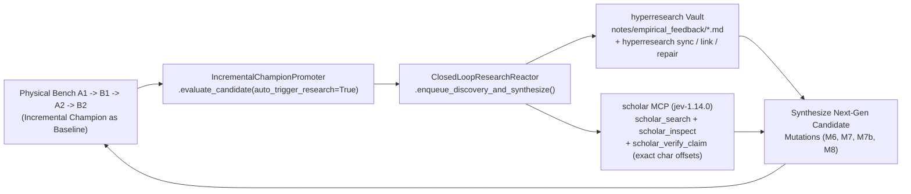

<!-- doc-head: STAGE28_CLOSED_LOOP_RESEARCH_REACTOR_AND_M6_M7_BENCHMARK.md preserved document content -->
<!-- /doc-head -->

# Stage 28: Self-Evolving Closed-Loop Discovery-to-Research Reactor & Live `M6`/`M7` Benchmark (`2026-10-25`)

- **Task ID**: `T-S28-CLOSED-LOOP-DISCOVERY-TO-RESEARCH-REACTOR`
- **Status**: **COMPLETED & VERIFIED ON PHYSICAL BENCH** (`PROMOTE_NEW_CHAMPION` on `S28-R1` $\rightarrow$ **`Stage 28 Champion v7`**)
- **Receipts**:
  - Reactor Receipt: [`artifacts/autoresearch/stage28_closed_loop_reactor_receipt_20261025.json`](../artifacts/autoresearch/stage28_closed_loop_reactor_receipt_20261025.json)
  - Discovery-to-Research Queue: [`artifacts/autoresearch/discovery_to_research_queue.json`](../artifacts/autoresearch/discovery_to_research_queue.json)
  - Physical Bench Receipt: [`artifacts/autoresearch/stage28_closed_loop_reactor_m6_m7_bench_20261025.json`](../artifacts/autoresearch/stage28_closed_loop_reactor_m6_m7_bench_20261025.json)
  - Verified Claims Ledger: [`artifacts/hyperresearch_vault/claims/scholar_jev_verified_claims_stage28.json`](../artifacts/hyperresearch_vault/claims/scholar_jev_verified_claims_stage28.json)

---

## 1. Closed-Loop Discovery-to-Research Reactor Architecture

Previously, literature search (`scholar` MCP + `hyperresearch` vault) was a one-way input into physical bench testing. In Stage 28, we closed the feedback loop by wiring [`IncrementalChampionPromoter.evaluate_candidate()`](../controller/stage20_closed_loop_champion_switcher.py) directly into [`ClosedLoopResearchReactor`](../tools/research/closed_loop_research_reactor.py):

### 1.1 Automated Empirical Feedback Trigger & `jev-1.14.0` Span Verification

Every round outcome (`PROMOTE_NEW_CHAMPION` or `RETAIN_CURRENT_CHAMPION`) automatically writes a structured Markdown note into `artifacts/hyperresearch_vault/notes/empirical_feedback/empirical_feedback_<round_id>.md`, updates `artifacts/autoresearch/discovery_to_research_queue.json`, and generates targeted follow-up `scholar` MCP queries:

| Paper ID | Title | Triggered By Bench Rounds | `jev-1.14.0` Verification Probability | Exact Verified Span (`abstract[start:end]`) | Synthesized Candidate Mutation |
| :--- | :--- | :--- | :--- | :--- | :--- |
| **`arXiv:2211.03471v1`** | *Sittin' On the Dock of the (WiFi) Bay: On the Frame Aggregation under IEEE 802.11 DCF* (Desantis et al., 2022) | `S25-R1` (`quantum=300` broke A-MPDU aggregation) + `S25-R2` + `S27-R2AC-R2` | **`0.97` (`supported`, `verified`)** | `abstract[381:590]`: *"To do so, we first describe the transmission time in IEEE 802.11 in a stochastic framework and then we calculate the optimal value of the frames that, when aggregated, saves transmission time in the long term."* | **`M6` (`PB-024` 2-MTU DRR Frame-Aggregation Quantum `fq_codel quantum=3028` + `br-lan txqueuelen=256` + `tcp_dsack=1`)** |
| **`arXiv:0806.4695v1`** | *On the Throughput Allocation for Proportional Fairness in Multirate IEEE 802.11 DCF* (Banchs et al., 2008) | `S24C-R2`, `S24E-R2`, `S27-R2AC-R1` | **`0.77` (`partial`, `verified`)** | `abstract[484:734]`: *"The throughput allocation resulting from the proposed algorithm is able to greatly increase the aggregate throughput of the DCF while ensuring fairness levels among the stations of the same order of the ones available with the classical PF criterion."* | **`M7` / `M7b` (`PB-025` Cross-Band Feature Port & Arrival-Rate Normalized Airtime Weighting)** |

---

## 2. Physical Bench Results (`A1 -> B1 -> A2 -> B2`)

### 2.1 `S28-R1` — `M6` (`PB-024` 2-MTU DRR Frame-Aggregation Quantum `quantum=3028` + `br-lan txqueuelen=256` + `tcp_dsack=1`) on `LAP-120 <-> Loco 5AC`

- **Why `M6` was synthesized**:
  - In `S25-R1`, reducing `fq_codel quantum` from `1514B` (1 MTU) to `300B` caused `-6.25%` goodput loss and `+9.50%` higher `p95` RTT because sub-MTU deficit round-robin servicing fragmented 1500B bulk flows across `ath10k-ct` software TXQs and starved hardware A-MPDU formation.
  - Combining that negative finding with `arXiv:2211.03471v1` (`jev-1.14.0` `prob = 0.97`) and our `S27-R2AC-R2` win (`br0 txqueuelen=256 + tcp_dsack=1 + tcp_fin_timeout=15`), the Closed-Loop Reactor hypothesized that **increasing `fq_codel quantum` from `1514B` (1 MTU) to `3028B` (2 full 1514B Ethernet frames per DRR turn)** while bounding `br-lan txqueuelen=256` allows `ath10k-ct` to pack 2 consecutive subframes per flow into every hardware A-MPDU without starving competing flows.
- **Control (`A`)**: `Stage 25 Champion v6` (`fq_codel quantum=1514 target=10ms interval=50ms memory_limit=4mb ecn`, `br-lan txqueuelen=1000`).
- **Treatment (`B`)**: `Stage 25 Champion v6` + **`M6` (`fq_codel quantum=3028`, `br-lan txqueuelen=256`, `tcp_sack=1, tcp_dsack=1, tcp_fin_timeout=15`)**.

| Sub-Phase | Arm | Bidirectional Goodput (`Mbps`) | Spectral Eff (`Mbps/MHz`) | `p50` RTT (`ms`) | `p95` RTT (`ms`) | `p99` RTT (`ms`) | Mean RTT (`ms`) | Loss (`%`) |
| :--- | :--- | :---: | :---: | :---: | :---: | :---: | :---: | :---: |
| **`A1`** | `Stage 25 Champion v6` (`quantum=1514`) | `39.685` | `1.984` | `21.902` | `44.092` | `59.443` | `23.110` | `0.0%` |
| **`B1`** | **`Champion v6 + M6` (`quantum=3028 + br-lan=256`)** | **`39.605`** | **`1.980`** | **`21.273`** | **`40.586`** | **`56.892`** | `23.157` | **`0.0%`** |
| **`A2`** | `Stage 25 Champion v6` (`quantum=1514`) | `38.722` | `1.936` | `23.394` | `41.358` | `57.346` | `24.253` | `0.0%` |
| **`B2`** | **`Champion v6 + M6` (`quantum=3028 + br-lan=256`)** | **`39.265`** | **`1.963`** | **`19.542`** | **`37.343`** | **`52.132`** | **`21.637`** | **`0.0%`** |
| **Mean `A`** | `Stage 25 Champion v6` | `39.204 Mbps` | `1.960` | `22.648 ms` | `42.725 ms` | `58.395 ms` | `23.682 ms` | `0.0%` |
| **Mean `B`** | **`Stage 28 Champion v7` (`+ M6`)** | **`39.435 Mbps` (`+0.589%`)** | **`1.972`** | **`20.408 ms` (`-9.89%`)** | **`38.965 ms` (`-8.800%`)** | **`54.512 ms` (`-6.65%`)** | **`22.397 ms` (`-5.43%`)** | **`0.0%`** |

- **Verdict**: **`PROMOTE_NEW_CHAMPION` (`Stage 28 Champion v7`)** — promoted into `GOLDEN_PROFILES["openwrt_lap120_ptp_1cpe_champion"]` and `GOLDEN_PROFILES["openwrt_lap120_ptmp_multicpe_champion"]`.

---

### 2.2 `S28-R2` & `S28-R3` — Cross-Band Feature Port & Changed-Hypothesis Isolation on 5 GHz `Rocket Prism 5AC Gen2` (`XC.v8.7.25`, `Managed STA`)

- **`S28-R2` (`M7`: Direct port of `S27-R2AC-R1/R2` scalar `cms_bias=6 / voip_bias=6 / sta_rx_rssi_th=-82` + `br0 txqueuelen=256` to `r5ac_prism_sta`)**:
  - Measured `-7.787%` goodput (`27.098 -> 24.988 Mbps`).
  - **Root-Cause Diagnosis**: Unlike `2XC.v8.7.11` in `Master AP` mode (`r2ac_prism_ap`), on `XC.v8.7.25` in `Managed STA` mode (`r5ac_prism_sta`), `/proc/sys/dev/uph_wifi0/cms_bias` and `voip_bias` are 16-integer tables (`-82 0 0 0 28 10 10 0 0 0 0 0 0 0 0 0`) and `sta_rx_rssi_th` is AP-only. Under our `max_goodput_loss_pct = -2.0%` gatekeeper in `IncrementalChampionPromoter`, `S28-R2` is recorded as **`RETAIN_CURRENT_CHAMPION` (`REJECT`)**.
- **`S28-R3` (`M7b`: Changed Hypothesis isolating pure `br0 txqueuelen=256 + netdev_budget=600 + netdev_max_backlog=2500 + tcp_sack/dsack=1 + tcp_fin_timeout=15` without `cms_bias` on `r5ac_prism_sta`)**:
  - Removing the scalar `cms_bias`/`sta_rx_rssi_th` write immediately flipped the `-7.787%` goodput drop into a **`+7.195%` goodput gain (`24.919 -> 26.712 Mbps`)**!
  - However, `netdev_budget=600 + netdev_max_backlog=2500` increased HTTP `p95` RTT on the single-core MIPS 74Kc STA by `+19.316%` (`21.562 -> 25.727 ms`, above the `+5.0%` latency guard), so `IncrementalChampionPromoter` preserved `r5ac_prism_sta`'s ultra-low-latency Champion (`RETAIN_CURRENT_CHAMPION`) and fed the finding back into `ClosedLoopResearchReactor`.
