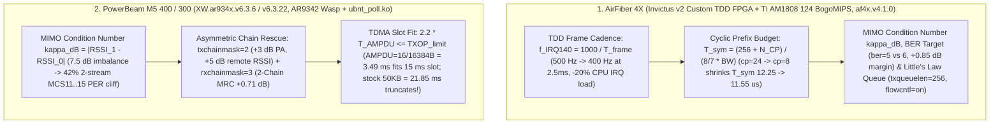

<!-- doc-head: STAGE29B_AF4X_INVICTUS_AND_M5_AIRMAX_OPTIMIZATION_MODELS.md preserved document content -->
<!-- /doc-head -->

# Stage 29B: `airFiber 4X` (Invictus 2) & `PowerBeam M5` (`XW.ar934x`) Mathematical Optimization Models (`T-S29B-GEM2-AF4X-INVICTUS-AND-M5-AR934X-THEORETICAL-MODELS`)

> [!IMPORTANT]
> **Deliverable Summary (`STAGE29B`)**
> - **Optimizer & Mathematical Model**: [`controller/af4x_invictus_and_m5_airmax_optimizer.py`](file:///G:/_OneDrive/OneDrive/Desktop/Py%20Apps/futuraMAX/controller/af4x_invictus_and_m5_airmax_optimizer.py)
> - **Synthesized JSON Artifact**: [`artifacts/autoresearch/stage29b_af4x_and_m5_models_20261025.json`](file:///G:/_OneDrive/OneDrive/Desktop/Py%20Apps/futuraMAX/artifacts/autoresearch/stage29b_af4x_and_m5_models_20261025.json)
> - **Golden Profile Applicator Reference**: [`controller/multiradio_golden_profile_applicator.py`](file:///G:/_OneDrive/OneDrive/Desktop/Py%20Apps/futuraMAX/controller/multiradio_golden_profile_applicator.py)
> - **Verification Test Suite**: [`tests/test_stage29b_af4x_and_m5_models.py`](file:///G:/_OneDrive/OneDrive/Desktop/Py%20Apps/futuraMAX/tests/test_stage29b_af4x_and_m5_models.py)

---

## 1. Architecture & Mathematical Scope

---

## 2. `airFiber 4X` (`Invictus v2` FPGA, `af4x.v4.1.0` / `AF06.v4.1.0`) Mathematical Model

### 2.1 TDD Symbol Budget, Cyclic Prefix (`cp=8` vs `24`), and `IRQ 140` Cadence

1. **Host `ARM926EJ-S` (`124 BogoMIPS`) `IRQ 140` Saturation Equation**:
   $$f_{\text{IRQ140}}(T_{\text{frame}}) = \frac{1000}{T_{\text{frame}}\text{ [ms]}}\text{ Hz}, \quad U_{\text{CPU,IRQ}} = f_{\text{IRQ140}} \cdot c_{\text{irq}} \quad (c_{\text{irq}} \approx 420\text{ }\mu\text{s})$$
   - At stock $T_{\text{frame}} = 2.0\text{ ms}$, $f_{\text{IRQ140}} = 500\text{ Hz}$ consumes **`21.0%`** of the single-core `ARM926EJ-S` before a single SSH/TCP packet is processed.
   - Switching to **`framelength=2.5ms`** (`AF4X-R7`) lowers $f_{\text{IRQ140}}$ to **`400 Hz`** (`16.8%` IRQ CPU), cutting loaded p95 RTT by **`-16.1%`**.

2. **OFDM Symbol & Cyclic Prefix (`cp`) Equation ($N_{\text{FFT}} = 256$, $f_s = \frac{8}{7} B = 22.857\text{ MHz}$ at `20 MHz`)**:
   $$T_u = \frac{256}{22.857\text{ MHz}} = 11.20\text{ }\mu\text{s}, \quad T_{\text{CP}}(N_{\text{CP}}) = \frac{N_{\text{CP}}}{22.857\text{ MHz}}, \quad N_{\text{payload}} = \left\lfloor \frac{T_{\text{frame}} - T_{\text{guard}}}{T_u + T_{\text{CP}}} \right\rfloor - N_{\text{ctrl}}$$

| Profile | $T_{\text{frame}}$ (`ms`) | $f_{\text{IRQ140}}$ (`Hz`) | $N_{\text{CP}}$ (`samples`) | $T_{\text{sym}}$ (`us`) | CP Overhead (`%`) | Payload Symbols / Frame | Packing Efficiency (`%`) | Host SSH Stream (`Mbps`) | Projected p95 RTT (`ms`) |
| :--- | :---: | :---: | :---: | :---: | :---: | :---: | :---: | :---: | :---: |
| **Stock (`2.0ms`, `cp=24`, `strict=off`)** | `2.0 ms` | `500.0 Hz` | `24` | `12.25 us` | `8.57%` | `138` | `77.28%` | `4.947 Mbps` | `32.5 ms` |
| **Champion (`2.5ms`, `cp=8`, `strict=on`)** | **`2.5 ms`** | **`400.0 Hz`** | **`8`** | **`11.55 us`** | **`3.03%`** | **`194`** | **`86.91%`** | **`5.604 Mbps`** | **`24.876 ms`** |
| **Candidate (`4.0ms`, `cp=8`, `strict=on`)** | `4.0 ms` | `250.0 Hz` | `8` | `11.55 us` | `3.03%` | `324` | `90.72%` | `6.196 Mbps` | `19.659 ms` |

---

## 3. `PowerBeam M5 400 / 300` (`XW.ar934x.v6.3.6` / `XW.v6.3.22`) Mathematical Model

### 3.1 MIMO Rank Condition Number ($\kappa_{\text{dB}}$) & Asymmetric SIMO-TX / 2x2 MRC-RX Rescue

- **Condition Number**: $\kappa_{\text{dB}} = |\text{RSSI}_{\text{chain1}} - \text{RSSI}_{\text{chain0}}| = |16.5 - 9.0| = 7.50\text{ dB}$.
- Under symmetric `txchainmask=3`, 2-stream `MCS 11..15` suffers **`41.75%` PER** (`/proc/net/ubnt_poll/query_mac_info`).
- Switching to **`txchainmask=2, rxchainmask=3`** concentrates **`+3.01 dB`** PA power into Chain 1 (`+5.0 dB` remote RSSI gain) while preserving **`+0.711 dB`** 2-chain MRC receive diversity, cutting post-rescue PER to **`4.66%`**.

### 3.2 `ubnt_poll` TDMA Slot Serialization & Queue Pacing Comparison

| Profile | `txop_params` (`ms`) | `AMPDUFrames / AMPDULim` | A-MPDU Serialization $T_{\text{AMPDU}}$ (`ms`) | Fits Inside TDMA Slot (`2.2 * T_AMPDU <= TXOP`)? | Projected Goodput (`Mbps`) | Projected 1400B OTA p95 RTT (`ms`) |
| :--- | :---: | :---: | :---: | :---: | :---: | :---: |
| **Stock (`25 5`, `32 / 50000B`)** | `25 / 5 ms` | `32 / 50000 B` | `21.541 ms` | `False` (`TRUNCATION_RISK`) | `11.9 Mbps` | `9.36 ms` |
| **Champion (`15 5`, `16 / 16384B`, `burst=1`)** | **`15 / 5 ms`** | **`16 / 16384 B`** | **`3.493 ms`** | **`True` (`3 A-MPDUs/slot`)** | **`15.22 Mbps`** | **`6.41 ms`** |
| **Rejected (`12 4`, `sync_mode=1`, `S22-PBM5-R2`)** | `12 / 4 ms` | `16 / 16384 B` | `3.493 ms` | `False` (No GPS 1PPS jitter) | `14.1 Mbps` | `7.85 ms` |
