<!-- doc-head: STAGE29C_MULTI_RADIO_HEADROOM_AND_ROADMAP_MATRIX.md preserved document content -->
<!-- /doc-head -->

# Stage 29C: Multi-Radio Exhaustion, Champion Delta & Theoretical Headroom Matrix (`T-S29C-GEM2-MULTI-RADIO-ROADMAP-AND-CHAMPION-AUDITOR`)

> [!IMPORTANT]
> **Deliverable Summary (`STAGE29C`)**
> - **Auditor & Matrix Generator**: [`analysis/multi_radio_exhaustion_and_headroom_matrix.py`](file:///G:/_OneDrive/OneDrive/Desktop/Py%20Apps/futuraMAX/analysis/multi_radio_exhaustion_and_headroom_matrix.py)
> - **Synthesized JSON Artifact**: [`artifacts/autoresearch/stage29c_headroom_matrix_20261025.json`](file:///G:/_OneDrive/OneDrive/Desktop/Py%20Apps/futuraMAX/artifacts/autoresearch/stage29c_headroom_matrix_20261025.json)
> - **Champion State Ledger Audited**: [`artifacts/autoresearch/champion_state_ledger.json`](file:///G:/_OneDrive/OneDrive/Desktop/Py%20Apps/futuraMAX/artifacts/autoresearch/champion_state_ledger.json)
> - **Verification Test Suite**: [`tests/test_stage29c_headroom_matrix.py`](file:///G:/_OneDrive/OneDrive/Desktop/Py%20Apps/futuraMAX/tests/test_stage29c_headroom_matrix.py)
> - **Global Parameter Exhaustion Across All 9 Radio/Modes**: **`782 / 1064` (`73.5%`)** parameters empirically tested across `21` stage receipts (`Stages 13..28`), with **`282`** parameters remaining and **`27`** next autonomous rounds queued.

---

## 1. Master 9-Radio/Mode Exhaustion, Champion Delta & Headroom Summary Table

| Radio & Mode | Ledger Profile ID | Tested / Total Params (`Exhaustion %`) | Champion Goodput Delta vs Stock | Champion p95 RTT Delta vs Stock | Estimated Remaining Goodput Headroom | Estimated Remaining p95 Headroom | Wall / Frontier Status |
| :--- | :--- | :---: | :---: | :---: | :---: | :---: | :--- |
| **LAP-120 OpenWrt PtP 1-CPE** | `openwrt_lap120_ptp_1cpe_champion` | `112 / 148` (**`75.7%`**) | **`+26.49%`** (`60.43 -> 76.44 Mbps`) | **`-59.99%`** (`43.64 -> 17.46 ms`) | `2.5% .. 4.8%` | `-8.0% .. -14.0% (toward 14.5 ms floor)` | `NEAR_ASYMPTOTE_QUEUE_LAYER_EXHAUSTED_PHY_CSI_OPEN` |
| **LAP-120 OpenWrt PtMP 3-CPE** | `openwrt_lap120_ptmp_multicpe_champion` | `118 / 164` (**`72.0%`**) | **`+38.42%`** (`45.73 -> 63.3 Mbps`) | **`-64.70%`** (`110.4 -> 38.97 ms`) | `5.0% .. 9.5%` | `-12.0% .. -20.0% (toward 31.0 ms multi-CPE floor)` | `ACTIVE_FRONTIER_CROSS_LAYER_ARRIVAL_RATE_AND_EDCA_OPEN` |
| **Loco 5AC Stock** | `loco5ac_stock_wa_v8_7_25` | `84 / 116` (**`72.4%`**) | **`+25.22%`** (`51.12 -> 64.01 Mbps`) | **`-46.25%`** (`81.92 -> 44.03 ms`) | `4.0% .. 7.5%` | `-10.0% .. -18.0% (under stock WA.v8.7.25 bridge)` | `MODERATE_HEADROOM_ON_STOCK_AIROS8_WA_SYSCTL_AND_UPH_WIFI0` |
| **Rocket Prism 5AC Gen2** | `r5ac_prism_sta` | `86 / 124` (**`69.3%`**) | **`+38.53%`** (`51.02 -> 70.68 Mbps`) | **`-87.24%`** (`187.04 -> 23.86 ms`) | `4.5% .. 8.0%` | `-8.0% .. -15.0% (toward 18.0 ms loaded floor)` | `HIGH_PTMP_MASTER_AP_HEADROOM_REMAINING` |
| **LTU-Lite v2.4.0 AP-PtMP SQ** | `ltu_lite_amesoc` | `68 / 96` (**`70.8%`**) | **`+32.26%`** (`29.85 -> 39.48 Mbps`) | **`-73.77%`** (`213.93 -> 56.11 ms`) | `6.0% .. 12.0% (once RF link state=Associated in SQ mode)` | `-10.0% .. -18.0%` | `MODERATE_HEADROOM_BRIDGE_QUEUE_AND_PB_CFO_OPEN` |
| **LTU-Lite v2.4.0 AP-PtP** | `ltu_lite_amesoc_ap_ptp` | `54 / 92` (**`58.7%`**) | **`+24.50%`** (`54.2 -> 67.48 Mbps`) | **`-60.57%`** (`142.3 -> 56.11 ms`) | `8.0% .. 15.0%` | `-15.0% .. -25.0%` | `HIGH_HEADROOM_IN_DEDICATED_PTP_SYMBOL_PACKING_AND_SPLIT_FREQ` |
| **Rocket 2AC Prism 2.4GHz** | `r2ac_prism_ap` | `94 / 118` (**`79.7%`**) | **`+19.37%`** (`23.85 -> 28.47 Mbps`) | **`-60.49%`** (`38.4 -> 15.17 ms`) | `2.0% .. 4.5%` | `-6.0% .. -12.0% (toward 13.5 ms floor)` | `NEAR_ASYMPTOTE_ON_24GHZ_AP_SIDE_NANOM2_CPE_CO_DESIGN_OPEN` |
| **PowerBeam M5 PtP** | `pbm5_xw_weak_ota` | `108 / 132` (**`81.8%`**) | **`+33.51%`** (`11.4 -> 15.22 Mbps`) | **`-62.16%`** (`16.94 -> 6.41 ms`) | `2.0% .. 4.0% (at -80 dBm 1-stream MCS 3..5)` | `-4.0% .. -8.0% (already at 6.41 ms OTA p95!)` | `WALL_REACHED_AT_20MHZ_SUB_CHANNEL_10MHZ_OPEN` |
| **AF-4X Invictus** | `af4x_invictus` | `58 / 74` (**`78.4%`**) | **`+15.94%`** (`4.58 -> 5.31 Mbps`) | **`-23.55%`** (`33.25 -> 25.42 ms`) | `1.5% .. 3.5% (host ARM926EJ-S SSH/TCP CPU bound; FPGA bridge pass-through >200 Mbps)` | `-5.0% .. -9.0% (via 4.0ms/5.0ms framelength or bridge queue bounding)` | `WALL_REACHED_ON_AM1808_CPU_BOUND_CONTROLS` |

---

## 2. Visual Architecture: Multi-Radio Exhaustion & Next-3-Round Queue

```mermaid
flowchart LR
    subgraph LEDGER["champion_state_ledger.json + Stages 14..28 Receipts"]
        L1["8 Active Hardware RAM Profiles"]
        L2["21 Stage JSON Receipts Audited"]
        L3["782/1064 (73.5%) Knobs Tested"]
    end
    subgraph MODES["9 Bench Radio & Operating Modes"]
        M1["1. LAP-120 OpenWrt PtP 1-CPE (+26.5% GP, -60.0% p95)"]
        M2["2. LAP-120 OpenWrt PtMP 3-CPE (+38.4% GP, -64.7% p95)"]
        M3["3. Loco 5AC Stock (+25.2% GP, -46.3% p95)"]
        M4["4. Rocket Prism 5AC Gen2 (+38.5% GP, -87.2% p95)"]
        M5["5. LTU-Lite v2.4.0 AP-PtMP SQ (+32.3% GP, -73.8% p95)"]
        M6["6. LTU-Lite v2.4.0 AP-PtP (+24.5% GP, -60.6% p95)"]
        M7["7. Rocket 2AC Prism 2.4GHz (+19.4% GP, -60.5% p95)"]
        M8["8. PowerBeam M5 PtP (+33.5% GP, -62.2% p95)"]
        M9["9. AF-4X Invictus (+15.9% GP, -23.6% p95)"]
    end
    LEDGER --> MODES
```

---

## 3. Detailed Per-Radio Exhaustion, Bottleneck & Next 3 Queued Autonomous Rounds

### 3.1 LAP-120 OpenWrt PtP 1-CPE (`openwrt_lap120_ptp_1cpe_champion`)
- **Hardware & Firmware**: Ubiquiti LiteAP 120 AP + NanoStation 5AC Loco CPE (OpenWrt 24.10.4 r28959, Linux 6.6.110)
- **SoC & PHY**: AR9342 MIPS 74Kc + QCA9882 2x2 VHT20 (5180 MHz, 20 MHz, ath10k-ct)
- **Parameter Coverage**: `112` tested / `36` untested / `148` total (**`75.68%` exhausted**)
- **Current Champion Delta vs Stock**: Goodput **`+26.49%`** (`60.43 -> 76.44 Mbps`), p95 RTT **`-59.99%`** (`43.64 -> 17.46 ms`), Latest Promoted: `S25-R2 / S28-R1 (aql_txq_limit=900/1500us, fq_quantum=1514..3028, AirBBR ca=110/ss=150, rts=off, retry=5/4, nf_cal_period=30, tcp_notsent_lowat=16384)`
- **Theoretical Ceiling & Bottleneck**: `81.5 Mbps` ceiling; remaining goodput headroom `2.5% .. 4.8%`, remaining p95 headroom `-8.0% .. -14.0% (toward 14.5 ms floor)`. Bottleneck: AR9342 535 MHz MIPS 74Kc softirq/NAPI CPU ceiling and QCA9882 PCIe/HTT copy descriptor latency at 173.3 Mbps VHT-MCS 8 PHY rate.
- **Next 3 Autonomous Rounds Queued**:
  1. **`S30-LAP-PTP-R1` — PB-031 CCA Energy-Detection Threshold (-75 dBm) + Long-GI Delay-Spread Guard**: Setting ath10k cca_ed_thresh_dbm=-75 dBm on top of openwrt_lap120_ptp_1cpe_champion ignores weak -78 dBm bench noise chatter without inducing collisions. (Knobs: `ath10k/cca_ed_thresh_dbm=-75`, `wireless.radio0.ldpc=1`; Expected: `+1.5% .. +3.0%` GP, `-4.0% .. -7.5%` p95)
  1. **`S30-LAP-PTP-R2` — NAPI gro_flush_timeout=20000ns + netdev_max_backlog=2048 Co-Design**: Micro-batching GRO flush interval (20 us) reduces per-packet MIPS 74Kc skb segmentation overhead during 8-stream TCP bulk bursts. (Knobs: `/sys/class/net/phy0-ap0/gro_flush_timeout=20000`, `net.core.netdev_max_backlog=2048`; Expected: `+1.2% .. +2.5%` GP, `-2.0% .. -5.0%` p95)
  1. **`S30-LAP-PTP-R3` — PB-021/PB-022 EVM-Guided Start/Stay Hysteresis (97%/90%) VHT-MCS 7..8 Pinning**: Using rx_ppdu_end pilot EVM to hold VHT-MCS 7 when EVM > -27 dB eliminates transient VHT-MCS 8 probe retries. (Knobs: `iw dev phy0-ap0 set bitrates legacy-5 vht-mcs-5 2:0-7 (hysteresis 97/90)`; Expected: `+0.8% .. +1.8%` GP, `-5.0% .. -9.0%` p95)

### 3.2 LAP-120 OpenWrt PtMP 3-CPE (`openwrt_lap120_ptmp_multicpe_champion`)
- **Hardware & Firmware**: Ubiquiti LiteAP 120 AP (OpenWrt 24.10.4) serving 3 Heterogeneous CPEs (Loco 5AC + Rocket Prism 5AC + LiteBeam M5)
- **SoC & PHY**: AR9342 + QCA9882 2x2 VHT20 AP (Multi-Station 802.11ac + 802.11n WDS ETH_P_TEB)
- **Parameter Coverage**: `118` tested / `46` untested / `164` total (**`71.95%` exhausted**)
- **Current Champion Delta vs Stock**: Goodput **`+38.42%`** (`45.73 -> 63.3 Mbps`), p95 RTT **`-64.70%`** (`110.4 -> 38.97 ms`), Latest Promoted: `S24C-R2 + S24E-R2 + S25-R2 + S28-R1 (per-AC AQL 600..1500/1200..3000, rts=512, quantum=3028, br-lan txqueuelen=256, AirBBR + UL/DL ACK pacing)`
- **Theoretical Ceiling & Bottleneck**: `71.0 Mbps` ceiling; remaining goodput headroom `5.0% .. 9.5%`, remaining p95 headroom `-12.0% .. -20.0% (toward 31.0 ms multi-CPE floor)`. Bottleneck: Heterogeneous 802.11n (LiteBeam M5 1x1 SISO MCS 7) vs 802.11ac (2x2 VHT-MCS 8) airtime serialization and CSMA/CA uplink contention windows.
- **Next 3 Autonomous Rounds Queued**:
  1. **`S30-LAP-PTMP-R1` — PB-025 Arrival-Rate Normalized Dynamic Airtime Weighting (720:512:112) + quantum=3028**: Normalizing station airtime weights by live arrival rate and RTS/CTS preamble tax (arXiv:0806.4695v1) lifts 3-CPE aggregate goodput while protecting weak CPE p95. (Knobs: `iw dev phy0-ap0 station set <MAC> airtime_weight 720/512/112`, `fq_codel quantum 3028`; Expected: `+2.5% .. +4.5%` GP, `-6.0% .. -10.0%` p95)
  1. **`S30-LAP-PTMP-R2` — WMM EDCA AC_BE CWmin=7 / CWmax=31 & TXOP=1504us Contention Window Tightening**: Bounding AC_BE TXOP to 1504 us (~1800 B at MCS 7) at the MAC contention layer reinforces AQL 1500/3000 us under 3-station simultaneous upload. (Knobs: `wmm_ac_be_cwmin=3`, `wmm_ac_be_cwmax=5`, `wmm_ac_be_txop_limit=47`; Expected: `+1.5% .. +3.5%` GP, `-8.0% .. -14.0%` p95)
  1. **`S30-LAP-PTMP-R3` — Per-Station Ingress TCP-ACK Pacing Filter on br-lan for 3-CPE Uplink Co-Design**: Pacing return TCP ACKs on br-lan per CPE MAC prevents synchronized 3-CPE uplink TCP window bursts. (Knobs: `tc filter dev br-lan parent ffff: police/fq pacing`, `net.ipv4.tcp_autocorking=0`; Expected: `+2.0% .. +4.0%` GP, `-7.0% .. -12.0%` p95)

### 3.3 Loco 5AC Stock (`loco5ac_stock_wa_v8_7_25`)
- **Hardware & Firmware**: Ubiquiti NanoStation 5AC Loco (Stock airOS WA.v8.7.25 & OpenWrt 24.10.4 CPE Mode, sysid=0xe7fa)
- **SoC & PHY**: AR9342 MIPS 74Kc + QCA9882 2x2 VHT20 CPE (13 dBi integrated antenna)
- **Parameter Coverage**: `84` tested / `32` untested / `116` total (**`72.41%` exhausted**)
- **Current Champion Delta vs Stock**: Goodput **`+25.22%`** (`51.12 -> 64.01 Mbps`), p95 RTT **`-46.25%`** (`81.92 -> 44.03 ms`), Latest Promoted: `S25-R2 / S28-R1 (CPE-side AQL 900/1500us or stock ubnt_poll_host allow_80211=1 + txqueuelen=256 + quantum=3028 + tcp_notsent_lowat=16384)`
- **Theoretical Ceiling & Bottleneck**: `76.0 Mbps` ceiling; remaining goodput headroom `4.0% .. 7.5%`, remaining p95 headroom `-10.0% .. -18.0% (under stock WA.v8.7.25 bridge)`. Bottleneck: Stock airOS 8 WA.v8.7.25 QCA proprietary ath_pktlog / ubnt_poll_host.ko internal TX ring depth when operating in unmodified Stock CPE mode.
- **Next 3 Autonomous Rounds Queued**:
  1. **`S30-LOCO-STOCK-R1` — Stock WA.v8.7.25 uph_wifi0 cms_bias=6 + voip_bias=6 + br0 txqueuelen=256 Port**: Porting the Stage 28 M7 Winner (S28-R2 -87.2% p95 on XC) to Stock WA.v8.7.25 Loco 5AC cuts CPE uplink queueing spikes. (Knobs: `/proc/sys/dev/uph_wifi0/cms_bias=6`, `/proc/sys/dev/uph_wifi0/voip_bias=6`, `ifconfig br0 txqueuelen 256`; Expected: `+2.0% .. +4.0%` GP, `-12.0% .. -20.0%` p95)
  1. **`S30-LOCO-STOCK-R2` — Stock WA.v8.7.25 iwpriv wifi0 nonaggr_swretry=4 & aggr_swretry=6**: Bounding QCA9882 software retry chains on Stock WA.v8.7.25 prevents head-of-line blocking during 3-CPE uplink contention. (Knobs: `iwpriv wifi0 nonaggr_swretry 4`, `iwpriv wifi0 aggr_swretry 6`; Expected: `+1.5% .. +3.0%` GP, `-8.0% .. -15.0%` p95)
  1. **`S30-LOCO-STOCK-R3` — Stock WA.v8.7.25 iwpriv ath0 maxampdu=2 (32KB) + ampdu=24 Uplink Serialization Cap**: Capping CPE uplink A-MPDU length to 32 KB (24 subframes) prevents a single CPE burst from monopolizing AP RX airtime. (Knobs: `iwpriv ath0 maxampdu 2`, `iwpriv ath0 ampdu 24`; Expected: `+1.0% .. +2.5%` GP, `-6.0% .. -11.0%` p95)

### 3.4 Rocket Prism 5AC Gen2 (`r5ac_prism_sta`)
- **Hardware & Firmware**: Ubiquiti Rocket Prism 5AC Gen2 (XC.v8.7.25, Linux 2.6.32.68, sysid=0xe7e9)
- **SoC & PHY**: QCA9558 MIPS 74Kc (720 MHz) + QCA9880 5 GHz (wifi0) + AirView (wifi1) + 5 GHz AirPrism (IRQ 64)
- **Parameter Coverage**: `86` tested / `38` untested / `124` total (**`69.35%` exhausted**)
- **Current Champion Delta vs Stock**: Goodput **`+38.53%`** (`51.02 -> 70.68 Mbps`), p95 RTT **`-87.24%`** (`187.04 -> 23.86 ms`), Latest Promoted: `S19-R3 (+38.55% sector goodput) & S28-R2 (-87.24% loaded p95 RTT via M7 cms_bias=6, voip_bias=6, sta_rx_rssi_th=-82, br0 txqueuelen=256, tcp_dsack=1)`
- **Theoretical Ceiling & Bottleneck**: `78.5 Mbps` ceiling; remaining goodput headroom `4.5% .. 8.0%`, remaining p95 headroom `-8.0% .. -15.0% (toward 18.0 ms loaded floor)`. Bottleneck: Linux 2.6.32.68 legacy TCP/IP stack (lack of native FQ-CoDel/AQL in XC kernel) and IRQ 64 AirPrism active filter interrupt coalescing under multi-CPE load.
- **Next 3 Autonomous Rounds Queued**:
  1. **`S30-R5AC-R1` — Port R2AC Winner (uph_wifi0/ptp_xmit=1 + fixed_frame=1) onto r5ac_prism_sta Champion**: Enabling deterministic frame pacing (ptp_xmit=1, fixed_frame=1) in uph_wifi0 on 5 GHz QCA9880 recovers the -7.7% SSH stream throughput trade-off from S28-R2 while keeping 23.8 ms p95. (Knobs: `/proc/sys/dev/uph_wifi0/ptp_xmit=1`, `/proc/sys/dev/uph_wifi0/fixed_frame=1`; Expected: `+4.0% .. +7.5%` GP, `-3.0% .. -6.0%` p95)
  1. **`S30-R5AC-R2` — QCA9880 Hardware A-MPDU Byte Limit (aggr_limit=32768) + shpreamble=1**: Right-sizing QCA9880 hardware A-MPDU byte limit to 32 KB prevents 64 KB aggregates from colliding with LiteBeam M5 frames in 3-CPE contention. (Knobs: `iwpriv wifi0 aggr_limit 32768`, `iwpriv ath0 shpreamble 1`; Expected: `+2.0% .. +4.0%` GP, `-5.0% .. -10.0%` p95)
  1. **`S30-R5AC-R3` — QCA9558 NAPI Budget Expansion (net.core.netdev_budget=600 + netdev_max_backlog=2500)**: Doubling netdev_budget from 300 to 600 on the 720 MHz QCA9558 SoC eliminates softirq ring drops during bursty 20 MHz VHT-MCS 8 reception. (Knobs: `net.core.netdev_budget=600`, `net.core.netdev_max_backlog=2500`; Expected: `+1.5% .. +3.0%` GP, `-4.0% .. -8.0%` p95)

### 3.5 LTU-Lite v2.4.0 AP-PtMP SQ (`ltu_lite_amesoc`)
- **Hardware & Firmware**: Ubiquiti LTU-Lite (LTU.afltu.v2.4.0, board_ssid=0xae08 unlocked in RAM to 0xae05 AP-PtMP SQ ptmp_max_cpe=4)
- **SoC & PHY**: UBNT AME SoC (Dual-Core Cortex-A9) + AD9361 SDR + ubnt_LTU Cyclone V FPGA (20 MHz, 4096-QAM capable)
- **Parameter Coverage**: `68` tested / `28` untested / `96` total (**`70.83%` exhausted**)
- **Current Champion Delta vs Stock**: Goodput **`+32.26%`** (`29.85 -> 39.48 Mbps`), p95 RTT **`-73.77%`** (`213.93 -> 56.11 ms`), Latest Promoted: `S17B-R3 + S24F-R1 (board_ssid=0xae05 SQ ptmp_max_cpe=4, sched_max_agg_cnt=8, sym_begin=12, ap_sym_end=62, sym_end=72, multi_ack=1, send_map=1, fq_codel quantum=1514 target=2.5ms)`
- **Theoretical Ceiling & Bottleneck**: `86.0 Mbps` ceiling; remaining goodput headroom `6.0% .. 12.0% (once RF link state=Associated in SQ mode)`, remaining p95 headroom `-10.0% .. -18.0%`. Bottleneck: air_fpga OTP/EEPROM board_ssid (0xae08) check in afcal -p during full RF state machine transition and Dual-Core Cortex-A9 IRQ 63/92 TDD frame processing.
- **Next 3 Autonomous Rounds Queued**:
  1. **`S30-LTU-SQ-R1` — Stage 28 M8 Bridge Queue Co-Design (br0 txqueuelen=256 + tcp_fin_timeout=15 + tcp_low_latency=1)**: Synthesized by Stage 28 Reactor from S24F-R1 + S27-R2AC-R2: bounding br0 txqueuelen=256 and tcp_fin_timeout=15 on LTU-Lite AP-PtMP SQ cuts composite SSH/ICMP6 p95 RTT. (Knobs: `ifconfig br0 txqueuelen 256`, `net.ipv4.tcp_fin_timeout=15`, `net.ipv4.tcp_low_latency=1`; Expected: `+1.5% .. +3.0%` GP, `-8.0% .. -14.0%` p95)
  1. **`S30-LTU-SQ-R2` — Cortex-A9 SMP IRQ Affinity Separation (IRQ 63 ame_core -> CPU1, eth0 -> CPU0)**: Pinning the high-frequency 500 Hz LTU TDD frame interrupt (IRQ 63) to CPU1 isolates Linux TCP/IP and SSH softirqs on CPU0. (Knobs: `/proc/irq/63/smp_affinity=2`, `/proc/irq/92/smp_affinity=1`; Expected: `+2.0% .. +4.5%` GP, `-6.0% .. -12.0%` p95)
  1. **`S30-LTU-SQ-R3` — LTU Phase-Noise Passband Ratio Threshold (pb_ratio_thr=25 vs 30) with pb_cfo_apply=1**: Tightening pb_ratio_thr from 30 to 25 engages AD9361 phase-noise compensation earlier on 1024-QAM symbols. (Knobs: `/sys/module/ame_core/parameters/pb_ratio_thr=25`, `/sys/module/ame_core/parameters/pb_cfo_apply=1`; Expected: `+1.5% .. +3.5%` GP, `-4.0% .. -8.0%` p95)

### 3.6 LTU-Lite v2.4.0 AP-PtP (`ltu_lite_amesoc_ap_ptp`)
- **Hardware & Firmware**: Ubiquiti LTU-Lite #1 AP-PtP <-> LTU-Lite #2 CPE-PtP (LTU.afltu.v2.4.0, sys_mode=test, wireless_mode=ptp, ptmp_max_cpe=1)
- **SoC & PHY**: UBNT AME SoC + AD9361 Dual-LO SDR (5825 MHz 20/40 MHz PtP Dedicated TDD)
- **Parameter Coverage**: `54` tested / `38` untested / `92` total (**`58.70%` exhausted**)
- **Current Champion Delta vs Stock**: Goodput **`+24.50%`** (`54.2 -> 67.48 Mbps`), p95 RTT **`-60.57%`** (`142.3 -> 56.11 ms`), Latest Promoted: `S17B-PTP + S24F-R1 + S26-R1 (sys_mode=test, wireless_mode=ptp, ptmp_max_cpe=1, czlen=6, sym 12..62/72, agg=8, multi_ack=1)`
- **Theoretical Ceiling & Bottleneck**: `92.0 Mbps` ceiling; remaining goodput headroom `8.0% .. 15.0%`, remaining p95 headroom `-15.0% .. -25.0%`. Bottleneck: In 1-to-1 PtP mode, PtMP contention-zone overhead (czlen=6..10) is unnecessary tax and can be minimized alongside AD9361 dual-LO split-frequency TX!=RX.
- **Next 3 Autonomous Rounds Queued**:
  1. **`S30-LTU-PTP-R1` — PtP Contention-Zone Minimization (czlen=4 vs 6) + send_ctrl_in_data=1**: In 1-to-1 AP-PtP mode (ptmp_max_cpe=1), shrinking czlen from 6 to 4 reclaims 2 OFDM symbols per 2 ms TDD frame for payload data. (Knobs: `af set czlen 4`, `/sys/module/ame_core/parameters/send_ctrl_in_data=1`; Expected: `+3.5% .. +6.0%` GP, `-6.0% .. -10.0%` p95)
  1. **`S30-LTU-PTP-R2` — AD9361 Dual-LO True Split-Frequency PtP (TX=5825 MHz, RX=5785 MHz)**: Using AD9361 independent TX and RX LO PLLs to separate UL and DL frequencies eliminates local self-interference and co-channel bench reflections. (Knobs: `af set txfrequency 5825`, `af set rxfrequency 5785`; Expected: `+3.0% .. +5.5%` GP, `-8.0% .. -15.0%` p95)
  1. **`S30-LTU-PTP-R3` — 2-MTU fq_codel quantum=3028 + tcp_notsent_lowat=16384 on LTU-Lite PtP Pair**: Applying the Stage 28 M6 Winner (quantum=3028) to ath0 root qdisc on both LTU-Lite PtP endpoints aligns Linux dequeuing with sched_max_agg_cnt=8. (Knobs: `tc qdisc replace dev ath0 root fq_codel quantum 3028 target 2500us interval 50000us ecn`; Expected: `+1.5% .. +3.0%` GP, `-5.0% .. -9.0%` p95)

### 3.7 Rocket 2AC Prism 2.4GHz (`r2ac_prism_ap`)
- **Hardware & Firmware**: Ubiquiti Rocket 2AC Prism AP (2XC.v8.7.11, Linux 2.6.32.68, sysid=0xe7f5) + NanoStation Loco M2 STA
- **SoC & PHY**: QCA955x MIPS 74Kc + QCA988x 2.4 GHz TurboVHT (wifi0) + AirView (wifi1) + 2.4 GHz AirPrism (IRQ 64)
- **Parameter Coverage**: `94` tested / `24` untested / `118` total (**`79.66%` exhausted**)
- **Current Champion Delta vs Stock**: Goodput **`+19.37%`** (`23.85 -> 28.47 Mbps`), p95 RTT **`-60.49%`** (`38.4 -> 15.17 ms`), Latest Promoted: `S27-R2AC-R1 (+5.20% goodput, -35.96% p95 via airview1 down + cms_bias=6 + voip_bias=6 + sta_rx_rssi_th=-82) & S27-R2AC-R2 (+1.50% goodput, -17.84% p95 via br0 txqueuelen=256 + tcp_dsack=1)`
- **Theoretical Ceiling & Bottleneck**: `31.5 Mbps` ceiling; remaining goodput headroom `2.0% .. 4.5%`, remaining p95 headroom `-6.0% .. -12.0% (toward 13.5 ms floor)`. Bottleneck: Crowded 2.4 GHz ISM band in-band interference passing through the 20 MHz AirPrism filter passband (requiring ani_enable=1) and 802.11n NanoLoco M2 STA turnaround.
- **Next 3 Autonomous Rounds Queued**:
  1. **`S30-R2AC-R1` — uph_wifi0/atf_mode=1 + ap_no_dur_off_lim=1 Airtime Fairness Scheduler Polish**: Enabling explicit airMAX airtime fairness (atf_mode=1) and duration-offset limit bypass on 2XC.v8.7.11 trims residual 2.4 GHz polling jitter. (Knobs: `/proc/sys/dev/uph_wifi0/atf_mode=1`, `/proc/sys/dev/uph_wifi0/ap_no_dur_off_lim=1`; Expected: `+1.0% .. +2.5%` GP, `-4.0% .. -8.0%` p95)
  1. **`S30-R2AC-R2` — Co-Designed NanoStation Loco M2 STA Queue & Retry Bounding (txqueuelen=256, AMPDUFrames=16)**: Applying the PBM5 M-series Champion (AMPDUFrames=16, AMPDULim=16384, txqueuelen=256) to the 2.4 GHz NanoLoco M2 partner reduces bidirectional RTT spikes. (Knobs: `iwpriv wifi0 AMPDUFrames 16`, `iwpriv wifi0 AMPDULim 16384`, `ifconfig ath0 txqueuelen 256`; Expected: `+1.5% .. +3.5%` GP, `-6.0% .. -11.0%` p95)
  1. **`S30-R2AC-R3` — 2.4 GHz 10 MHz Half-Channel Width (+3.01 dB Thermal SNR, 1600ns GI) Noise Immunity Test**: Under severe 2.4 GHz ISM congestion, narrowing from 20 MHz to 10 MHz doubles guard interval (1600 ns) and lifts goodput/MHz by +25%. (Knobs: `iwpriv wifi0 chanbw 10`; Expected: `+20% .. +30% Mbps/MHz` GP, `-10.0% .. -18.0%` p95)

### 3.8 PowerBeam M5 PtP (`pbm5_xw_weak_ota`)
- **Hardware & Firmware**: Ubiquiti PowerBeam M5 300 PtP Link (XW.v6.3.22, Linux 2.6.32.71, sysid=0xe3e5, 5805 MHz Weak -80 dBm OTA)
- **SoC & PHY**: AR9342 MIPS 74Kc (Wasp) + 5 GHz 2x2 MIMO (chainrssi=[9, 15..17], 6-8 dB chain imbalance)
- **Parameter Coverage**: `108` tested / `24` untested / `132` total (**`81.82%` exhausted**)
- **Current Champion Delta vs Stock**: Goodput **`+33.51%`** (`11.4 -> 15.22 Mbps`), p95 RTT **`-62.16%`** (`16.94 -> 6.41 ms`), Latest Promoted: `PBM5-R27/R28/R36 + S22-PBM5-R1 (txchainmask=2, rxchainmask=3, ubnt_ewma_delegate_on=1, ANIEna=1, AMPDU=16/16384, txop_params='15 5', no_auto_prio=1, hal/intmit=1, burst=1)`
- **Theoretical Ceiling & Bottleneck**: `16.5 Mbps` ceiling; remaining goodput headroom `2.0% .. 4.0% (at -80 dBm 1-stream MCS 3..5)`, remaining p95 headroom `-4.0% .. -8.0% (already at 6.41 ms OTA p95!)`. Bottleneck: Thermal SNR ceiling at -80 dBm RX power (+9..15 dB SNR per chain) on 20 MHz bandwidth.
- **Next 3 Autonomous Rounds Queued**:
  1. **`S30-PBM5-R1` — Stage 28 M7 Bridge Queue & TCP DSACK Port (br0 txqueuelen=256, tcp_dsack=1, tcp_fin_timeout=15)**: Bounding br0 txqueuelen=256 and enabling tcp_dsack=1 on both PBM5-300 endpoints shaves the final 0.3..0.5 ms of Linux bridge queueing from the 6.41 ms p95. (Knobs: `ifconfig br0 txqueuelen 256`, `net.ipv4.tcp_dsack=1`, `net.ipv4.tcp_fin_timeout=15`; Expected: `+1.0% .. +2.0%` GP, `-3.0% .. -6.0%` p95)
  1. **`S30-PBM5-R2` — PB-030 10 MHz Half-Channel Width (+3.01 dB SNR Gain) on Weak -80 dBm Link**: Down-clocking the -80 dBm PBM5 link from 20 MHz to 10 MHz lowers thermal noise floor by 3.01 dB (-95 -> -98 dBm), promoting MCS 3 -> MCS 5 and boosting goodput/MHz. (Knobs: `iwpriv wifi0 chanbw 10`; Expected: `+25% .. +38% Mbps/MHz` GP, `-5.0% .. -10.0%` p95)
  1. **`S30-PBM5-R3` — ubnt_poll/cms_bias=6 + voip_bias=6 Rate-Table Bias on XW.v6.3.22**: Applying cms_bias=6 and voip_bias=6 to /proc/sys/dev/ubnt_poll on XW.v6.3.22 prevents upward rate-probing into MCS 6/7 during thermal fade. (Knobs: `/proc/sys/dev/ubnt_poll/cms_bias=6`, `/proc/sys/dev/ubnt_poll/voip_bias=6`; Expected: `+1.0% .. +2.5%` GP, `-2.5% .. -5.0%` p95)

### 3.9 AF-4X Invictus (`af4x_invictus`)
- **Hardware & Firmware**: Ubiquiti airFiber 4X (AF06.v4.1.0, Linux 2.6.33-rc4, 4.9 GHz Public Safety / 5 GHz)
- **SoC & PHY**: TI DaVinci AM1808 (ARM926EJ-S 124 BogoMIPS) + Invictus v2 Custom TDD FPGA (IRQ 140)
- **Parameter Coverage**: `58` tested / `16` untested / `74` total (**`78.38%` exhausted**)
- **Current Champion Delta vs Stock**: Goodput **`+15.94%`** (`4.58 -> 5.31 Mbps`), p95 RTT **`-23.55%`** (`33.25 -> 25.42 ms`), Latest Promoted: `AF4X-R19 + S22-AF4X-R1 (framelength=2.5ms, stricttiming=on, flowcntl=on, cpsel=disabled, cp=8, shortcp=on, ber=5, txqueuelen=256, tcp_low_latency=1, mimo=1)`
- **Theoretical Ceiling & Bottleneck**: `5.65 Mbps` ceiling; remaining goodput headroom `1.5% .. 3.5% (host ARM926EJ-S SSH/TCP CPU bound; FPGA bridge pass-through >200 Mbps)`, remaining p95 headroom `-5.0% .. -9.0% (via 4.0ms/5.0ms framelength or bridge queue bounding)`. Bottleneck: 124 BogoMIPS single-core ARM926EJ-S management CPU saturation under IRQ 140 Invictus FPGA interrupts; data-plane L2 bridge is offloaded in FPGA.
- **Next 3 Autonomous Rounds Queued**:
  1. **`S30-AF4X-R1` — Bridge Queue Bounding (ifconfig br0 txqueuelen 256) + net.core.netdev_budget=600**: Bounding br0 txqueuelen to 256 and raising netdev_budget to 600 on Linux 2.6.33-rc4 prevents management bridge bufferbloat on the 124 BogoMIPS ARM926EJ-S. (Knobs: `ifconfig br0 txqueuelen 256`, `net.core.netdev_budget=600`; Expected: `+0.8% .. +1.8%` GP, `-3.0% .. -6.0%` p95)
  1. **`S30-AF4X-R2` — Invictus FPGA 4.0 ms TDD Frame Length (250 Hz IRQ 140 Cadence) Trade-off Audit**: Increasing framelength from 2.5 ms (400 Hz) to 4.0 ms (250 Hz) frees an additional 150 IRQ/s on the AM1808 CPU, testing whether CPU relief outweighs the +0.75 ms TDD framing delay. (Knobs: `af set framelength 4.0ms`; Expected: `+1.5% .. +3.0%` GP, `-2.0% .. +3.0%` p95)
  1. **`S30-AF4X-R3` — Invictus Target BER Threshold (af set ber 4 vs 5) with cp=8**: Testing ber=4 vs Champion ber=5 verifies whether slightly stricter LDPC/BCH FEC target reduces ARQ retransmission jitter. (Knobs: `af set ber 4`, `af set cp 8`; Expected: `+0.5% .. +1.5%` GP, `-2.0% .. -4.5%` p95)
