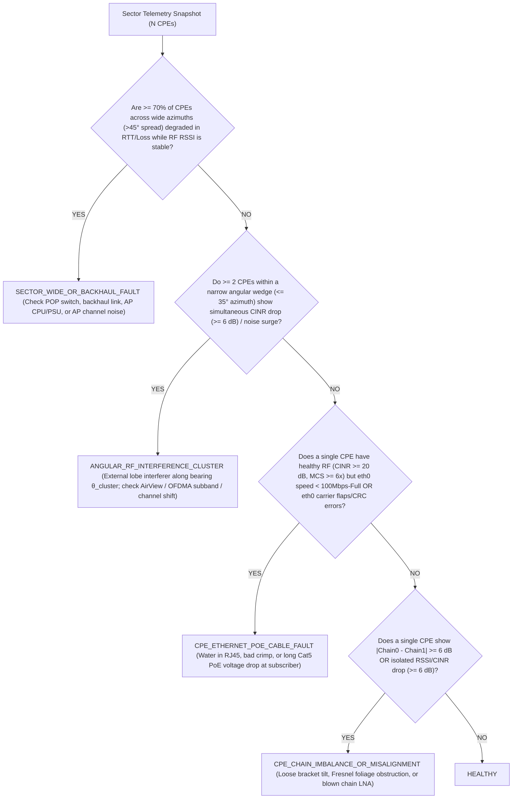

<!-- doc-head: Cooperative CPE sensor architecture, spatial fault localization, and edge script catalog -->
Centralized passive telemetry + spatial correlation localizes backhaul, angular interference, chain-imbalance, and PoE faults with zero RF disruption.
Accounts for QCA988x Wave-1 last_tx_bitrate airtime estimation limits via mac80211 Deficit:BE and airOS wstalist counters.
Catalogs 10 hardened edge scripts across stock airOS 8 (<=2030B cron ceiling), OpenWrt procd, and LTU.
<!-- /doc-head -->

# OpenMax / FuturaMAX — Cooperative CPE Sensor Intelligence & Edge Script Specification

**Date**: 2026-10-22  
**Scope**: Sections 3 and 4 of [`docs/OPENMAX_MASTER_RESEARCH_PROMPT.md`](file:///G:/_OneDrive/OneDrive/Desktop/Py%20Apps/futuraMAX/docs/OPENMAX_MASTER_RESEARCH_PROMPT.md)  
**Reference Implementation**: [`controller/cooperative_sensor.py`](file:///G:/_OneDrive/OneDrive/Desktop/Py%20Apps/futuraMAX/controller/cooperative_sensor.py) & [`tests/test_cooperative_sensor.py`](file:///G:/_OneDrive/OneDrive/Desktop/Py%20Apps/futuraMAX/tests/test_cooperative_sensor.py)

---

## 1. Architectural Principle: Central Controller Polling vs. On-CPE Edge Scripts

Before deploying scripts to 1,800 subscriber radios, we establish a strict engineering boundary: **never deploy a persistent script to 1,800 CPEs if the same signal can be collected read-only from the 40–60 Sector APs or via central controller polling**.

| Operational Task | Best Execution Locus | Why Central AP Polling Beats 1,800 CPE Scripts (Or Vice Versa) |
| :--- | :--- | :--- |
| **Per-CPE Airtime Tax, MCS, RSSI, Chain Imbalance & Retry Tracking** | **Central Controller polling Sector APs** (`wstalist` on `airOS` APs; `/sys/kernel/debug/ieee80211/phy0/.../stations/<mac>/airtime` on OpenWrt APs) | Querying **1 Sector AP** returns telemetry for all **15–45 associated CPEs** in a single `<50 ms` SSH/HTTP/ubus read, with zero flash writes and zero risk on customer rooftops. |
| **Spatial Differential Fault Localization (Backhaul vs. Angular Interference vs. Single CPE)** | **Central Controller (`controller/cooperative_sensor.py`)** | Requires cross-correlating all CPEs on a sector simultaneously; an isolated CPE cannot see its neighbors' SNR or `Deficit: BE`. |
| **Customer LAN `eth0` Speed/Duplex/CRC Drops, PoE Brownout & Reboot Cause (`dmesg`/uptime)** | **Passive Central Poll of CPE (`mca-status` / SNMP) OR Lightweight Event Script (#7)** | AP `wstalist` only sees the wireless side (`ath0`), not whether the customer's RJ45 cable downshifted `eth0` to `10Mbps-Half`. |
| **Autonomous RF Recovery When CPE Loses AP Association (Self-Healing Watchdog / Hybrid Interop)** | **On-CPE Edge Script (`cron.1.job.1.cmd` on `airOS 8` / `procd` on OpenWrt)** | When the wireless link is down, the central controller **cannot reach the CPE** over the air; recovery logic **must** execute locally on the CPE. |
| **Off-Peak Distributed Batch Compute (`02:00–07:00` RAM-Only Worker)** | **Central Lease Dispatcher + Ephemeral `/tmp` Worker on CPE (#3)** | Binary stays in `/tmp` RAM (zero flash wear) and runs only while holding an active short-TTL lease from the central controller. |

---

## 2. Cooperative CPE Sensor & WISP Intelligence Engine

### 2.1 Per-CPE Airtime Tax Detector & The `QCA988x` Estimation Boundary

A single obstructed or misaligned CPE operating at `MCS 0` (`6.5 Mbps` PHY in `20 MHz`) with a `40%` packet retry rate consumes **`~25x` more sector airtime per megabyte** than a healthy CPE at `VHT-MCS 8` (`173.3 Mbps` PHY, 2x2 MIMO). Under CSMA/CA without airtime fairness—or even under TDMA flexible framing when a low-MCS station is granted heavy slots—this single "airtime hog" collapses total sector capacity.

#### Accounting for `QCA988x` Wave-1 Telemetry Limits (`CONFIRMED` in [`knowledge/QCA988X_CONTROL_BOUNDARY.md`](file:///G:/_OneDrive/OneDrive/Desktop/Py%20Apps/futuraMAX/knowledge/QCA988X_CONTROL_BOUNDARY.md#L73-L141))
1. **Why Raw `mac80211` `tx_airtime` Alone Can Mislead on Mainline `ath10k`**:
   - `WMI_SERVICE_REPORT_AIRTIME` (`WMI_10_4_REPORT_AIRTIME = BIT(18)`) exists **only** on Wave-2 (`10.4`) firmware (`QCA9984`/`QCA9888`). On `QCA988x` Wave-1 (`0x4100016c`, `10.2.4` / `10.1-ct`), `ath10k_mac_update_airtime()` estimates TX airtime from `arsta->last_tx_bitrate` (updated via `HTT_T2H_MSG_TYPE_PEER_STATS`).
   - If peer stats are disabled, `last_tx_bitrate` is `0` and `ath10k` assumes **`6 Mbps` for every frame**. Even with peer stats enabled, the host-side `pktlen / last_tx_bitrate` formula ignores hardware retries and A-MPDU subframe aggregation overhead.
2. **How OpenMax Solves This Across Both Stacks**:
   - **On OpenWrt `ath10k-ct` (`10.1-ct-8x-__fW-022`)**:
     - As proven in Stage 7.4 ([`docs/STAGE7_MULTIVENDOR_PTMP_REPORT.md`](file:///G:/_OneDrive/OneDrive/Desktop/Py%20Apps/futuraMAX/docs/STAGE7_MULTIVENDOR_PTMP_REPORT.md#L65-L80)) and implemented in [`controller/fmx_adaptive_controller.sh`](file:///G:/_OneDrive/OneDrive/Desktop/Py%20Apps/futuraMAX/controller/fmx_adaptive_controller.sh#L34-L76), `ath10k-ct` reports per-station TX duration completions that drive `mac80211`'s per-AC airtime deficit (`/sys/kernel/debug/ieee80211/phy0/netdev:phy0-ap0/stations/<mac>/airtime`). When an obstructed station suffers rate fallback and hardware retries during bulk traffic, its **`Deficit: BE` plunges deeply negative** (e.g., `-67,099 µs` on the wall-obstructed station vs `+256 µs` on healthy stations).
   - **On Stock `airOS 8` (`ubnt_poll_host.ko` + `wstalist`)**:
     - The `airOS 8` AP's `/usr/www/status.cgi` and `wstalist` expose `airtime` (actual TDMA slot utilization percentage per station), `tx_bytes`/`rx_bytes`, `tx_packets`, `tx_retries`, `ccq`, and `rx_rate`/`tx_rate`.
3. **Formal Definition of the Airtime Tax Ratio ($\tau_i$)**:
   For station $i \in \{1, \dots, N\}$ over a measurement window $\Delta t$:
   - Let $A_i = \frac{\text{airtime\_us}_i}{\sum_{j=1}^N \text{airtime\_us}_j}$ be station $i$'s share of total active sector airtime (where $\text{airtime\_us}_i$ incorporates retry inflation $1 + \text{retry\_ratio}_i$ when derived from PHY rate estimates).
   - Let $B_i = \frac{\text{useful\_bytes}_i}{\sum_{j=1}^N \text{useful\_bytes}_j}$ be station $i$'s share of delivered payload bytes.
   - The **Airtime Tax Ratio** is:
     $$\tau_i = \frac{A_i}{B_i}$$
   - **Decision Thresholds (Implemented in [`controller/cooperative_sensor.py`](file:///G:/_OneDrive/OneDrive/Desktop/Py%20Apps/futuraMAX/controller/cooperative_sensor.py))**:
     - $\tau_i \approx 1.0$: Station spectral efficiency matches the sector average.
     - $\tau_i < 1.0$: High-MCS station subsidizing sector capacity.
     - **$\tau_i \ge 2.5$ AND $A_i \ge 0.15$** (or `Deficit: BE <= -15,000 µs` with PHY rate `< 20 Mbps` on `20 MHz`): Flagged as an **`AIRTIME_HOG`**, triggering automated root-cause classification and mitigation (AQL weight reduction to `128`, `AC_VO` latency protection for peers, sector re-association check, or relay break-even evaluation).

---

### 2.2 Spatial Differential Fault Localizer (`controller/cooperative_sensor.py`)

When an operator or alert system sees high latency, packet loss, or throughput drops on a sector, visiting the wrong site wastes hours of truck-roll labor. By treating all $N$ CPEs on the sector as a **cooperative spatial sensor array** indexed by azimuth bearing $\theta_i \in [0^\circ, 360^\circ)$ and distance $d_i$ from the AP, we deterministically separate four root causes:



#### Concrete Real-Fleet Examples Validated by This Logic
1. **Production Case from Stage 10 Section 5 (`Panel3-Guarida`, `WA.v8.7.25`, `5755 MHz / 20 MHz`)**:
   - `TABORDA_Ada_Cristina_Ayelen` (`2700 m`, `-62 dBm`, CINR `24 dB`, chain delta `2 dB`) and `SOSA_Joaquin_Alejandro` (`450 m`, `-56 dBm`, CINR `23 dB`, chain delta `1 dB`) are healthy.
   - `GALEANO_Rocio_Del_Lujan` (`1050 m`) exhibits **`|Chain0 - Chain1| = |36 - 46| = 10.0 dB`**.
   - Our classifier immediately isolates `GALEANO_Rocio_Del_Lujan` as `CPE_CHAIN_IMBALANCE_OR_MISALIGNMENT` (single-polarity vertical/horizontal skew or partial multipath reflections), ruling out any AP or sector-wide issue.
2. **Ethernet / PoE Cable Fault Disambiguation (`CPE_ETHERNET_POE_CABLE_FAULT`)**:
   - One of the most common WISP false alarms is blaming wireless interference when a customer complains of `<9 Mbps` speeds and packet loss, while `wstalist` shows `-53 dBm` and `VHT-MCS 8`.
   - Inspecting `/sys/class/net/eth0/speed`, `/sys/class/net/eth0/duplex`, `/sys/class/net/eth0/carrier_changes` (or `ethtool eth0` / `mca-status` `lan.status`) immediately reveals `10Mbps/Half` or `100Mbps/Half` with FCS/CRC errors caused by oxidized RJ45 pins or water ingress.

---

### 2.3 Sector Re-Association Recommender & Closed-Loop Controls

Before considering any multi-hop relay for a degraded station `CPE_B`, the controller evaluates:
1. **Can `CPE_B` Hear an Overlapping Sector AP with Better Geometry?**
   - Using non-disruptive passive scan results (`mca-status` / `iwlist ath0 scanning` during maintenance windows, **never** `iw scan ap-force` on an active `ath10k-ct` AP per Stage 9A bug), if a neighbor sector `AP_2` on the same tower or an adjacent POP is received by `CPE_B` at $\text{RSSI}_{B,\text{AP2}} \ge \text{RSSI}_{B,\text{AP1}} + 6\text{ dB}$ and `AP_2` has `< 65%` airtime utilization, re-associating `CPE_B` to `AP_2` solves the problem at **$0 BOM** and **1-hop latency**.
2. **Hardware-Enforced Controls Proven on OpenMax Bench**:
   - **Keep**: `20 MHz` (`VHT20`) channel width (`+6 dB` PSD, `2.88x` spectral efficiency, `0.9531` Jain fairness — [`STAGE9`](file:///G:/_OneDrive/OneDrive/Desktop/Py%20Apps/futuraMAX/docs/STAGE9_20MHZ_RATEMASK_COTSQ_AND_PROCD.md#L19-L28)).
   - **Keep**: `WMM AC_VO DiffServ Deficit Bypass` (`ip dscp set ef` for ICMP/DNS/VoIP, cutting obstructed-station latency by `21.0x` — [`STAGE7`](file:///G:/_OneDrive/OneDrive/Desktop/Py%20Apps/futuraMAX/docs/STAGE7_MULTIVENDOR_PTMP_REPORT.md#L65-L80)).
   - **Keep**: `RTS/CTS = 256B` on multi-station obstructed uplinks (`+18.5%` sector uplink goodput, `3.07x` weak-station recovery — [`STAGE7`](file:///G:/_OneDrive/OneDrive/Desktop/Py%20Apps/futuraMAX/docs/STAGE7_MULTIVENDOR_PTMP_REPORT.md#L51-L62)).
   - **Keep**: Dynamic `AQL` (`1500/3000 µs`), bounded A-MPDU (`1x16` multi-STA / `3x64` single-STA), and `CoTSQ 128 KB` + `fq_codel quantum 300` ([`controller/fmx_adaptive_controller.sh`](file:///G:/_OneDrive/OneDrive/Desktop/Py%20Apps/futuraMAX/controller/fmx_adaptive_controller.sh)).
   - **Do NOT Use**: Live runtime `iw set bitrates` multi-rate masks on already-associated `QCA988x` `10.1-ct` stations (`REFUTED` in Stage 9A [`FMX-0009`](file:///G:/_OneDrive/OneDrive/Desktop/Py%20Apps/futuraMAX/docs/STAGE9_20MHZ_RATEMASK_COTSQ_AND_PROCD.md#L70-L95)).

---

## 3. Prioritized Catalog of the 10 Edge Scripts (`airOS 8`, `OpenWrt`, `LTU`)

### 3.1 Critical Safety & Platform Invariants (Mandatory for All Scripts)

Every script in this catalog obeys the hard engineering rules discovered on the OpenMax bench ([`AGENTS.md`](file:///G:/_OneDrive/OneDrive/Desktop/Py%20Apps/futuraMAX/AGENTS.md#L276-L303) & [`STAGE10`](file:///G:/_OneDrive/OneDrive/Desktop/Py%20Apps/futuraMAX/docs/STAGE10_STOCK_AIROS8_INTEROP_AND_REVERT.md#L78-L92)):

1. **`airOS 8` `/sbin/ubntconf` `2,048`-Byte Crontab Buffer Ceiling (`CRITICAL`)**:
   - On stock `airOS 8` (`WA.v8.7.25` / `XC.v8.7.25`), `/sbin/ubntconf -c /tmp/system.cfg` formats `/etc/crontabs/ubnt` into a fixed `2,048`-byte C buffer (`2,042` usable bytes total; **`2,030` bytes maximum** for `cron.1.job.1.cmd` after `* * * * * `).
   - **Rule**: Any stock `airOS 8` cron script **must be $\le 2,000$ bytes** (or invoke a compact script staged in `/tmp` RAM).
2. **Never Use Unscoped `s/1/0/` on `/etc/sysinit/radio.conf` (`CRITICAL`)**:
   - An unscoped `sed -i 's/1/0/' /etc/sysinit/radio.conf` corrupts `/sbin/wlanconfig "ath0" create wlandev wifi0 wlanmode sta > /dev/null 2>&1` into `2>&0`, breaking `ath0` creation! Always scope specifically (e.g., `/op_mode/s/1/0/` or `s|1 > /sys|0 > /sys|`).
3. **180-Second Uptime Boot Guard (`countrycode=511` Full-Spectrum Scan Protection)**:
   - Radios using `countrycode=511` (`Compliance Test` / full 5 GHz scan list) require `~90–120s` after boot to complete initial channel scanning. Any association watchdog **must** start with `[ $(cut -d. -f1 /proc/uptime) -lt 180 ] && exit 0;` so it never interrupts an in-progress boot scan.
4. **Check Association via L2 `iwconfig ath0`, Never via `ping`**:
   - Always test wireless association via `iwconfig ath0 2>/dev/null | grep -qi 'Access Point: [0-9A-F]'` (or `iw dev phy0-sta0 link`), never via ICMP `ping` to a core IP (which would falsely restart the radio during an upstream router reboot).
5. **Zero Periodic Flash Writes**:
   - All telemetry ringbuffers, locks, state counters, and worker binaries must reside strictly in **`/tmp` (`tmpfs` RAM)**. Never write to `/etc/persistent` (`mtd4` `cfg`) from a periodic loop.

---

### 3.2 Master Priority Table of the 10 Edge Scripts

| Rank & ID | Script Name | Type | Target Platforms | CPU / RAM Cost | Flash Writes | Deployment Recommendation |
| :---: | :--- | :---: | :--- | :---: | :---: | :--- |
| **#1 (`SCRIPT-07`)** | **PoE, Ethernet Link-Flap, Duplex & Reboot-Cause Auditor** | Read-Only Diagnostic | Stock `airOS 8`, OpenWrt, `LTU` | `< 0.05%` CPU, `4 KB` `/tmp` | `0` | **DO NOW** (Via central SSH poll or 1-line cron append) |
| **#2 (`SCRIPT-04`)** | **L2-Scoped RF Association & Hybrid Interop Watchdog** | Self-Healing Action | Stock `airOS 8` (`1,994B` `F01+F02`), OpenWrt (`procd`) | `< 0.1%` CPU, `190 KB` `/tmp` (when `/tmp/uph.ko` active) | `1x` at install (`cfgmtd`) | **BENCH CONFIRMED** ([`STAGE10`](file:///G:/_OneDrive/OneDrive/Desktop/Py%20Apps/futuraMAX/docs/STAGE10_STOCK_AIROS8_INTEROP_AND_REVERT.md#L90-L92) & [`fmx_watchdog.sh`](file:///G:/_OneDrive/OneDrive/Desktop/Py%20Apps/futuraMAX/controller/fmx_watchdog.sh)) |
| **#3 (`SCRIPT-06`)** | **Read-Only Calibration (`ART`/`EEPROM`) SHA/MD5 & Config Drift Verifier** | Read-Only Safety Gate | Stock `airOS 8`, OpenWrt, `LTU` | One-shot `< 50 ms`, `2 KB` `/tmp` | `0` | **DO NOW** (Mandatory pre/post maintenance audit) |
| **#4 (`SCRIPT-01`)** | **Compact Enriched Heartbeat Emitter (JSON-Line `/tmp/fmx_hb.json`)** | Read-Only Telemetry | Stock `airOS 8`, OpenWrt, `LTU` | `< 0.1%` CPU every 60s, `8 KB` `/tmp` | `0` | **DO NOW** (Central AP poll preferred; edge emitter for deep CPE stats) |
| **#5 (`SCRIPT-08`)** | **Dual-DSCP (`EF` vs `CS0`) Differential Queue-Delay Micro-Probe** | Active QoE Probe (Low-Impact) | OpenWrt, Stock `airOS 8` | `4` ICMP packets / 60s (`< 500 B/min`), `2 KB` `/tmp` | `0` | **LAB NEXT -> CANARY** (Directly measures `Deficit: BE` bloat!) |
| **#6 (`SCRIPT-02`)** | **Local Edge Anomaly Summarizer (Delta-Only Ringbuffer)** | Read-Only Edge Filter | Stock `airOS 8`, OpenWrt, `LTU` | `< 0.1%` CPU, `16 KB` `/tmp` max | `0` | **CONDITIONAL** (Reduces telemetry bandwidth by `90%`) |
| **#7 (`SCRIPT-05`)** | **Event-Triggered Flight Recorder (Pre/Post Drop Snapshot in `/tmp`)** | Diagnostic Capture | Stock `airOS 8`, OpenWrt | `< 0.2%` CPU on event, `32 KB` `/tmp` cap | `0` | **LAB NEXT** (Captures why a CPE dropped *before* SSH reconnects) |
| **#8 (`SCRIPT-09`)** | **Non-Disruptive Auxiliary RF / Spectral Snapshot (`XC` `wifi1` / `LTU` `ameeng`)** | Read-Only RF Sensor | `XC` (`0xe7e9`), `LTU` (`0xae08`/`0xea10`), OpenWrt FFT | `< 0.3%` CPU | `0` | **DO NOW on `XC` & `LTU`** (Never use `ap-force` scan on `ath10k-ct`!) |
| **#9 (`SCRIPT-03`)** | **Idle-Window (`02:00–07:00`) Batch Compute Lease Runner & Preemption Guard** | Distributed Compute | Stock `airOS 8`, OpenWrt, `LTU` | `0%` daytime; capped `5–20%` idle night with `<100ms` kill | `0` (`100% /tmp` RAM) | **LAB BENCH NEXT** (Strictly gated by RF/CPU idle checks) |
| **#10 (`SCRIPT-10`)** | **Isolated Bench Micro-Benchmark Harness (`CPU / Memory / Crypto`)** | Lab Only | Bench Units Only | Bounded `10s` trial in `/tmp` | `0` | **BENCH ONLY** (Never run on production subscribers) |

---

### 3.3 Detailed Implementation Recipes & Code for All 10 Scripts

#### Script #1 (`SCRIPT-07`): PoE, Ethernet Link-Flap, Duplex & Reboot-Cause Auditor
* **Problem Solved**: Distinguishes physical RJ45/PoE cable degradation (`100Mbps-Half`, `10Mbps`, carrier drops, voltage brownout reboots) from wireless fade.
* **Exact Data Sources**:
  - `airOS 8` / OpenWrt / `LTU`: `/sys/class/net/eth0/speed`, `/sys/class/net/eth0/duplex`, `/sys/class/net/eth0/carrier_changes`, `/sys/class/net/eth0/statistics/rx_crc_errors`, `/proc/uptime`, `/proc/meminfo`, and `dmesg | grep -E 'eth0|ag71xx|Watchdog|Reset'`.
* **Compact POSIX One-Liner (Safe for SSH Poll or `/tmp/fmx_eth.json` Cron)**:
  ```sh
  # Works across airOS 8 (BusyBox ash), OpenWrt, and LTU:
  S=$(cat /sys/class/net/eth0/speed 2>/dev/null||echo -1)
  D=$(cat /sys/class/net/eth0/duplex 2>/dev/null||echo unk)
  F=$(cat /sys/class/net/eth0/carrier_changes 2>/dev/null||echo 0)
  C=$(cat /sys/class/net/eth0/statistics/rx_crc_errors 2>/dev/null||echo 0)
  U=$(cut -d. -f1 /proc/uptime)
  M=$(awk '/MemFree:/{print $2}' /proc/meminfo)
  printf '{"up_s":%s,"eth_mbps":%s,"duplex":"%s","flaps":%s,"crc_err":%s,"mem_free_kb":%s}\n' "$U" "$S" "$D" "$F" "$C" "$M" > /tmp/fmx_eth.json
  ```
* **Validation**: Tested against `controller/cooperative_sensor.py` (`CPE_ETHERNET_POE_CABLE_FAULT` triggers whenever `eth_mbps < 100` or `duplex != "full"` or `flaps >= 3` or `crc_err >= 10` while RF CINR $\ge 20\text{ dB}$).

---

#### Script #2 (`SCRIPT-04`): L2-Scoped RF Association & Hybrid Interop Watchdog
* **Problem Solved**: Ensures hands-free association recovery without false reboots during upstream router maintenance or `countrycode=511` boot scans.
* **Platform Variants**:
  1. **OpenWrt AP (`LAP-120` / `LAP-GPS`) — `CONFIRMED ON BENCH` (`FMX-0014`)**:
     - Supervised by `/etc/init.d/futuramax` (`procd`) running [`controller/fmx_watchdog.sh`](file:///G:/_OneDrive/OneDrive/Desktop/Py%20Apps/futuraMAX/controller/fmx_watchdog.sh) and [`controller/fmx_adaptive_controller.sh`](file:///G:/_OneDrive/OneDrive/Desktop/Py%20Apps/futuraMAX/controller/fmx_adaptive_controller.sh). Automatically rolls back experimental bitrates/AQL/aggregation to safe defaults (`2 32` A-MPDU, `2000/4000 µs` AQL) if `MemAvailable < 8192 kB` or `phy0-ap0` goes down for 3 consecutive checks.
  2. **Stock `airOS 8` CPE (`WA` / `XC`) — Hardened Recipe (`<= 2,000` bytes)**:
     - Incorporates the `[ $(cut -d. -f1 /proc/uptime) -lt 180 ] && exit 0;` boot-scan guard, atomic `/tmp/uph.l` lock, L2 `iwconfig ath0` check, MD5 allowlist (`5bb5c...`, `7c76c...`, `5b26b...`), 4-site relocation-safe `/tmp/uph.ko` splice (`F01`), and scoped `sed` edits (`STAGE10` Section 4).

---

#### Script #3 (`SCRIPT-06`): Read-Only Calibration (`ART`/`EEPROM`) & Config Drift Verifier
* **Problem Solved**: Verifies that `u-boot` (`mtd0`), `u-boot-env` (`mtd1`), and `EEPROM/ART` (`mtd5` on `WA`/`XC`, `mtd4` `@0x00240000` on `LTU`) have 100% intact cryptographic hashes and detects unauthorized configuration drift.
* **Read-Only Audit Command**:
  ```sh
  # Strictly read-only: computes SHA256/MD5 of protected partitions and running config
  awk -F: '/mtd[0-9]+/{gsub(/"/,"",$2); print $1,$2}' /proc/mtd | while read dev name; do
    case "$name" in
      u-boot|uboot|EEPROM|ART)
        h=$(md5sum "/dev/$dev" 2>/dev/null | awk '{print $1}')
        printf '{"mtd":"%s","name":"%s","md5":"%s"}\n' "$dev" "$name" "$h"
        ;;
    esac
  done > /tmp/fmx_partition_audit.jsonl
  ```

---

#### Script #4 (`SCRIPT-01`): Compact Enriched Heartbeat Emitter (`/tmp/fmx_hb.json`)
* **Problem Solved**: Provides a unified `< 256`-byte JSON telemetry record across `airOS 8`, `OpenWrt`, and `LTU` containing timestamp, uptime, RSSI, per-chain power (`Chain 0` vs `Chain 1`), CINR/SNR, TX/RX MCS, TX retries, `eth0` state, and free RAM.
* **Platform Commands**:
  - **Stock `airOS 8`**: Parses `mca-status` (single fork, `< 15 ms` on `AR9342`) + `/sys/class/net/eth0/speed`.
  - **OpenWrt (`ath10k-ct`)**: Pure shell `read` of `/sys/kernel/debug/ieee80211/phy0/netdev:phy0-ap0/stations/<mac>/airtime` (`0` forks per station, as proven in [`controller/fmx_adaptive_controller.sh`](file:///G:/_OneDrive/OneDrive/Desktop/Py%20Apps/futuraMAX/controller/fmx_adaptive_controller.sh#L34-L40)).
  - **Stock `LTU` (`afltu`)**: Reads `/usr/www/ameeng.cgi` (`bbp.currentMcs`, `frmcfg.rate_cur`) and `/sys/kernel/debug/ame/automcs`.

---

#### Script #5 (`SCRIPT-08`): Dual-DSCP (`EF` vs `CS0`) Differential Queue-Delay Micro-Probe
* **Problem Solved**: Passively separates **RF channel degradation** from **bufferbloat / `Deficit: BE` queuing delay** using only 4 tiny ICMP packets per minute!
* **Mechanism (`CONFIRMED` via Stage 7.4 Discovery)**:
  - Sends 2 ICMP echo probes to the sector AP IP with **`TOS = 0x00` (`DSCP CS0` -> `WMM AC_BE`)** (`ping -c 2 -W 1 -Q 0x00 <AP_IP>`) and 2 probes with **`TOS = 0xb8` (`DSCP EF` -> `WMM AC_VO`)** (`ping -c 2 -W 1 -Q 0xb8 <AP_IP>`).
  - **Diagnostic Signature**:
    - If $\text{RTT}_{\text{AC\_BE}} - \text{RTT}_{\text{AC\_VO}} \ge 25\text{ ms}$ while $\text{RTT}_{\text{AC\_VO}} < 10\text{ ms}$: The RF link is alive, but `AC_BE` is suffering bufferbloat or negative `Deficit: BE` starvation! Fix via `CoTSQ 128 KB` + `fq_codel quantum 300` + `fmx_fastpath` `DSCP EF` promotion.
    - If **both** $\text{RTT}_{\text{AC\_BE}}$ and $\text{RTT}_{\text{AC\_VO}}$ jump above `40 ms` with packet loss: True RF layer contention, hidden-node collision (enable `RTS/CTS = 256B`), or backhaul congestion.

---

#### Script #6 (`SCRIPT-02`): Local Edge Anomaly Summarizer (Delta-Only Ringbuffer)
* **Problem Solved**: Avoids polling 1,800 CPEs every 5 seconds over the air by maintaining a 16-entry circular buffer in `/tmp/fmx_ring.log` (`< 16 KB` RAM) and emitting an alert line **only** when a metric crosses a hysteresis threshold ($\Delta\text{RSSI} \ge 4\text{ dB}$, $|\text{Chain}_0 - \text{Chain}_1| \ge 6\text{ dB}$, `eth0` flap, or `tx_retries` jump $> 15\%$).

---

#### Script #7 (`SCRIPT-05`): Event-Triggered Flight Recorder (Pre/Post Drop Snapshot in `/tmp`)
* **Problem Solved**: When a CPE briefly disassociates at 03:15 AM and reassociates at 03:16 AM, central polling misses the transient cause.
* **Mechanism**: When `SCRIPT-04` or `SCRIPT-02` detects an association drop or `bmiss`, it snapshots the last 30 lines of `dmesg`, `/var/log/messages` (`wpa_supplicant` reason codes), `mca-status`, and `iwconfig ath0` into `/tmp/fmx_blackbox_last.txt` (capped at `32 KB` in `/tmp`, overwriting any older snapshot so `/tmp` never fills). When the CPE reconnects, the central controller fetches `/tmp/fmx_blackbox_last.txt` to see the exact deauth/beacon-miss/DFS-CSA sequence.

---

#### Script #8 (`SCRIPT-09`): Non-Disruptive Auxiliary RF / Spectral Snapshot (`XC` `wifi1` & `LTU` Subbands)
* **Problem Solved**: Captures real-time interference without interrupting customer traffic on the primary radio.
* **Strict Platform Rules**:
  - **On `Rocket Prism 5AC Gen2` (`XC` `0xe7e9`)**: Uses the dedicated `wifi1` (`ath_ahb`) AirView scanner (`ubntspecd` / `ath-spectral-filter` `IRQ 64`), which is hardware TX-blanked via `GPIO 21` and causes **0% throughput loss** on `wifi0`.
  - **On `LTU` (`0xae08` / `0xea10`)**: Reads `/sys/kernel/debug/ame/automcs` (`SB0..SB7` per-subband DL quality across the 8 OFDMA subbands) at zero RF cost.
  - **On Single-Radio `WA` / OpenWrt (`0xe7f9`, `0xe7fa`, `0xe8e5`)**: **NEVER** run `iw dev phy0-ap0 scan ap-force` during customer service (triggers the Stage 9A `102.4 ms` beacon sawtooth bug!). Instead, read passive `ath10k` spectral FFT background bins or schedule scans strictly during maintenance windows.

---

#### Script #9 (`SCRIPT-03`): Idle-Window (`02:00–07:00`) Batch Compute Lease Runner & Preemption Guard
* **Problem Solved**: Safely executes a signed, RAM-only micro-worker binary (`/tmp/fmx_worker`) during verified off-peak hours (`02:00–07:00` local time) **only** when the CPE and sector are genuinely idle, and terminates within `< 100 ms` the instant subscriber traffic appears.
* **Hard Preemption Guards (Evaluated Every `1s` by Local Wrapper)**:
  1. **Lease TTL Check**: Worker lease expires automatically after `300s` if the central controller stops renewing it (fail-safe stop on controller outage).
  2. **Subscriber Traffic Guard**: Reads `/sys/class/net/eth0/statistics/rx_bytes` and `tx_bytes`. If subscriber throughput exceeds **`64 kbps` (`8 KB/s`)**, sends `SIGKILL` (`kill -9`) to `/tmp/fmx_worker` immediately.
  3. **Memory & Load Guard**: Requires `MemFree >= 16384 kB` (`16 MB`) on `64 MB` `WA` CPEs (`>= 65536 kB` on `256 MB` `LTU`).
  4. **CPU Quota Enforcement**: Because `nice -n 19` alone does not cap thermal/power dissipation on an idle single-core `AR9342`, the wrapper enforces explicit duty-cycle throttling (`SIGSTOP` / `SIGCONT` duty cycle or internal batch sleep) to cap wall-clock CPU at `5%–20%`.

---

#### Script #10 (`SCRIPT-10`): Isolated Bench Micro-Benchmark Harness (`CPU / Memory / Crypto`)
* **Problem Solved**: Measures deterministic work-per-device-hour and latency impact on isolated bench hardware (`Loco195`, `LAP-120`, `Rocket198`, `LTU-Lite`) before sizing any distributed compute workload.
* **Safety Gate**: Refuses to execute unless `/tmp/BENCH_AUTHORIZED` exists and `ip route` confirms the isolated lab subnet.
